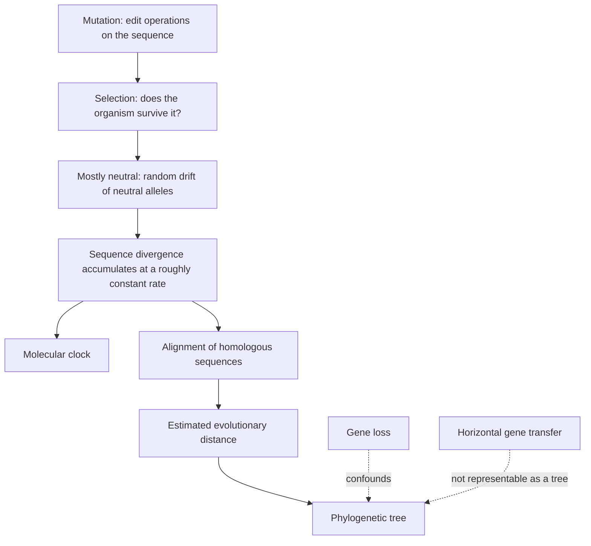

# Molecular Evolution

## Definition

**Evolution is a process of mutation with selection.**
**Molecular evolution** is *the study of changes in genes and proteins throughout
different branches of the tree of life*.
**Phylogeny** is *the inference of evolutionary relationships* — formally, *the doctrine
of the phylogenetic evolution of living beings, the emergence of species and their
evolutionary relationships*.

## Why it matters

It supplies the *interpretation* for everything module 1 built around
[[sequence-alignment]]. Two sequences being similar is a measurement; two sequences being
**homologous**, and separated by an estimable number of substitutions, is an inference —
and it is the inference that answers questions like the one the notes attach to a
cladogram:

> **Is my favourite gene under selective pressure?**

## Details

### Vocabulary

| Term | Definition in the notes |
|---|---|
| **Anagenesis** | **transformation** of species |
| **Cladogenesis** | species **splitting** |
| **Taxon** | a group of living beings; a unit within the biological classification |
| **OTU** | operational taxonomic unit — a sequenced, present-day organism |
| **HTU** | hypothetical taxonomic unit — an inferred common ancestor |
| **LUCA** | the last universal common ancestor; the root of a rooted tree |

### Two kinds of evidence

```text
morphological features (phenotype)  ⎫
                                     ⎬→ reconstruction of family relationships
sequence data (genotype)            ⎭
            ↑
        mutations (edit operations)  ←  evolution
```

Mutations are **edit operations** — exactly the insertions, deletions and substitutions
of the alignment problem — which is what makes an alignment the natural input to a
distance estimate.

### Two principles

- **Neutral theory**: *the main cause of evolutionary change is random drift of mutant
  alleles that are selectively neutral.* This is [[genetic-drift]] from module 1, now
  cast as the engine of sequence divergence rather than as a confounder.
- **Molecular clock**: *for every given protein, the rate of molecular evolution is
  approximately constant in all evolutionary lineages.* See [[molecular-clock]].

### Acceptance of mutations

> **The success of a mutation depends on its effect on the organism.**

Substitutions come in two types — [[transition-and-transversion|transitions and
transversions]] — and **transitions are more common**.

### Two complications for tree reconstruction

- **Gene loss.** A gene present in the ancestor may be absent from some descendants, so
  the gene's tree has fewer leaves than the species tree. See
  [[gene-tree-and-species-tree]].
- **Horizontal gene transfer** — *gene transfer between species*. It creates edges that
  no tree can represent, which is why *"no horizontal gene transfer"* is one of the data
  selection criteria in [[phylogenetic-tree-reconstruction]].

### Modelling molecular evolution

```text
Starting point:  sequence differences = evolutionary changes
Looking for:     a measure of the EVOLUTIONARY DISTANCE between two sequences
Ideally:         the number of mutations since the last common ancestor — not possible
Solution:        an ESTIMATION MODEL, based on a correct alignment of homologous
                 sequences
```

The estimation models are developed in [[evolutionary-distance]],
[[jukes-cantor-model]] and [[kimura-two-parameter-model]].

## Diagram


Mutation filtered by selection accumulates as divergence, which an estimation model turns into a distance and then into a tree; gene loss and horizontal transfer confound the last step.

## Relations

- [[phylogenetic-tree]] — the object this process is reconstructed into.
- [[evolutionary-distance]] — the quantity the models estimate.
- [[molecular-clock]] — the constant-rate assumption; [[upgma]] depends on it.
- [[transition-and-transversion]] — the two substitution types, and why
  [[kimura-two-parameter-model]] gives them different rates.
- [[gene-tree-and-species-tree]] — what gene duplication and gene loss do to the
  correspondence between the two.
- [[homology]] — orthologs, paralogs, in-paralogs and co-orthologs: the vocabulary for
  which genes may legitimately be compared.
- [[genetic-drift]], [[population-genetics]] — the module-1 machinery underlying the
  neutral theory.
- [[dna-mutation]] — the structural classes of mutation from module 1; molecular
  evolution works mostly with the point substitutions among them.
- [[sequence-alignment]] — the required input: *a correct alignment of homologous
  sequences*.
- [[substitution-matrix]] — PAM and BLOSUM are empirical substitution models; the
  `Q`-matrices here are their mechanistic counterparts.
- [[evolutionary-algorithm]] — borrows the vocabulary of mutation, crossover, fitness and selection as an optimisation metaphor.

## Appears in

- [[M2L08-molecular-evolution-and-phylogeny]]
- [[M2E08-phylogenetics]]

## Sources

- `raw/module2/csb_3.pdf`, p. 23 — evolution as mutation with selection, molecular
  evolution, phylogeny, the cladogram question, anagenesis, cladogenesis, taxon.
- `raw/module2/csb_3.pdf`, p. 26 — morphological versus sequence evidence, mutations as
  edit operations, gene trees versus species trees, neutral theory, the molecular clock.
- `raw/module2/csb_3.pdf`, p. 27 — acceptance of mutations, transitions and
  transversions, gene loss, horizontal gene transfer, and the modelling programme.
- `raw/module2/csb_4.pdf`, p. 15 — evolutionary computation described in biological terms.
