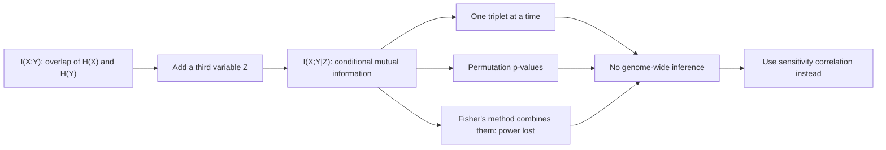

# Mutual information

## Definition

Mutual information `I(X;Y)` is the **amount of information obtained about one random
variable by observing the other random variable**. In the entropy Venn diagram it is the
overlap of `H(X)` and `H(Y)`:

```text
I(X;Y) = H(X) − H(X|Y) = H(Y) − H(Y|X) = H(X) + H(Y) − H(X,Y)
```

**Conditional mutual information** `I(X;Y|Z)` is the same overlap measured *after* the
third variable `Z` has been accounted for — the part of the `X`/`Y` overlap that does not
also lie inside `Z`.

## Why it matters

[[information-content]] already measured how surprising a single position is. Mutual
information measures **dependence between two variables** without assuming it is linear,
which makes it the natural first candidate for inferring regulatory edges from expression
data. In this lecture it is the first attempt at inferring a
[[competing-endogenous-rna|ceRNA]] edge: does gene `A` tell us something about gene `B`
once we condition on the miRNA `Z`?

## Details

The Venn picture of the notes:

- `H(X)` and `H(Y)` are the two circles.
- `H(X|Y)` is the part of `X` left once `Y` is known; `H(Y|X)` symmetrically.
- The intersection is `I(X;Y)`, the **mutual information**.
- The union is the joint entropy `H(X,Y)`.
- Adding a third circle `Z` and taking the part of the `X∩Y` lens outside `Z` gives
  `I(X;Y|Z)`, the **conditional mutual information (CMI)**.

### Why CMI fails for genome-wide ceRNA inference

The notes list four problems, and together they are the reason
[[sensitivity-correlation]] exists:

1. **CMI can be computed for one triplet at a time.** There is no formulation that takes
   several miRNAs at once.
2. **p-values are combined with Fisher's method, leading to a loss of power.** Each
   triplet gives its own p-value, and merging them discards information; see
   [[fishers-exact-test]] for the exact test whose author also gave this combination rule.
3. **Random permutations of gene expression vectors are needed to infer an empirical
   p-value.** As in [[gene-set-enrichment-analysis]], there is no closed-form null, so
   significance costs a permutation run per triplet.
4. **No genome-wide inference.** Items 1–3 together make the full transcriptome
   unreachable.

## Diagram


Conditional mutual information expresses the right quantity but cannot be scaled, which motivates the correlation-based alternative.

## Relations

- [[information-content]] — entropy and relative entropy, the same toolbox one step
  earlier; mutual information is a relative entropy between the joint and the product of
  the marginals.
- [[sensitivity-correlation]] — the correlation-based replacement that *can* be scaled.
- [[competing-endogenous-rna]] — the network CMI was meant to infer.
- [[sponge]] — the tool that takes the sensitivity-correlation route instead.
- [[fishers-exact-test]] — Fisher's method for combining p-values, named here as the
  source of the power loss.
- [[gene-set-enrichment-analysis]] — the other place in module 2 where an empirical
  p-value has to be bought with permutations.
- [[statistical-testing]] — p-values, power, and what losing power costs.

## Appears in

- [[M2L09-non-coding-rnas]]
- [[M2E09-non-coding-rnas-and-sponge]]

## Sources

- `raw/module2/csb_4.pdf`, p. 6 — the mutual-information definition, the two Venn
  diagrams, and the four issues with CMI for ceRNA network inference.
