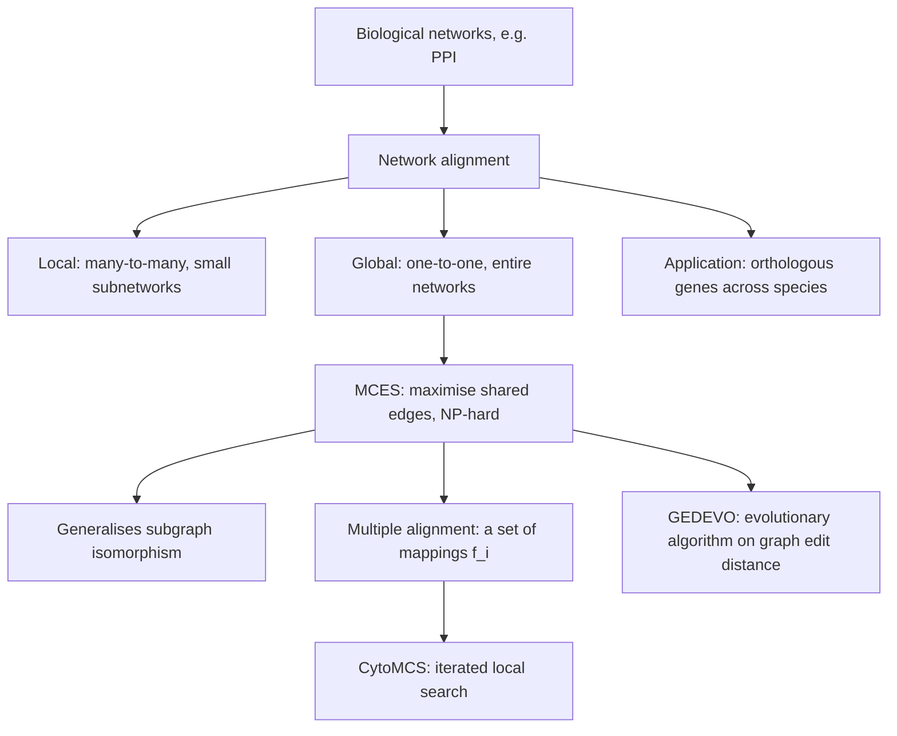

# Network alignment

## Definition

Network alignment is the problem of **finding the best mapping between the nodes of two
or more networks**. It aims to find **topologically or functionally similar nodes or
regions** in the networks.

## Why it matters

[[sequence-alignment]] compares two sequences letter by letter; network alignment does
the same one level up, on the wiring. It is **commonly applied to PPI networks of
different species** in order to **identify orthologous genes** — which makes it a way of
**transferring knowledge from well-studied model organisms** to poorly annotated ones.
Where [[homology]] is argued from sequence in module 1, here it is argued from topology.

## Details

### Biological networks

A biological network **models entities and their relationships** — for example
**protein–protein interactions**. See [[interaction-network]].

### Two kinds of alignment

| | Mapping | Scope |
|---|---|---|
| **Local alignment** | **many-to-many** | small subnetworks |
| **Global alignment** | **one-to-one** | entire networks |

The analogy with [[smith-waterman]] (local) versus [[needleman-wunsch]] (global) is
exact in spirit, but neither has a dynamic-programming solution here.

### The MCES problem

**Maximum common edge subgraph problem**: find the **pairwise, global alignment with the
most edges shared between the networks**.

Given `G₁ = (V₁, E₁)` and `G₂ = (V₂, E₂)` with `|V₁| ≤ |V₂|`, find a mapping
`f : V₁ → V₂` that maximises the fitness function

```text
F(f) = Σ          { 1,  if (f(u), f(v)) ∈ E₂
      (u,v) ∈ E₁  { 0,  else
```

**MCES is NP-hard.**

### Complexity: the link to isomorphism

- Two networks `G₁` and `G₂` are **isomorphic** if there exists a function
  `f : V₁ → V₂` such that for **all** edges `(u,v) ∈ E₁`, the edge `(f(u), f(v)) ∈ E₂`.
- **MCES is a generalization of the subgraph isomorphism problem.**
- Equivalently: `G₁` and `G₂` are isomorphic **iff** a mapping `f` exists preserving all
  edges, i.e. `F(f) = |E₁| = |E₂|`.

So the optimum of the MCES objective *decides* isomorphism, and since subgraph
isomorphism is NP-complete, the optimisation problem is NP-hard. As everywhere else in
module 2 — [[keypathwayminer]], [[transclust]], the
[[travelling-salesman-problem]] — the practical answer is a metaheuristic:
[[cytomcs]] uses iterated local search, [[gedevo]] an [[evolutionary-algorithm]].

### Multiple network alignment

[[cytomcs]] generalises MCES to **more than two** networks: given
`X = {G₁(V₁,E₁), …, G_n(V_n,E_n)}` with `|V₁| ≤ |V_i| ∀ i ≤ n`, a **multiple alignment**
is a set of mappings `A = { f_i : V₁ → V_i | 1 ≤ i ≤ n }` and the goal is to maximise the
number of **fully conserved** edges

```text
f(A) = Σ            { 1,  if (f_i(u), f_i(v)) ∈ E_i  ∀ i ∈ [1,n]
      (u,v) ∈ V₁    { 0,  else
```

An edge therefore only counts if it survives in **every** network.

## Diagram


The network-alignment problem, its two variants, and the two heuristics that attack it.

## Relations

- [[interaction-network]] — the object being aligned.
- [[cytomcs]] — iterated local search for multiple global alignment, maximising
  conserved edges.
- [[gedevo]] — evolutionary search minimising the [[graph-edit-distance]].
- [[graph-edit-distance]] — the dual objective: edges to insert/delete instead of edges
  shared.
- [[graphlet-degree-signature-distance]] — the local-topology measure GEDEVO uses to
  score a candidate node pair.
- [[sequence-alignment]] — the same global/local distinction one abstraction level down.
- [[homology]] — what the alignment is evidence for; orthology transferred across
  species.
- [[algorithmic-complexity]] — NP-hardness, and why only heuristics are usable here.
- [[travelling-salesman-problem]] — the reference NP-hard problem of module 2.
- [[evolutionary-algorithm]] — the metaheuristic family GEDEVO belongs to.
- [[hamiltonian-and-eulerian-paths]] — module 1's version of the same lesson: the choice
  of graph formulation decides tractability.

## Appears in

- [[M2L10-network-alignment]]
- [[M2E10-network-alignment]]
- [[L05-sequence-comparison-and-networks]] — the module-1 lecture that introduces both
  sequence comparison and interaction networks, which this page joins.

## Sources

- `raw/module2/csb_4.pdf`, p. 11 — biological networks, the alignment goal, local versus
  global, the MCES problem and its fitness function, NP-hardness.
- `raw/module2/csb_4.pdf`, p. 12 — isomorphism, MCES as a generalisation of subgraph
  isomorphism, and the multiple-alignment formulation.
