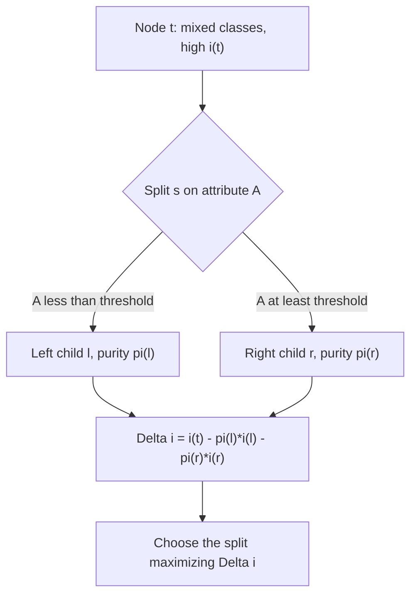

# Node Impurity

## Definition

The **impurity** `i(t)` of a node `t` in a [[decision-tree]] is any function
`Φ(p₁,…,p_J)` of the **relative occurrences** `p_j = p(j|t)` — the frequency of objects
of class `j` in node `t`. It measures how mixed the classes inside that node are.

## Why it matters

Tree induction is greedy: at every node it must choose **one** attribute to split on.
Impurity is what makes that choice computable. The goal of the whole tree is stated in
terms of it — *construct a tree with leaf nodes that contain cases of a single class
only*, i.e. **find a tree with minimal impurity over all splits and all nodes**. The same
quantity, aggregated over a forest, becomes the **variable importance score** that
[[random-forest]] uses for feature selection.

## Details

**Required properties of Φ**

- `Φ` is **symmetric** in `p₁,…,p_J` — the class labels are interchangeable.
- `Φ` is **maximal** for an **even distribution** — all classes equally frequent is the
  worst case.
- `Φ` is **minimal** when all observations belong to a **single class** — a *pure* node.

**Quality of a split**

The quality of a split `s` below node `t`, with left child `l` and right child `r` and
`π(l)`, `π(r)` the proportions of cases sent to each:

```text
Δi(s,t) = i(t) − π(l)·i(l) − π(r)·i(r)
```

A good split is one with a large `Δi`: the children are purer than the parent.

**The three impurity functions in the notes**

1. **Resubstitution error**

   ```text
   i(t) = 1 − max_j p(j|t)
   ```

   The fraction misclassified if the node predicted its own majority class.

2. **Gini impurity / Gini index**

   ```text
   i(t) = p(A|t) · (1 − p(A|t))                 // two classes
   i(t) = Σ_j p(j|t) · (1 − p(j|t))             // general
   ```

   `p(A|t)` is the frequency of cases of class `A` in node `t`.

3. **Entropy / information gain**

   ```text
   i(t) = − Σ_j p(j|t) · log p(j|t)
   ```

   A measure of the average amount of information generated by drawing randomly with
   replacement from this node. **If a node is pure, the class label yields zero
   information gain.**

This is the same entropy as in [[information-content]], applied to class labels instead
of residue frequencies at a motif position.

## Diagram


Impurity turns the choice of splitting attribute into a maximisation of the impurity drop.

## Relations

- [[decision-tree]] — top-down induction picks, at every node, the attribute with the
  largest `Δi`.
- [[random-forest]] — ranks variables by their accumulated Gini-index importance.
- [[information-content]] — the same entropy formula `−Σ p log p`, used there on a motif
  column and here on a class distribution.
- [[descriptive-statistics]] — relative frequencies `p(j|t)` are the descriptive summary
  the impurity is computed from.
- [[machine-learning]] — impurity is the objective a supervised tree learner optimises.

## Appears in

- [[M2L03-machine-learning-and-classification]]
- [[M2E03-machine-learning-and-classification]]

## Sources

- `raw/module2/csb_part2.pdf`, p. 5 — impurity definition, required properties, split
  quality `Δi(s,t)`, resubstitution error.
- `raw/module2/csb_part2.pdf`, p. 6 — Gini impurity and entropy/information gain.
