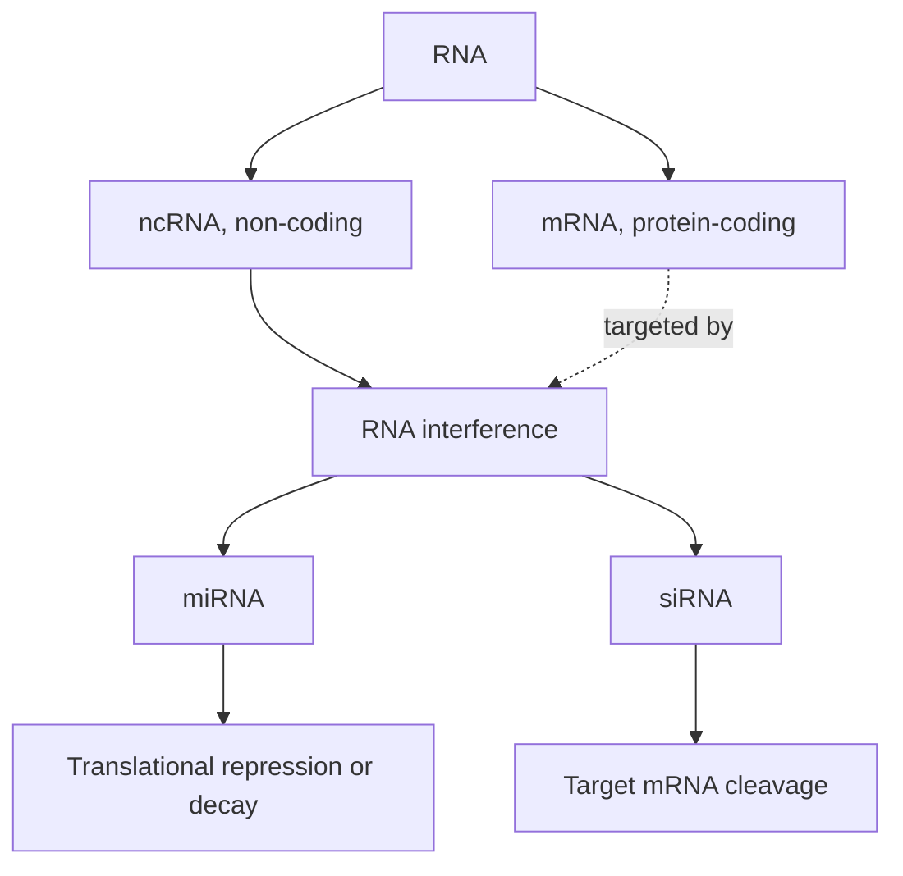

# Non-coding RNA

## Definition

A non-coding RNA (ncRNA) is an RNA molecule that is transcribed from the genome but is
**not translated into protein**. It is the complement of protein-coding messenger RNA
(mRNA) and includes the two regulatory species developed in this lecture,
[[microrna|microRNA]] and [[small-interfering-rna|small interfering RNA]].

## Why it matters

The lecture opens with the question that motivates the whole topic:

> **How can we explain differences between cell types and tissues?**

Every cell of an organism carries the same DNA sequence ([[genome-organization]]), so the
difference between a neuron and a hepatocyte cannot be written in the letters alone. The
[[central-dogma]] accounts for the *production* of protein, not for the *dosage* of it.
Non-coding RNAs supply one of the missing control layers: they suppress specific
transcripts after they have already been made, which is why the mechanism is also called
**post-transcriptional gene silencing**. The other control layer the modules cover is
[[epigenetics]].

## Details

The classification used in the notes:

| Class | Coding? | Role here |
|---|---|---|
| mRNA | protein-coding | the transcript that is *targeted* |
| ncRNA | non-coding | everything else |
| miRNA | non-coding | endogenous regulator, imperfect seed pairing |
| siRNA | non-coding | mostly exogenous, perfect complementarity |

[[rna-interference]] is the process that spans the last two rows: both miRNA and siRNA
act through it, and both end up loaded into an Argonaute-containing effector complex.

The lecture adds a third, derived object: when several mRNAs share binding sites for the
same miRNA, they compete for it and therefore regulate each other. Those transcripts are
[[competing-endogenous-rna|competing endogenous RNAs]], and the competition can be read
out statistically from expression data.

## Diagram

The RNA classification of p. 1: RNA interference is the process in which the two non-coding regulators act on protein-coding mRNA.

## Relations

- [[rna-interference]] — the mechanism through which ncRNAs silence genes.
- [[microrna]] — the endogenous, seed-pairing branch.
- [[small-interfering-rna]] — the perfectly complementary, cleaving branch.
- [[competing-endogenous-rna]] — mRNAs linked to each other by a shared miRNA.
- [[central-dogma]] — the baseline model this layer sits on top of; ncRNA is the
  transcript that never reaches the ribosome.
- [[gene-regulation]] — transcriptional control; ncRNA adds the post-transcriptional
  level.
- [[epigenetics]] — the other mechanism in these modules that explains cell-type
  differences without sequence differences.
- [[rna-seq]] — the measurement that quantifies both mRNA and miRNA abundance.

## Appears in

- [[M2L09-non-coding-rnas]]
- [[M2E09-non-coding-rnas-and-sponge]]

## Sources

- `raw/module2/csb_4.pdf`, p. 1 — the RNA/mRNA/ncRNA classification and the motivating
  question about cell types and tissues.
