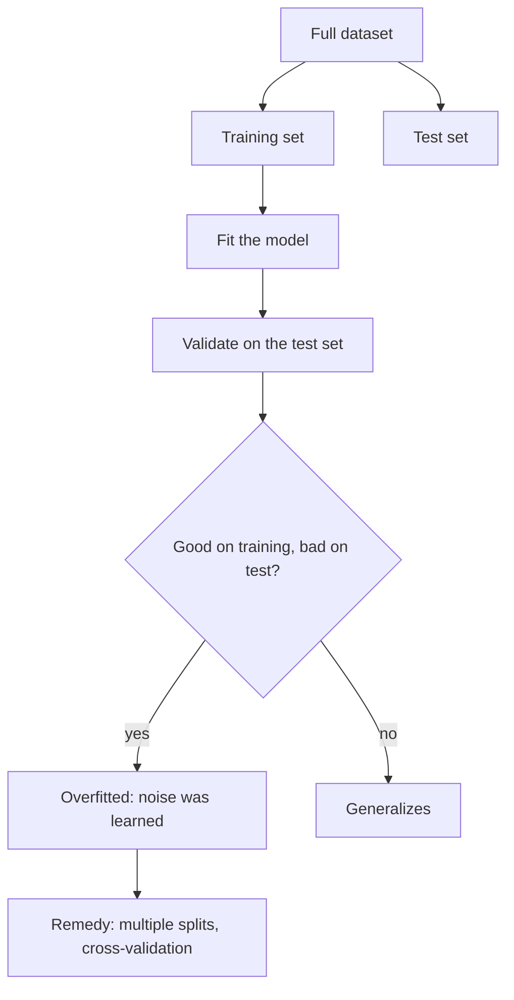

# Overfitting

## Definition

A model is **overfitted** when the final model **perfectly explains the training data
but performs badly on never-seen data**. It has learned the noise of the sample instead
of the structure of the population.

## Why it matters

Overfitting is the reason none of the [[machine-learning]] results in module 2 may be
reported on the data they were fitted on. It is the single motivation for the
train/test split, for [[cross-validation]], for [[bootstrapping]], for the out-of-bag
error of the [[random-forest]], and for the margin maximisation of the
[[support-vector-machine]]. In biomedical work the datasets are small — a few hundred
patients — so the risk is permanent.

## Details

**Splitting the data**

1. Avoid overfitting by splitting the data into a **training set** and a **test set**.
2. The model is trained **exclusively** on the training data.
3. It is subsequently **validated** on the test data.
4. If the model is overfitted → **bad performance on the test data**.

**The problem with a fixed test set** — the objection that leads straight to
[[cross-validation]]:

- If the dataset is small, a large part is **wasted**: it could have been used for
  training.
- The model **looks different depending on which samples ended up in the training set**.
- → Create **multiple splits** of the data.

**Why leave-one-out** (from the exercise): when the dataset is relatively small and one
wants to be sure of not overfitting to the limited number of observations — for example
the patients available in disease research. It helps to identify potential issues with
overfitting and to ensure that every model is robust enough.

**Which models resist it** — the [[random-forest]] is called *robust to overfitting*
precisely because it aggregates many trees, each grown on a subset of the features and a
subset of the observations; a single [[decision-tree]] grown to purity is the textbook
overfitted model.

## Diagram

The train/test split and the diagnosis it enables.

## Relations

- [[machine-learning]] — overfitting is the permanent failure mode of model fitting.
- [[cross-validation]] — the systematic answer: many splits instead of one.
- [[bootstrapping]] — resampling with replacement, lower variance but larger bias than
  cross-validation.
- [[random-forest]] — robust to overfitting by ensembling, and measures generalization
  error with the out-of-bag rate.
- [[decision-tree]] — grown until the training examples are perfectly classified, which
  is overfitting by construction.
- [[support-vector-machine]] — maximum-margin classification gives good accuracy for PAC
  (probably approximately correct) learning.
- [[batch-effect]] — the module-1 analogue of "the model learned the circumstances, not
  the biology".
- [[multiple-testing-correction]] — the statistical twin: searching long enough through
  noise always finds something.
- [[bias-variance-tradeoff]] — overfitting is the variance failure; the training/dev/human-error comparison tells you which failure you have.
- [[dropout]] — the deep-learning regularizer against it; see [[M2L06-deep-learning]] and [[M2E06-deep-learning]].
- [[neural-network]], [[deep-learning]], [[convolutional-neural-network]] — model classes with enough capacity to overfit anything.
- [[cost-function]], [[pooling-layer]], [[generative-adversarial-network]] — further places the same tension appears.

## Appears in

- [[M2L03-machine-learning-and-classification]]
- [[M2E03-machine-learning-and-classification]]

## Sources

- `raw/module2/csb_part2.pdf`, p. 1 — overfitting and splitting the data.
- `raw/module2/csb_part2.pdf`, p. 2 — the problem with a single test set.
- `raw/module2/csb_part2.pdf`, p. 9 — the exercise answers on overfitting and
  leave-one-out.
