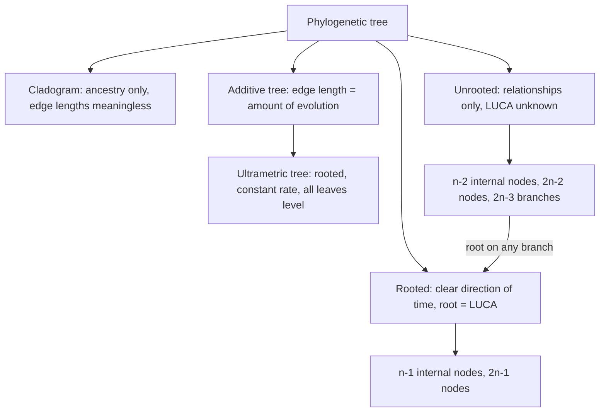

# Phylogenetic Tree

## Definition

A **phylogenetic tree** represents the inferred evolutionary relationships among a set of
taxa by a **topology** (who branched from whom) and optionally **branch lengths** (how
much change happened on each branch).

## Why it matters

The tree is the output of every method in
[[M2L08-molecular-evolution-and-phylogeny]], and almost every question about the
material — how many trees exist, is this one rooted, does this edge length mean anything
— is really a question about which *kind* of tree is on the page.

## Details

### Anatomy

| Part | Definition in the notes |
|---|---|
| **External node** | an **OTU** — *operational taxonomic unit*; **nowadays a species**, and **sequenced** |
| **Internal node** | an **HTU** — *hypothetical taxonomic unit*; a **common ancestor**, **based on predictions** |
| **Branch** | an **evolutionary kinship** |
| **Root** | optional; it is **LUCA**, the last universal common ancestor |

The structure is **acyclic**. In a **fully resolved** tree every internal node has
**2 offspring and 1 ancestor** — i.e. it is a **binary tree**.

### Rooted versus unrooted

| | What it shows |
|---|---|
| **Unrooted** | evolutionary relationships only; **LUCA unknown**, **no clear evolutionary direction** |
| **Rooted** | a **clear time course of evolution or divergence** |

### Three kinds of tree

| Kind | Rooted? | Edge lengths |
|---|---|---|
| **Cladogram** | rooted or unrooted | **only ancestry is displayed; edge lengths have no meaning** |
| **Additive tree** | rooted or unrooted | **edge length = a quantitative measure of evolution**; the **sum of edge lengths along a path = the evolutionary distance of two taxa**; **no information about the mutation rate** |
| **Ultrametric tree** | **rooted** | **edges assume a constant mutation rate**; **identical evolutionary distance between an ancestor and all of its descendants** — every leaf sits at the same height |

**Scaling.** In an ultrametric tree, *evolutionary time = real time intervals*; in an
additive tree, *evolutionary distance = a measure of distance between taxa*. Only the
ultrametric tree, which assumes a [[molecular-clock]], can be read as a clock.

### Counting trees

With `n` leaves, in a fully resolved (binary) tree:

| | Unrooted | Rooted |
|---|---|---|
| **# internal nodes** | `n − 2` | `n − 1` |
| **# nodes total** | `2n − 2` | `2n − 1` |

> The notes' internal-node row appears to list `n−1` and `n−2`, which contradicts their
> own total-node row; the values above are the ones consistent with `2n−2` / `2n−1`.
> See [[open-questions]].

**The root can be placed on any branch** ⇒ there are **`2n − 3` rooted trees for one
unrooted tree** (an unrooted binary tree with `n` leaves has `2n − 3` edges).

**Number of possible trees:**

```text
unrooted:   (2n − 5)!  /  ( 2^(n−3) · (n − 3)! )
rooted:     (2n − 3)!  /  ( 2^(n−2) · (n − 2)! )
```

Small cases from the notes:

| `n` | Unrooted trees |
|---|---|
| 3 | **1** |
| 4 | **3** |
| 5 | **15** |

The growth is super-exponential, which is why [[maximum-parsimony]] — which searches
*all* topologies — becomes impossible very quickly and why the distance-based methods
[[upgma]] and [[neighbor-joining]] build one tree greedily instead.

An equivalent way to see the 4 → 5 step, used in the exercise: an unrooted tree with 4
taxa has **5 branches**, and the fifth taxon can be attached to any of them; with the
3 distinct 4-taxon topologies, `3 × 5 = 15`.

## Diagram


The classification of phylogenetic trees by what their edges mean and whether they are rooted.

## Relations

- [[molecular-evolution]] — the process the tree is a reconstruction of.
- [[phylogenetic-tree-reconstruction]] — the four-step procedure that produces one.
- [[upgma]] — produces a **rooted ultrametric** tree.
- [[neighbor-joining]] — produces an **unrooted additive** tree.
- [[maximum-parsimony]] — searches over topologies, *results in multiple unrooted trees*.
- [[molecular-clock]] — the assumption that makes an ultrametric tree legitimate.
- [[gene-tree-and-species-tree]] — two different trees that can be built over the same
  taxa.
- [[hamiltonian-and-eulerian-paths]], [[de-bruijn-graph]] — module 1's other encounter
  with a super-exponential search space over graphs, and the same resolution: build
  greedily rather than enumerate.
- [[algorithmic-complexity]] — the tree-counting formulas are a factorial growth class.
- [[homology]] — which sequences may be placed on the same tree at all.
- [[bootstrap-tree-assessment]] — supplies the branch-support values annotated on the tree.
- [[bootstrapping]] — the general resampling idea specialised to branch support.

## Appears in

- [[M2L08-molecular-evolution-and-phylogeny]]
- [[M2E08-phylogenetics]]

## Sources

- `raw/module2/csb_3.pdf`, p. 24 — topology and branch lengths, HTU and OTU, branch,
  root as LUCA, acyclic structure, fully resolved trees, rooted versus unrooted,
  cladogram, additive tree.
- `raw/module2/csb_3.pdf`, p. 25 — ultrametric trees, scaling, node counts, `2n−3`
  rooted trees per unrooted tree, the `n=3` and `n=4` cases and both counting formulas.
- `raw/module2/csb_3.pdf`, p. 36 — the exercise: 15 unrooted and 105 rooted trees for
  5 taxa, and the "attach taxon 5 to any of the 5 branches" argument.
