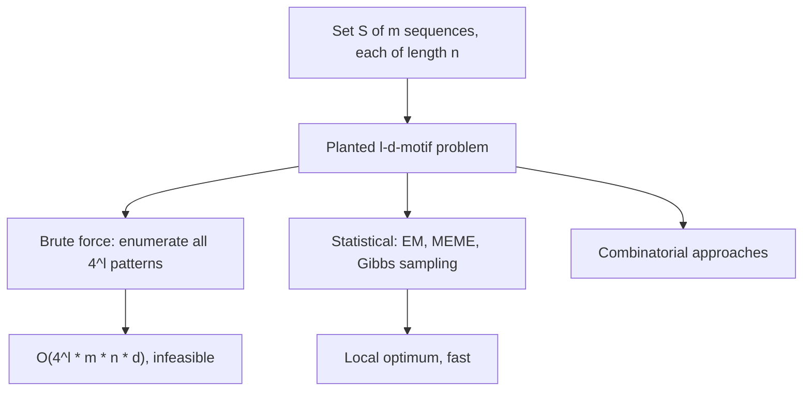

# Planted motif problem

## Definition

> **Given**: a set `S` of sequences of length `n`, and two integers `l`, `d` with
> `d < l < n`.
> **Wanted**: a pattern `M` of length `l` such that in **each** sequence of `S` there is
> a substring which can be transformed into `M` with **at most `d` substitutions**.

A pattern satisfying this is called an **`(l, d)`-motif**: a reoccurring nucleotide
sequence of length `l` tolerating at most `d` mutations.

## Why it matters

This is the combinatorial core of [[sequence-motif|motif discovery]], stripped of all
biology. It makes precise what "the same short pattern occurs in all these sequences,
but never exactly the same way" means, and it is the problem statement against which
[[em-motif-discovery]] and [[gibbs-sampling]] are measured.

## Details

- `d < l < n` is required: the allowed mutation budget must be smaller than the motif,
  and the motif smaller than the sequence.
- Only **substitutions** are allowed in the basic formulation — no insertions or
  deletions, so no [[sequence-alignment|alignment]] is needed, only Hamming distance.
- The problem demands an occurrence in **every** sequence. That is a strong assumption
  and one of the known weaknesses carried over into [[em-motif-discovery]], which
  likewise assumes exactly one motif occurrence per sequence.

### Variations named in the notes

- find **exactly one** or **several** motifs;
- **with or without gaps** in the motif;
- require occurrence **in every sequence**, or only in most of them.

### Why brute force is hopeless

Enumerating every candidate pattern of length `l` over a 4-letter alphabet and checking
it against all sequences costs

```
O(4^l · m · n · d)
```

for `m` sequences of length `n` — exponential in the motif length `l`. Practical motif
lengths (`l ≈ 8–20`) put this out of reach, which is why the course turns to statistical
([[expectation-maximization]], [[gibbs-sampling]]) and combinatorial approaches instead.
This is the same polynomial/exponential divide drawn in [[algorithmic-complexity]].

## Diagram


One problem statement, three families of solvers, and the complexity that rules out the obvious one.

## Relations

- [[sequence-motif]] — the biological object this formalises.
- [[em-motif-discovery]] — the statistical solver developed in the lecture.
- [[gibbs-sampling]] — the stochastic alternative that escapes local maxima better.
- [[expectation-maximization]] — the general estimation framework behind both.
- [[algorithmic-complexity]] — supplies the exponential/polynomial reading of the
  brute-force bound.
- [[string-matching]] — the exact version of the same search; `d = 0` would reduce the
  planted motif problem to it.
- [[gene-knockout]] — the experiment that supplies the sequence set `S`.

## Appears in

- [[M2L02-sequence-motifs-and-motif-discovery]]

## Sources

- `raw/module2/csb_1.pdf`, p. 17 — the `(l, d)`-motif definition, the planted motif
  problem statement and its variations.
- `raw/module2/csb_1.pdf`, p. 18 — brute force, its complexity, and the statistical and
  combinatorial alternatives.
