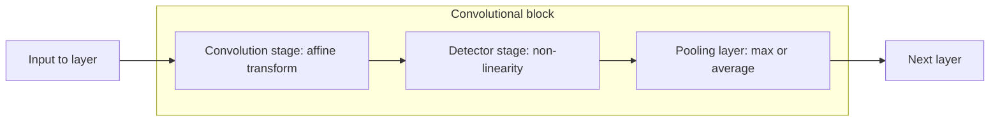

# Pooling Layer

## Definition

A **pooling layer** *reduces the spatial dimensions of the input volume while retaining
important features*. It replaces each small window of a feature map by a single
summary value — the maximum (**max pooling**) or the mean (**average pooling**).

## Why it matters

It is the third stage of every convolutional block in a
[[convolutional-neural-network]], and it does three jobs at once: it shrinks the data so
the next layer is cheaper, it discards precise positions so the answer becomes robust to
small shifts, and it widens the receptive field of later filters without adding
parameters. It has **no learnable weights**, so it costs nothing in
[[overfitting]] terms.

## Details

A pooling layer is specified by its **window size** and its **stride**; the usual choice
is a `2 × 2` window with stride 2, which halves each spatial dimension.

```text
POOL(A, w, type):
  m ← ⌊ |A| / w ⌋
  for r ← 1 to m:
    for c ← 1 to m:
      W ← A[ (r−1)w+1 … rw , (c−1)w+1 … cw ]     // the w × w window
      if type = MAX: O[r,c] ← max(W)
      if type = AVG: O[r,c] ← mean(W)
  return O
```

**Worked example** — the `4 × 4` map from the exercise, pooled with a `2 × 2` window:

```text
         12   5    0   6
         25   8   18  12
         12  14   25   4
          1  37   12  50
```

| Window | Values | Max | Average |
|---|---|---|---|
| top-left | 12, 5, 25, 8 | **25** | **12.5** |
| top-right | 0, 6, 18, 12 | **18** | **9** |
| bottom-left | 12, 14, 1, 37 | **37** | **16** |
| bottom-right | 25, 4, 12, 50 | **50** | **22.75** |

```text
Max pooling:            Average pooling:
   25  18                 12.5   9
   37  50                 16    22.75
```

Max pooling keeps the strongest detection in each neighbourhood and is the default in
the notes' Keras sketch (`MaxPooling1D`); average pooling keeps the overall level and is
less sensitive to a single extreme value.

## Diagram


The pooling layer closes a convolutional block, after the convolution and detector stages.

## Relations

- [[convolutional-neural-network]] — pooling is the third stage of its block.
- [[activation-function]] — the detector stage immediately preceding it.
- [[neural-network]] — pooling has no weights, so it does not enter the weight count.
- [[overfitting]] — downsampling reduces capacity, complementing [[dropout]].
- [[descriptive-statistics]] — average pooling is a windowed mean; max pooling an order
  statistic.

## Appears in

- [[M2L06-deep-learning]]
- [[M2E06-deep-learning]]

## Sources

- `raw/module2/csb_3.pdf`, p. 6 — max pooling and average pooling in the convolutional
  block.
- `raw/module2/csb_3.pdf`, p. 10 — the exercise definition and the `4 × 4` worked
  example with its max and average results.
- `raw/module2/csb_3.pdf`, p. 11 — `MaxPooling1D` in the Keras sketch.
