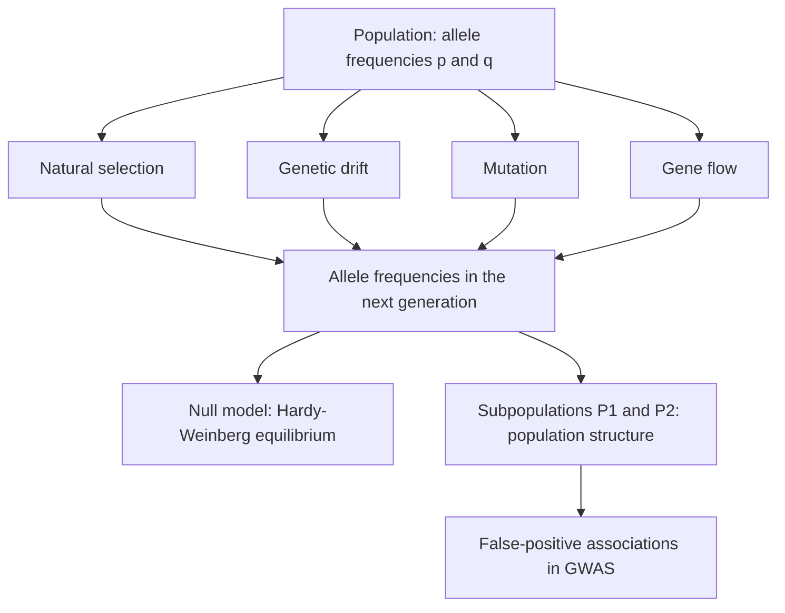

# Population Genetics

## Definition

**Population genetics** is the study of the distributions of, and changes in, **allele
frequencies** in a population. Allele frequencies are subject to four evolutionary
processes: **natural selection**, **genetic drift**, **mutation** and **gene flow**.

## Why it matters

A single genome says what one individual carries; a population says what is *variable*,
and variation is what association studies test against disease
([[genome-wide-association-study]]). Population genetics supplies both the null model
(what frequencies do in the absence of any effect — [[hardy-weinberg-equilibrium]],
[[wright-fisher-model]]) and the main confounder (population structure).

## Details

**Vocabulary**

- **Allele** (Allel) — one of the different variants of a gene at a particular position
  on a chromosome.
- **Allele frequency** (Allelfrequenz) — the relative frequency of a particular allele in
  a population.
- **Locus** — a fixed position on the chromosome (fester Ort auf dem Chromosom).
- **Genotype** — the pair of alleles carried at a locus: **homozygous** (`AA`, `aa`) or
  **heterozygous** (`aA`).
- **SNP** — single-nucleotide polymorphism, a locus where a single base differs between
  individuals. SNPs are the units measured in [[genome-wide-association-study|GWAS]].
- **Linkage** — two loci are *linked* when they are associated with each other, i.e.
  their alleles are inherited together more often than chance would predict.

**The human genome as a population object**

- ~3 billion bases; 20,000–25,000 genes.
- ~2 % encodes genes; the remaining 98 % is **not junk** — functionality has been
  discovered for much of it (see [[genome-organization]]).
  This is a *biochemical-activity* statement and sits alongside, not against, the
  *constraint-based* "≈ 7–9 % of the genome is functional" figure recorded in
  [[L01-bioinformatics-and-the-cell]]: the first says most of the genome does
  *something*, the second says a much smaller part is under measurable purifying
  selection. Both are kept as written; see [[open-questions]].
- Chromosome set: 22 autosome pairs plus the sex chromosomes, XY (male) or XX (female) —
  the human is **diploid**.
- Inheritance as treated here concerns only the **autosomes 1–22** (non-sex
  chromosomes).

**Population structure**

Cases and controls in a study may be drawn from different subpopulations `P1` and `P2`.
Any allele that simply differs in frequency between `P1` and `P2` then looks associated
with the disease. The goal is to avoid such **false-positive hits**:

- Match the background of cases and controls as well as possible.
- Remove SNP positions known for ethnic differences.
- Correct for population structure statistically — in practice with
  [[principal-component-analysis]], the same tool used against a [[batch-effect]].

## Diagram

The four forces acting on allele frequencies, the null model they are measured against, and the confounder they create.

## Relations

- [[hardy-weinberg-equilibrium]] — the genotype distribution expected when none of the
  four forces acts.
- [[genetic-drift]] — frequency change from random sampling alone.
- [[wright-fisher-model]] — the formal model in which drift is derived.
- [[haplotype-phasing]] — recovering which allele sits on which of the two chromosomes.
- [[genome-wide-association-study]] — the application: linking allele frequency to
  phenotype.
- [[dna-mutation]] — mutation is the ultimate source of the alleles studied here.
- [[genome-organization]] — chromosomes, genes and the coding/non-coding split.
- [[snp]] — the single-base polymorphism that is the unit in which this variation is
  measured.
- [[expression-qtl]] — takes the allele and linkage vocabulary defined here and
  associates genotypes with expression levels.
- [[endophenotype]] — module 2's intermediate trait sits between the genotype studied here and the phenotype.
- [[molecular-evolution]] — the neutral theory and the molecular clock recast population-genetic drift as the engine of sequence divergence.
- [[M2E08-phylogenetics]] — mutation, recombination and gene flow as the reasons genes evolve.

## Appears in

- [[L14-population-genetics]]
- [[E11-population-genetics-and-multiple-testing]]

## Sources

- `raw/module1/gsb_3.pdf`, pp. 20, 22.
