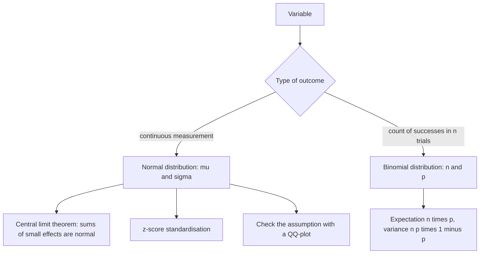

# Probability Distribution

## Definition

A **probability distribution** assigns to every possible value of a variable the
probability (or probability density) of observing it. It is the model against which an
observed sample is compared in [[statistical-testing]].

## Why it matters

A test statistic is only interpretable if the distribution it is supposed to follow is
known. Assuming normality when the data are not normal is one of the three classic causes
of a wrong test decision ("test assumption not met"), so the assumption has to be
checked — with a [[qq-plot]], for instance.

## Details

**Normal (Gaussian) distribution**

- Symmetric "bell curve"; the mean `μ` sits at the centre; the characteristic width is
  the standard deviation `σ`.
- Most sets of biological and physical measurements approximate it.
- A large set of small, independent measurements gives an approximately normal
  distribution — the **central limit theorem**. This is why the normal distribution is
  the default assumption even when the underlying variable is not itself normal.
- Expression values of one gene in two groups are drawn as two bell curves; for the gene
  to be useful as a marker the **overlap of the two curves should be minimal**.

**Binomial distribution**

- Models a fixed number of repeated, identical, **independent** trials, each with two
  outcomes — success with probability `p`, failure with probability `1 − p`. The textbook
  example is the number of heads in a series of coin flips.

```text
P_{n,p}(X) = C(n, X) · p^X · (1 - p)^(n - X),   X ∈ [0, n]
E(X)   = n · p
Var(X) = n · p · (1 - p)
```

- `n` = number of trials, `X` = number of successes.

**Shapes**

- **Unimodal** — one peak; **bimodal** — two peaks, usually a sign that the sample mixes
  two subpopulations (a situation in which a single mean is misleading).

**Standardising**

The **z-score** `z = (x − μ)/σ` maps any normal variable onto the standard normal
distribution with `μ = 0`, `σ = 1`, so that values from different experiments become
comparable (see [[descriptive-statistics]]).

## Diagram


The two distributions covered by the course, where each applies and how the normal assumption is checked.

## Relations

- [[descriptive-statistics]] — the sample summaries that estimate `μ` and `σ`.
- [[statistical-testing]] — compares an observation against the distribution.
- [[qq-plot]] — the graphical test of distributional agreement.
- [[microarray-expression-analysis]] — expression values are modelled as approximately
  normal after normalisation.
- [[data-normalization]] — skewed distributions are transformed towards the normal one
  before modelling; uniform and Poisson shapes also appear in the exercises.
- [[genetic-drift]] and [[wright-fisher-model]] — the binomial distribution is the engine
  of allele-frequency sampling.
- [[multiple-testing-correction]] — p-values are **uniformly** distributed under the null
  hypothesis, which is why many tests produce false positives.

- [[peak-calling]] — MACS2 models the ChIP-Seq background with a **local Poisson**
  distribution and computes each peak's p-value from its tail.
- [[markov-chain]] — each row of a transition matrix is a discrete distribution over the
  states.
- [[hidden-markov-model]] — transitions and emissions are both discrete distributions.
- [[hardy-weinberg-equilibrium]] — its Punnett square multiplies allele probabilities to
  give the genotype distribution `p²`, `2pq`, `q²`.
- [[z-score]] — maps a normal variable onto the standard normal distribution with
  `μ = 0`, `σ = 1`.

- [[fishers-exact-test]] — the hypergeometric distribution as an exact null.
- [[expectation-maximization]] — uses the binomial likelihood in the coin example.
- [[information-content]] — entropy measures how spread out a discrete distribution is.
- [[gene-set-enrichment-analysis]] — builds its null distribution empirically, by permutation.
- [[M2E02-motif-discovery-and-expectation-maximization]] — worked binomial calculations.
- [[bootstrapping]] — approximates the sampling distribution of a statistic by resampling the data instead of assuming a parametric family.
- [[droplet-based-single-cell-methods]] — Poisson loading sets the capture rate `1 − e^(−μ)`.
- [[doublet]], [[barcode-collision]] — the artefact rates are elementary probability calculations on the same model.
- [[single-cell-rna-seq]] — the experimental design is chosen by these numbers.
- [[maximum-likelihood]] — a likelihood is a distribution evaluated at the observed data and read as a function of the parameters.

## Appears in

- [[L10-biostatistics-and-statistical-testing]]
- [[L11-normalization-pca-and-batch-effects]]
- [[L14-population-genetics]]
- [[L16-epigenetics]]
- [[L17-markov-chains-and-hidden-markov-models]]
- [[E08-test-errors-and-z-score]]
- [[E12-epigenetics-and-peak-calling]]

## Sources

- `raw/module1/gsb_part2.pdf`, pp. 20, 22–23.
- `raw/module1/gsb_3.pdf`, pp. 1–2, 21–22 — skewed shapes, the uniform/Poisson/binomial
  exercise, and the binomial sampling of allele counts.
- `raw/module1/gsb_part4.pdf`, pp. 6, 11 — the local Poisson background of MACS2;
  pp. 13–14 — transition and emission distributions of Markov models.

