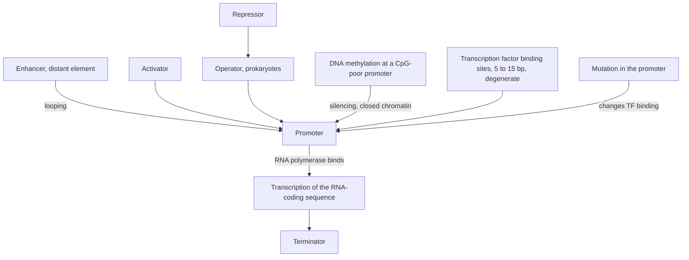

# Promoter

## Definition

A **promoter** (Promotor) is the DNA element at which RNA polymerase binds in order to
start transcription of the downstream sequence. It is the first element of a
transcription unit and therefore the point at which the decision *whether and how much to
transcribe* is physically made.

## Why it matters

Because transcriptional control is the dominant regulatory level in eukaryotes, the
promoter is where most of [[gene-regulation]] is implemented: activators, repressors,
enhancers and epigenetic marks all act on it. It is also the genomic compartment in which
a single-base change has a *dose* effect rather than a protein-sequence effect, which is
why [[dna-mutation]] and [[expression-qtl]] both single it out.

## Details

**Position in the transcription unit**

A eukaryotic transcription unit reads **promoter — RNA-coding sequence — terminator**
(see [[genome-organization]]). In prokaryotes the promoter is one component of an
**operon**, together with the **operator** and the **structural genes**.

**What acts on a promoter**

| Input | Effect on transcription |
|---|---|
| RNA polymerase binding | transcription starts |
| **Activator** (positive regulation) | increases transcription |
| **Repressor** (negative regulation) | decreases or blocks it; in prokaryotes it binds the **operator** next to the promoter |
| **Enhancer** | a distant element that boosts transcription from the promoter by looping to contact it |
| **DNA methylation** of the promoter region | **decreases** gene expression ([[dna-methylation]]) |

In the prokaryotic operon model the promoter itself is not the switch — the operator is;
the promoter is the binding site that the switch gates. The *lac* operon is **inducible**
(off by default) and the *trp* operon **repressible** (on by default).

**Promoters are built from binding sites**

The sequences that activators and repressors recognise are
[[transcription-factor-binding-site|transcription factor binding sites]]: short (5–15 bp)
and degenerate, with the degree of degeneracy setting the *level* of regulation. A
promoter is therefore not a single exact word but a cluster of such tolerant sites, which
is why exact [[string-matching]] is the wrong tool for finding them and
[[position-weight-matrix|PWMs]] are used instead.

**Mutation in a promoter**

| Location of the mutation | Effect |
|---|---|
| **Promoter** | changes which transcription factors bind → expression increases *or* decreases |
| **Exon** | may change the amino-acid sequence of the protein |
| **Intron** | usually no effect, unless a splice site is hit ([[splicing]]) |

This is the explicit comparison made on the first exercise sheet
([[E01-cell-biology-and-gene-expression]]): the same single-base change has a completely
different consequence depending on which compartment it lands in. A variant of this kind
that measurably shifts a gene's expression in a population is an [[expression-qtl|eQTL]],
and the single-base version of such a variant is an [[snp|SNP]].

**The epigenetic layer on promoters**

- [[cpg-island|CpG islands]] are dense regions of C and G that sit disproportionately at
  gene promoters; they decide where the methylation machinery can act at all.
- **CpG-poor promoters** are **silenced** by methylation and show a **closed chromatin
  structure** ([[chromatin]]). CpG-poor regions generally — enhancers excepted — are
  typically methylated in normal cells.
- Methylation at a promoter or an enhancer **decreases** expression, while gene-body
  methylation accompanies *high* expression.
- In cancer the notes record **hypermethylation of tumour-suppressor genes** and
  **hypomethylation of oncogene promoters**.

## Diagram

Everything that converges on a promoter: sequence-specific proteins, distant enhancers, epigenetic marks and mutations, all of them acting on one decision — whether RNA polymerase starts.

## Relations

- [[gene-regulation]] — the promoter is the element on which activators, repressors and enhancers act.
- [[genome-organization]] — places the promoter as the first part of a transcription unit.
- [[transcription-factor-binding-site]] — the short degenerate words a promoter is assembled from.
- [[position-weight-matrix]] — the model used to search for those sites computationally.
- [[dna-mutation]] — a promoter mutation changes expression level rather than protein sequence.
- [[snp]] — a single-base promoter polymorphism is one route from genotype to expression.
- [[expression-qtl]] — a cis-eQTL is often exactly such a regulatory promoter variant.
- [[cpg-island]] — islands sit at promoters and determine their methylatability.
- [[dna-methylation]] — methylation here decreases expression.
- [[chromatin]] — silenced CpG-poor promoters come with closed chromatin.
- [[central-dogma]] — the promoter governs the transcription step of the flow.
- [[splicing]] — the next processing step after the transcript the promoter initiates.
- [[atac-seq]] — promoters are the strongest and most reproducible class of
  accessibility peaks.

## Appears in

- [[L01-bioinformatics-and-the-cell]]
- [[L02-gene-expression-and-regulation]]
- [[L12-binding-sites-and-position-weight-matrices]]
- [[L16-epigenetics]]
- [[E01-cell-biology-and-gene-expression]]
- [[E12-epigenetics-and-peak-calling]]

## Sources

- `raw/module1/gsb_part1.pdf`, pp. 5–6, 10–11 — the operon model, the eukaryotic
  transcription unit, and the effect of a promoter mutation.
- `raw/module1/gsb_3.pdf`, p. 5 — protein–DNA interaction and the properties of
  transcription factor binding sites.
- `raw/module1/gsb_part4.pdf`, pp. 7–8, 12 — CpG islands at promoters, promoter
  methylation and silencing, and the cancer methylation patterns.
- Consolidated from [[gene-regulation]], [[genome-organization]], [[dna-mutation]],
  [[cpg-island]], [[dna-methylation]] and
  [[E01-cell-biology-and-gene-expression]]; see those pages for the original `raw/`
  page references.
