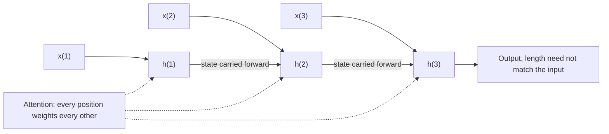

# Recurrent Neural Networks, Attention and Transformers

## Definition

**Sequence models** are the [[deep-learning]] architectures for data whose items arrive
in order and whose length is not fixed: **recurrent neural networks (RNNs)**, and the
**attention**-based **transformers** that replaced them.

## Why it matters

A plain [[neural-network]] has a fixed-size input vector. Speech, text — and, in this
module, DNA, RNA and protein sequences — have neither fixed length nor positional
independence. The notes' motivation is simply *"for sequence data, e.g. speech"*, but the
same argument puts these models in direct competition with the
[[hidden-markov-model]] as the course's tool for sequences with memory.

## Details

**What sequence models must handle**, as listed in the notes:

- **In and out lengths are not fixed** — a sentence maps to a sentence of another length.
- **Many inputs for one output** — e.g. a whole sequence classified with one label.
- **The output of the first signal of data can affect the second one** — i.e. the model
  carries state forward; this is what "recurrent" means.
- **Transformers, in addition to memory, have attention**, i.e. a learned weighting
  deciding *to which word to pay more attention*.

The progression is therefore: a recurrent network carries a hidden state from step to
step, which gives it memory but forces strictly sequential processing and a long
gradient path; attention lets every position look directly at every other position,
which removes both limitations at the cost of a quadratic comparison.

> The notes name RNNs, attention and transformers but do not develop their equations.
> See [[open-questions]].

## Diagram

A recurrent network passes a hidden state along the sequence; attention adds direct, weighted links between all positions.

## Relations

- [[deep-learning]], [[neural-network]] — the family and the building block.
- [[hidden-markov-model]] — the module-1 sequence model with memory; the HMM's state is
  discrete, interpretable and trained by [[baum-welch-algorithm]], the RNN's hidden state
  is a continuous vector trained by [[backpropagation]].
- [[markov-chain]] — the first-order-memory baseline both improve on.
- [[convolutional-neural-network]] — the other way of handling ordered data: a 1-D
  kernel sees a fixed window, a recurrent state sees everything before it.
- [[backpropagation]] — the long gradient path through a recurrent network is the
  textbook case of the vanishing-gradient problem the notes mention.
- [[graph-neural-network]] — the sibling architecture for data with a non-sequential
  structure.
- [[sequence-motif]] — the biological signals a sequence model would be asked to find.

## Appears in

- [[M2L06-deep-learning]]

## Sources

- `raw/module2/csb_3.pdf`, p. 8 — neural networks for sequence models: motivation,
  recurrent NNs, attention and transformers, and the four bullet points on variable
  lengths, many-to-one, carried-forward state and attention.
