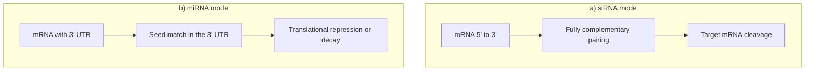

# RNA interference

## Definition

RNA interference (RNAi) is **a biological process in which RNA molecules are involved in
the sequence-specific suppression of gene expression**. Because the suppression happens
after transcription, it is also known as **post-transcriptional gene silencing**.

## Why it matters

RNAi is the mechanism that lets a cell switch a specific transcript off without touching
the DNA, and it is the experimental handle that lets a researcher do the same: a
transfected [[small-interfering-rna|siRNA]] produces a **knockdown**, the reversible
counterpart to the permanent [[gene-knockout|knock-out]]. Scaled up with robotics it
becomes **gene silencing on a genome-wide scale** — one gene silenced per well, across
the whole genome.

## Details

**The two binding modes.** The notes draw them side by side:

- **a) siRNA** — binds the mRNA **fully complementary** over its whole length. The
  consequence is cleavage of the target.
- **b) miRNA** — binds the **3′ UTR** of the mRNA through a short **seed** region only.
  The pairing is imperfect, so the consequence is translational repression or decay
  rather than a clean cut.

The imperfect pairing of the miRNA mode is the whole source of the computational problem
that follows: a short, degenerate match is cheap to find by chance, so
[[mirna-target-prediction]] is swamped by false positives.

**RNAi screening.** Run genome-wide, RNAi becomes a high-throughput assay carried out by
**robotic high-throughput screens**. The notes list the bioinformatics tasks that such a
screen generates, and every one of them is a topic already covered elsewhere in the two
modules:

| Task | Covered by |
|---|---|
| Quality control | [[single-cell-analysis-workflow]], [[microarray-expression-analysis]] |
| Normalization | [[data-normalization]] |
| Batch effect correction | [[batch-effect]] |
| Visual analytics | [[principal-component-analysis]], [[t-sne]], [[umap]] |
| Statistical analysis | [[statistical-testing]], [[multiple-testing-correction]] |
| Systems biology | [[interaction-network]] |
| Network enrichment | [[keypathwayminer]], [[enrichment-analysis]] |

**RNAi for therapy.** RNAi has great potential for targeted therapy — but the notes add
the blunt verdict that **CRISPR is better nowadays**; see [[crispr-cas9]] for the
comparison table.

## Diagram

The two pairing modes of p. 1: perfect complementarity cuts, seed pairing represses.

## Relations

- [[non-coding-rna]] — the class of molecules that carry out RNAi.
- [[microrna]] — the endogenous effector, seed pairing.
- [[small-interfering-rna]] — the exogenous effector, perfect complementarity.
- [[crispr-cas9]] — the permanent alternative; knockdown versus knock-out.
- [[gene-knockout]] — RNAi gives the reversible version of the same experiment.
- [[gene-regulation]] — RNAi is the post-transcriptional layer of it.
- [[mirna-target-prediction]] — the computational problem the imperfect seed pairing
  creates.
- [[batch-effect]], [[data-normalization]], [[statistical-testing]] — the analysis stack
  a genome-wide RNAi screen requires.
- [[epigenetics]] — RNAi is the post-transcriptional arm of epigenetic silencing.

## Appears in

- [[M2L09-non-coding-rnas]]
- [[M2E09-non-coding-rnas-and-sponge]]

## Sources

- `raw/module2/csb_4.pdf`, p. 1 — RNAi definition, post-transcriptional gene silencing,
  the two binding modes.
- `raw/module2/csb_4.pdf`, p. 3 — genome-wide scale, robotic high-throughput screens,
  the bioinformatics task list, and RNAi for therapy.
