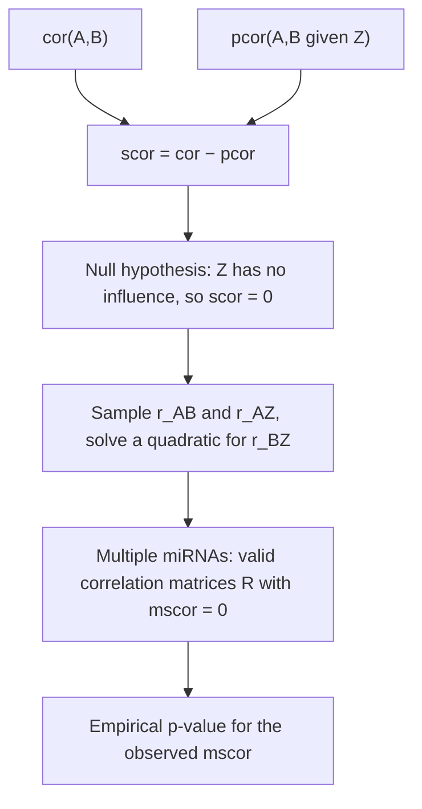

# Sensitivity correlation

## Definition

Sensitivity correlation measures **how much of the correlation between two genes
disappears once a miRNA is conditioned on** — that is, how much of their co-expression
the miRNA explains:

```text
scor(A,B ; Z) = r_AB − r_AB|Z = r_AB − pcor
```

where `r_AB` is the ordinary correlation of genes `A` and `B` and `r_AB|Z` is their
**partial correlation** given the miRNA `Z`.

## Why it matters

The quantity the lecture is after is stated plainly:

> We are interested in quantifying the **regulatory effect of the miRNA `Z` on genes `A`
> and `B`**.

[[mutual-information|Conditional mutual information]] expresses the same idea but cannot
be computed genome-wide. Sensitivity correlation replaces it with two correlations, both
cheap, and is what [[sponge]] scales up to a whole
[[competing-endogenous-rna|ceRNA network]].

## Details

### Partial correlation

```text
                r_AB − (r_AZ · r_BZ)
r_AB|Z  =  ───────────────────────────────
            √(1 − r_AZ²) · √(1 − r_BZ²)
```

It is the correlation of `A` and `B` after the linear influence of `Z` has been removed
from both.

### Reading the three cases

The notes draw three bar pairs, `cor(A,B)` next to `pcor(A,B|Z)`:

| Picture | `cor` vs `pcor` | Interpretation |
|---|---|---|
| **No effect** | equal | the miRNA explains nothing; `scor ≈ 0` |
| **Moderate effect** | `pcor` somewhat lower | part of the co-expression is miRNA-driven |
| **Strong effect** | `pcor` much lower | the co-expression is largely competition for `Z` |

The notes mark **significance** of these values as an **open challenge** — which is what
the null model below is for.

### Multiple sensitivity correlation

Generalising from one miRNA `Z` to a **set** `M` of miRNAs:

```text
mscor(g₁, g₂, M) = cor(g₁, g₂) − pcor(g₁, g₂ | M)
```

This is the statistic [[sponge]] computes for every gene pair with shared miRNAs.

### Null model for scor values

**Null hypothesis**: `Z` has **no influence** on `A` and `B`, thus `scor = 0`. It follows
that `pcor(A,B|Z) = cor(A,B)`.

Sampling under that hypothesis is done by fixing two of the three correlations and
solving for the third:

- randomly sample `r_AB` and `r_AZ`;
- `r_BZ` is then obtained by **solving a quadratic formula**, `r_BZ = (−B ± √(B² − 4AC)) / (2A)`,
  whose coefficients follow from setting the partial-correlation expression equal to
  `r_AB`.

For **multiple miRNAs** the same idea is lifted to a **correlation matrix**

```text
R = ( R₁₁  R₁₂ )
    ( R₂₁  R₂₂ )
```

and the task becomes: **generate valid examples of correlation matrices for which
`mscor = 0` holds**, then **sample data under the null hypothesis** from them. Simulated
`mscor` values then give an empirical p-value without permuting real expression vectors
one triplet at a time — the exact cost that sank the CMI approach.

**Multiple miRNA sensitivity correlation is affected by**:

- the **gene–gene correlation** `R`,
- the **number of miRNAs** `m`,
- the **number of samples**.

Hence the null model must be built *per* `(R, m, #samples)` combination, which is why
SPONGE precomputes it.

## Diagram


Sensitivity correlation and the simulated null model that makes it testable.

## Relations

- [[competing-endogenous-rna]] — the edge this statistic scores.
- [[microrna]] — the conditioning variable `Z`.
- [[mutual-information]] — the information-theoretic alternative it replaces, and why.
- [[sponge]] — the tool that computes `mscor` genome-wide and attaches the null model.
- [[statistical-testing]] — null hypothesis, empirical p-value, and the open challenge of
  significance.
- [[descriptive-statistics]] — correlation and covariance, the raw material here.
- [[gene-set-enrichment-analysis]] — the other module-2 method whose significance comes
  from a simulated null rather than a closed form.

## Appears in

- [[M2L09-non-coding-rnas]]
- [[M2E09-non-coding-rnas-and-sponge]]

## Sources

- `raw/module2/csb_4.pdf`, p. 7 — partial correlation, sensitivity correlation, the three
  effect pictures, and multiple sensitivity correlation.
- `raw/module2/csb_4.pdf`, p. 8 — the null model, the quadratic solution for `r_BZ`, the
  correlation-matrix generalisation, and the three factors affecting `mscor`.
