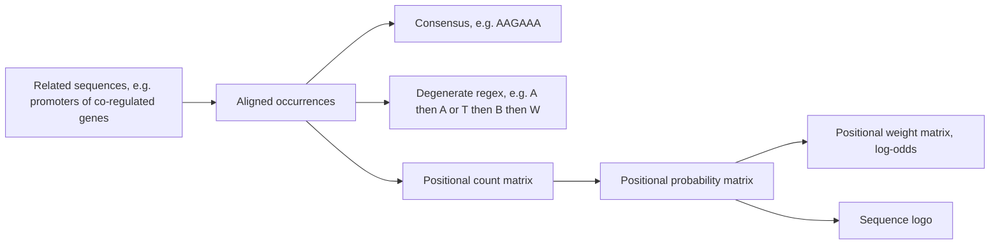

# Sequence motif

## Definition

A sequence motif is a **short, recurring, conserved pattern in DNA, RNA or protein** that
is shared among a group of related sequences and is believed to carry a biological
function beyond that of any single sequence. Motifs are typically associated with a
particular biological function, most prominently protein–DNA interactions that regulate
gene expression.

## Why it matters

The most important instance is the [[transcription-factor-binding-site]]: a transcription
factor recognises a short, degenerate pattern upstream of the genes it controls. Finding
that pattern in silico is cheaper and higher-resolution than finding it in the wet lab,
so motif discovery is the computational route into [[gene-regulation]].

Beyond regulation, motifs serve **protein binding**, **evolutionary analysis** and the
identification of **protein motifs** (domains, active sites).

## Details

### Why motifs are hard to find

- The **position** of a binding site varies between the sequences that contain it — there
  is no fixed offset to look at.
- The common feature is **typically very short** (a handful of bases) and is embedded in
  very long DNA, so the **signal (foreground) to noise (background) ratio is bad**.
- Motifs are **degenerate**: two occurrences of the same motif usually differ, so exact
  [[string-matching]] cannot be used.
- Wet-lab experiments are **not exact enough**: mutating a binding site and watching for
  functional changes is expensive and time-consuming and has **bad resolution**. What
  such experiments deliver is an *approximate* position, plus the working assumption that
  binding sites are **evolutionarily conserved**.

### The formal definition used in the course

> A motif is a reoccurring nucleotide sequence; it is an **`(l, d)`-motif** if it is of
> length `l` and occurs with **at most `d` mutations**.

This turns motif finding into the [[planted-motif-problem]].

### Representations

Four representations of increasing richness, all covered in the course:

1. **Regular expressions**
   - *Consensus*: the single most frequent letter per position, e.g. `AAGAAA`.
   - *Degenerate sequence*: IUPAC-style alternatives, e.g. `A[A/T]BW`.
2. **Positional count matrix (PCM)** — raw letter counts per position.
3. **Positional probability matrix (PPM)** — counts normalised per column.
4. **Positional weight matrix (PWM)** — log-odds against a background.

A regular expression throws away *how* degenerate each position is; the three matrix
representations keep it, which is why they, and not the consensus, are what scanning and
[[em-motif-discovery|motif discovery]] actually use. A [[sequence-logo]] is the graphical
rendering of the same numbers. The full treatment of the matrix hierarchy — the
pseudo-count, the `s = log₂(P_ij / π_j)` weights and the genome-wide scan — is on
[[position-weight-matrix]].

## Diagram

The same set of motif occurrences, rendered at four increasing levels of detail.

## Relations

- [[transcription-factor-binding-site]] — the biological instance the course cares about.
- [[position-weight-matrix]] — the probabilistic representation of a motif, and the
  object a motif-discovery algorithm actually returns.
- [[sequence-logo]] — the visual representation, scaled by [[information-content]].
- [[planted-motif-problem]] — the combinatorial formalisation of "find the motif".
- [[em-motif-discovery]] and [[gibbs-sampling]] — the two statistical search strategies.
- [[gene-knockout]] — the experiment that produces the candidate sequence set in the
  first place.
- [[string-matching]] — exact search fails on degenerate motifs; this is the reason the
  matrix models exist.
- [[homology]] — the assumption that binding sites are evolutionarily conserved is the
  same assumption that underlies homology search.
- [[L12-binding-sites-and-position-weight-matrices]] — the module-1 lecture that models
  one class of motif, the transcription-factor binding site.
- [[recurrent-neural-network]] — sequence models learn motif-like features instead of being given them.
- [[convolutional-neural-network]] — a learned kernel over a sequence is a motif detector.
- [[microrna]] — the seed is a motif, only ~7 nt long, which is exactly why its matches are mostly false positives.

## Appears in

- [[M2L02-sequence-motifs-and-motif-discovery]]
- [[M2E02-motif-discovery-and-expectation-maximization]]

## Sources

- `raw/module2/csb_1.pdf`, p. 14 — definition of sequence motifs and of motif discovery.
- `raw/module2/csb_1.pdf`, p. 15 — the four representations, consensus and degenerate
  regular expressions.
- `raw/module2/csb_1.pdf`, p. 17 — why motifs are hard to find, and the `(l, d)`-motif
  definition.
- `raw/module2/csb_1.pdf`, p. 23 — exercise definition.

- `raw/module2/csb_4.pdf`, pp. 1, 4 — seed pairing and the resulting false-positive rate.
