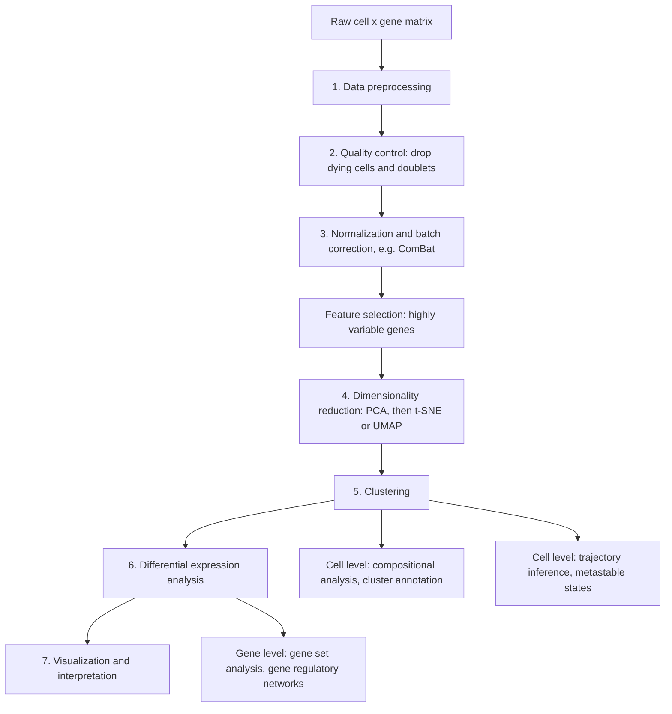

# Single-Cell Analysis Workflow

## Definition

The **single-cell analysis workflow** is the fixed seven-step pipeline that turns the raw
cell × gene matrix produced by [[single-cell-rna-seq]] into annotated cell populations
and differentially expressed genes. In the notes it is anchored to **Scanpy**, the Python
toolkit used in the exercise.

## Why it matters

The notes state the purpose plainly: the pipeline

> **aims to unravel heterogeneity**, identify **novel cell types, cell states and cell
> characteristics** → **identifying potential therapeutic targets**.

Each step exists to remove a specific artefact of the chemistry described in
[[droplet-based-single-cell-methods]], and skipping one does not merely lose power — it
produces confident, wrong cell types.

## Details

### The seven steps

```text
1) Data preprocessing
2) Quality control
3) Normalization
4) Dimensionality reduction
5) Clustering
6) Differential expression analysis
7) Visualization and interpretation
```

### 1–2. Preprocessing layers and quality control

The preprocessing layers of the notes:

| Layer | Alternatives |
|---|---|
| **Measured** | raw / **normalized** |
| **Corrected** | **technical** correction / **biological** correction |
| **Reduced** | **feature selected** / **dimensionally reduced** |

**Quality control** examines *the distributions of the QC covariates for outlier peaks
that are filtered out*. **These outlier barcodes can correspond to dying cells or
[[doublet|doublets]].** The three covariates and how they are read:

| Signature | Interpretation |
|---|---|
| **low count depth, few detected genes, high fraction of mitochondrial counts** | a **dying cell**: *cytoplasmic mRNA has leaked out through a broken membrane, so only mRNA located in the mitochondria is still conserved* |
| **unexpectedly high counts and a large number of detected genes** | likely a **doublet**; *high count-depth thresholds are commonly used to filter out potential doublets* |

The exercise adds the practical rule: *set the threshold such that the outliers are cut
out* — the filter is drawn from the shape of the observed distribution, not from a
universal number.

### 3–4. Normalization, batch correction, reduction

[[data-normalization]] makes cells with different library sizes comparable. Then
**batch-effect correction**: the notes draw two embeddings, one with **poor mixing of
batches** (no correction) and one in which the batches overlap (corrected), and name
**ComBat** as the tool — the same [[batch-effect]] problem as in module 1, now visible
as the dominant structure of a two-dimensional embedding.

**Feature selection** keeps the [[highly-variable-genes]]. **Dimensionality reduction**
then follows, with the **visualization methods** listed as:

```text
PC (principal components), t-SNE, DC (diffusion components), UMAP, FA
```

The **number of principal components** is chosen with the **elbow** of the
variance-ratio-against-ranking curve — the same elbow rule as for `k` in [[k-means]].
The idea behind the non-linear methods is stated as: *similar objects near each other*.

### 5–7. Downstream analysis

The notes split downstream analysis by the level it operates on:

| Level | Analyses |
|---|---|
| **Cell level** | **cluster analysis**: clustering, compositional analysis, cluster annotation |
| **Cell level** | **trajectory analysis**: trajectory inference, metastable states, gene-expression dynamics |
| **Gene level** | **gene set analysis**, **gene regulatory networks**, **differential expression analysis** |

Cluster analysis asks *what types are present*; trajectory analysis asks *what path
cells move along*, treating the clusters as metastable states on a continuum rather than
as discrete classes.

## Diagram


The seven steps, and the cell-level and gene-level analyses they feed.

## Relations

- [[single-cell-rna-seq]] — the experiment this pipeline consumes.
- [[doublet]] — one of the two things quality control is looking for.
- [[highly-variable-genes]] — the feature-selection step.
- [[principal-component-analysis]], [[t-sne]], [[umap]] — step 4; PCA first and with an
  elbow, then a non-linear embedding for the picture.
- [[cluster-analysis]], [[k-means]] — step 5.
- [[data-normalization]], [[batch-effect]] — step 3, with ComBat named as the corrector.
- [[enrichment-analysis]], [[gene-set]] — "gene set analysis" at the gene level.
- [[interaction-network]], [[gene-regulation]] — "gene regulatory networks" at the gene
  level.
- [[rna-seq]], [[microarray-expression-analysis]] — the bulk pipelines of module 1 whose
  steps this mirrors, cell by cell.
- [[statistical-testing]], [[multiple-testing-correction]] — differential expression over
  thousands of genes and many clusters is a very large family of tests.
- [[rna-interference]] — shares the same QC → normalization → batch correction → statistics backbone.
- [[unique-molecular-identifier]] — UMI deduplication is the first quantification step of the workflow.

## Appears in

- [[M2L07-single-cell-rna-seq]]
- [[M2E07-single-cell-rna-seq-and-dimensionality-reduction]]

## Sources

- `raw/module2/csb_3.pdf`, p. 15 — the preprocessing layers: measured, corrected,
  reduced.
- `raw/module2/csb_3.pdf`, p. 16 — quality control: QC covariate distributions, outlier
  peaks, dying cells with high mitochondrial fraction, doublets with high counts.
- `raw/module2/csb_3.pdf`, p. 17 — batch-effect correction and ComBat, the visualization
  methods PC/t-SNE/DC/UMAP/FA, and the elbow for selecting the number of PCs.
- `raw/module2/csb_3.pdf`, p. 22 — the exercise: thresholding out outliers, the seven
  steps, what the pipeline is used for, and the cell-level/gene-level split of
  downstream analysis.
- `raw/module2/csb_4.pdf`, p. 3 — the analysis stack of genome-wide RNAi screens.
