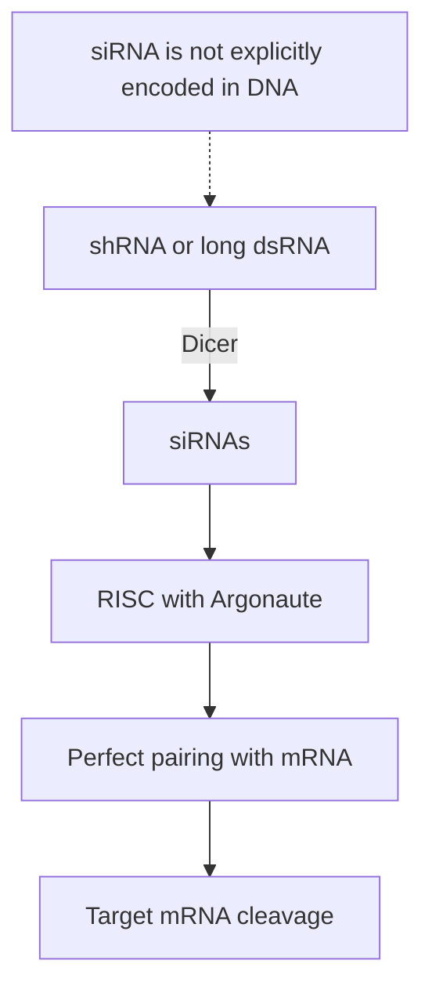

# Small interfering RNA

## Definition

A small interfering RNA (siRNA) is a short double-stranded [[non-coding-rna]] that pairs
**fully complementarily** with a target mRNA and directs its **cleavage**. Unlike
[[microrna]], siRNA is **not explicitly encoded in the DNA** of the cell — it is derived
from long double-stranded RNA or from an introduced short hairpin RNA.

## Why it matters

Perfect complementarity makes siRNAs **highly specific**, which is why siRNA is the
reagent of choice for a deliberate **knockdown**: transfect a sequence, lose one
transcript, see what breaks. It is the reversible counterpart of the permanent
[[gene-knockout]] produced by [[crispr-cas9]], and therefore the only one of the two that
can be used to study **essential genes**.

## Details

### Biogenesis — siRNA-mediated gene silencing

1. **shRNA** (short hairpin RNA) or **long dsRNAs** enter the pathway. The notes stress
   that, unlike miRNA, **siRNA is not explicitly encoded in DNA**.
2. **Dicer** cuts the long double-stranded precursor into short **siRNAs**.
3. The siRNA is loaded into **RISC**, which contains an **Argonaute** protein.
4. RISC finds the mRNA by **perfect base pairing** and Argonaute cleaves it.
5. Result: **target mRNA cleavage**.

### Contrast with miRNA

| | miRNA | siRNA |
|---|---|---|
| Encoded in the genome | yes, as a miRNA gene | **no** |
| Precursor | pri- → pre-miRNA hairpin | long dsRNA or shRNA |
| Pairing with target | short **seed** only, imperfect | **perfect complementarity** |
| Binding region | 3′ UTR | anywhere along the transcript |
| Effect | translational repression / decay | **cleavage** |
| Specificity | low — hundreds of targets | **high** |

The two pathways share Dicer and Argonaute; they differ in where the precursor comes from
and in how strictly the target has to match.

## Diagram

The siRNA-mediated silencing pathway of p. 2, ending in cleavage rather than repression.

## Relations

- [[non-coding-rna]] — the class it belongs to.
- [[rna-interference]] — the process; siRNA is its perfectly complementary branch.
- [[microrna]] — the sibling species, with the opposite trade-off between breadth and
  specificity.
- [[gene-knockout]] — siRNA gives the *knockdown*, the reversible version.
- [[crispr-cas9]] — the permanent alternative, compared point by point there.
- [[mirna-target-prediction]] — unnecessary for siRNA, because the match is exact; this
  is exactly why miRNA prediction is hard.

## Appears in

- [[M2L09-non-coding-rnas]]
- [[M2E09-non-coding-rnas-and-sponge]]

## Sources

- `raw/module2/csb_4.pdf`, p. 1 — fully complementary pairing with mRNA.
- `raw/module2/csb_4.pdf`, p. 2 — shRNA/long dsRNA → Dicer → siRNA → RISC/Argonaute →
  cleavage; "siRNA not explicitly encoded in DNA"; "siRNAs are highly specific".
- `raw/module2/csb_4.pdf`, p. 10 — the miRNA/siRNA contrast (exercise).
