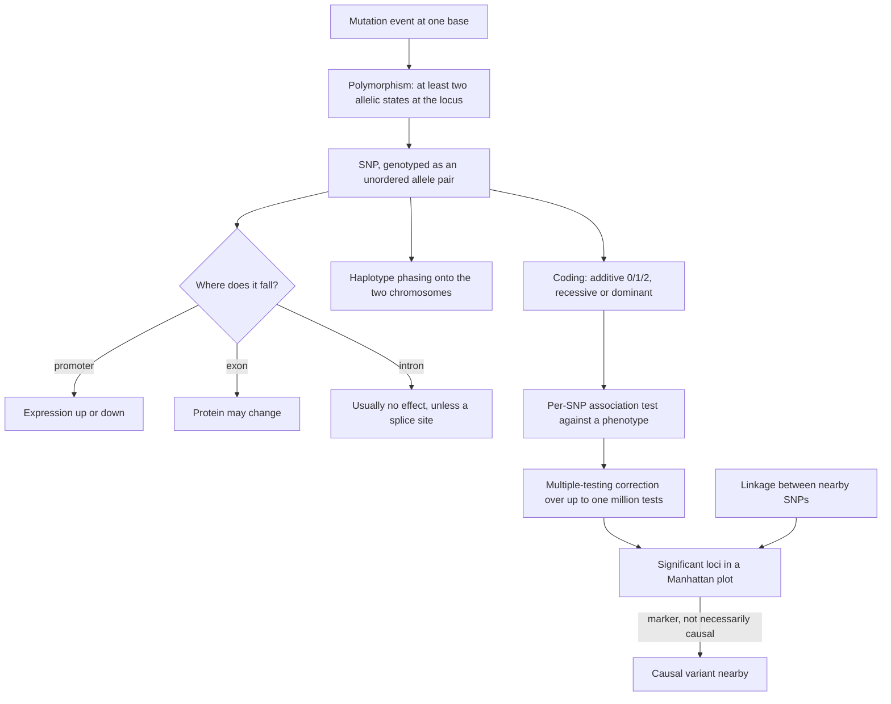

# SNP

## Definition

A **SNP** — **single-nucleotide polymorphism** (Einzelnukleotid-Polymorphismus) — is a
locus at which a **single base differs between individuals** of a population. It is the
single-base case of a **polymorphism**: the presence of at least two allelic states at a
specific locus, where one of the alleles can be traced back to a **mutation event**.

## Why it matters

SNPs are the unit in which human genetic variation is measured. They are what a
[[genome-wide-association-study|GWAS]] tests against a phenotype, what an
[[expression-qtl|eQTL]] scan tests against expression, what
[[haplotype-phasing]] has to assign to chromosomes, and what makes
[[multiple-testing-correction]] mandatory — a scan of a million of them at `α = 0.05`
yields ~50,000 false positives on its own.

## Details

**Vocabulary it sits in** ([[population-genetics]])

- **Allele** — one of the different variants of a gene at a particular position on a
  chromosome; **allele frequency** is its relative frequency in the population.
- **Locus** — a fixed position on the chromosome.
- **Genotype** — the pair of alleles carried at a locus: **homozygous** (`AA`, `aa`) or
  **heterozygous** (`aA`); humans are **diploid**, with 22 autosome pairs plus XY or XX.
- A [[dna-mutation|mutation]] that persists in a population becomes an allele; a
  single-base one becomes a SNP.

**Genotype coding in an association study**

Each SNP is encoded per individual as a number, and the encoding *is* the genetic model
being tested:

| genotype | additive | recessive | dominant |
|---|---|---|---|
| homozygous **major** allele (`G/G`) | 0 | 0 | 0 |
| **heterozygous** (`A/G` or `G/A`) | 1 | 0 | 2 |
| homozygous **minor** allele (`A/A`) | 2 | 2 | 2 |

The additive model is the default but is blind to a heterozygote-specific risk: a
**Cochran–Armitage** trend test fits a line through the three genotypic risk estimates
and tests for zero slope, and a raised risk in heterozygotes alone produces no slope.

**Linkage**

SNPs in proximity are very often **correlated** — knowing `x = A` makes `y = G`
predictable. The causes given in the notes are that evolution has not had enough time to
break up the association and that some recombinations are lethal. Two consequences:

- **Only one SNP per region of strong linkage is needed**, which is why chips carrying
  ~600,000–~2,500,000 sites are sufficient for three billion bases.
- **Association is not causation**: the significant SNP is usually a *marker* for the
  causal variant, not the causal variant itself.

**Where a SNP falls decides what it does**

| Location | Consequence |
|---|---|
| [[promoter]] | alters transcription-factor binding → expression up or down; this is the typical mechanism of a cis-[[expression-qtl\|eQTL]] |
| **Exon** | may change an amino acid, or create a premature stop codon ([[genetic-code]]) |
| **Intron** | usually no effect, unless a splice site is hit ([[splicing]]) |

Most disease-associated variants found by GWAS are not in coding sequence; they change
*how much* of a gene is made.

**Quality control and confounders**

- Deviation from [[hardy-weinberg-equilibrium]] at a locus is a standard QC filter —
  in practice usually a genotyping artefact rather than an evolutionary signal.
- **Population structure**: if cases and controls are drawn from different subpopulations
  `P1` and `P2`, any SNP that merely differs in frequency between them looks associated.
  Remedies: match the backgrounds, remove SNP positions known for ethnic differences, and
  correct statistically with [[principal-component-analysis]].
- SNPs in strong linkage are correlated tests, which makes the Benjamini–Hochberg bound
  conservative ([[multiple-testing-correction]]).

**Phasing**

Genotyping reports the **unordered** allele pair at each SNP. Only heterozygous sites are
ambiguous, and `h` of them admit `2^h` labelled assignments to the two chromosomes —
resolved by trio or population data in [[haplotype-phasing]].

The reference resource named in the notes is the **1000 Genomes Project**, whose goal is
to identify genetic causes of disease.

## Diagram

A SNP's life cycle: from one mutation event, through genotype coding and testing, to a hit that is a marker rather than a cause.

## Relations

- [[population-genetics]] — supplies alleles, loci, genotypes and linkage.
- [[dna-mutation]] — a SNP is a persisting single-base mutation.
- [[genome-wide-association-study]] — SNPs are the variants it tests, one at a time.
- [[expression-qtl]] — the same design with expression as the phenotype; a cis-eQTL SNP is usually regulatory.
- [[hardy-weinberg-equilibrium]] — deviation at a SNP is a routine QC filter.
- [[haplotype-phasing]] — heterozygous SNPs are exactly the ambiguous positions it resolves.
- [[multiple-testing-correction]] — a million SNP tests make correction unavoidable.
- [[principal-component-analysis]] — corrects the population structure that fakes SNP associations.
- [[promoter]] — a regulatory SNP acts by changing transcription-factor binding there.
- [[genetic-code]] — decides whether an exonic SNP is synonymous or protein-changing.
- [[splicing]] — the exception that makes an intronic SNP consequential.
- [[epigenome-wide-association-study]] — the same study design with methylation levels instead of SNP genotypes.
- [[transition-and-transversion]] — most human SNPs are transitions, for the same chemical reason the lecture gives.

## Appears in

- [[L14-population-genetics]]
- [[L15-gwas-eqtl-and-multiple-testing]]

## Sources

- `raw/module1/gsb_3.pdf`, pp. 20, 22–23 — allele, locus, genotype, SNP, linkage and
  population structure.
- `raw/module1/gsb_3.pdf`, pp. 25–28 — SNP chips, genotype coding, the single-SNP tests,
  and polymorphism traced back to a mutation event.
- `raw/module1/gsb_part1.pdf`, pp. 10–11 — the effect of a single-base change by genomic
  compartment.
- Consolidated from [[population-genetics]], [[dna-mutation]],
  [[genome-wide-association-study]], [[expression-qtl]], [[haplotype-phasing]] and
  [[multiple-testing-correction]]; see those pages for the original `raw/` page
  references.
