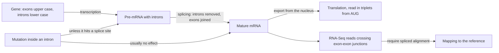

# Splicing

## Definition

**Splicing** (Spleißen) is the processing step that removes the **introns** (Introns)
from a eukaryotic pre-mRNA and joins the remaining **exons** into a continuous mature
mRNA. It sits between transcription and translation in the [[central-dogma]] and happens
inside the nucleus, before the mRNA is exported.

## Why it matters

Splicing is what makes the eukaryotic transcript differ from the gene that produced it.
Everything downstream inherits that difference: the [[genetic-code]] is applied to the
*spliced* sequence, a mutation's consequence depends on whether it falls in a retained or
a removed segment, and read mapping in [[rna-seq]] must be **spliced** because reads
cross exon–exon junctions. Bacteria have almost no introns, which is why prokaryotic
analysis does not need any of this ([[genome-organization]]).

## Details

**Exons and introns**

- **Exons** are retained in the mature mRNA; **introns** are spliced out.
- A eukaryotic transcription unit reads [[promoter]] — RNA-coding sequence (exons and
  introns) — terminator.
- In the notes, intron boundaries are written as **lower-case** sequence between
  **upper-case** exons.

**The rule applied**

```text
DNA (coding strand):  5'...CAAGAT...G  gtaag....g  GAT...3'
after splicing:           ...CAAGAT...G           GAT...
mRNA:                 5'...CAAGAU...G             GAU...3'
```

Two separate rules are chained here: splicing (introns removed, exons joined) and the
transcription rule `T → U`. The resulting mature mRNA is then read in triplets from `AUG`
until the first in-frame stop codon — the worked exercise in
[[E01-cell-biology-and-gene-expression]].

**Where splicing puts a mutation's consequence**

| Location | Effect |
|---|---|
| [[promoter]] | changes transcription-factor binding → expression up or down |
| **Exon** | may change the amino-acid sequence of the protein |
| **Intron** | usually no effect — the segment is removed anyway — **unless a splice site is hit** |

The splice site is therefore the one place where an intronic change is *not* harmless:
removing or shifting the boundary changes which sequence survives into the mature mRNA.
See [[dna-mutation]].

**Why it also matters computationally**

- An RNA-Seq read that maps half to the end of exon 2 and half to the start of exon 3
  can only be placed by **spliced alignment**; an ungapped mapper would discard it and
  bias junction coverage downwards ([[rna-seq]]).
- Spliced read alignment is accordingly a fixed stage of the RNA-Seq pipeline:
  raw data → quality control → **spliced read alignment** → transcript reconstruction →
  differential expression ([[L06-expression-profiling]]).
- Transcript reconstruction from short reads is itself an assembly problem.
- A genome whose genes are split this way is harder to work with than a gene-dense
  bacterial genome: *E. coli* has ≈ 3200 genes on 4.6 Mbp with almost no introns, whereas
  a human gene spans 1148 bp to 37.7 kb.

## Diagram


Splicing turns a gene into a different, shorter message — which is why both translation and read mapping have to be aware of it.

## Relations

- [[central-dogma]] — splicing is the step between transcription and translation.
- [[genome-organization]] — defines the exons and introns that splicing acts on, and the near absence of introns in bacteria.
- [[genetic-code]] — is applied to the spliced, mature mRNA, not to the gene.
- [[promoter]] — the element that initiates the transcript later spliced.
- [[dna-mutation]] — intronic mutations are usually silent unless a splice site is hit.
- [[rna-seq]] — needs spliced read alignment because reads span junctions.
- [[sequence-alignment]] — the gapped alignment machinery that spliced mapping builds on.
- [[snp]] — a single-base variant at a splice site is the exception to "intronic variants are harmless".
- [[single-cell-rna-seq]] — isoform and splicing questions are on the lecture's wish list for single-cell resolution.

## Appears in

- [[L01-bioinformatics-and-the-cell]]
- [[L02-gene-expression-and-regulation]]
- [[L06-expression-profiling]]
- [[E01-cell-biology-and-gene-expression]]
- [[M2L09-non-coding-rnas]] — module 2 revisits splicing as the origin of lncRNAs and circRNAs.

## Sources

- `raw/module1/gsb_part1.pdf`, pp. 2–3, 10–11 — exons and introns, the splicing example
  and the mutation-by-location table.
- `raw/module1/gsb_part1.pdf`, p. 26 — RNA-Seq and the need for spliced read alignment.
- Consolidated from [[central-dogma]], [[genome-organization]], [[dna-mutation]],
  [[rna-seq]] and [[E01-cell-biology-and-gene-expression]]; see those pages for the
  original `raw/` page references.
