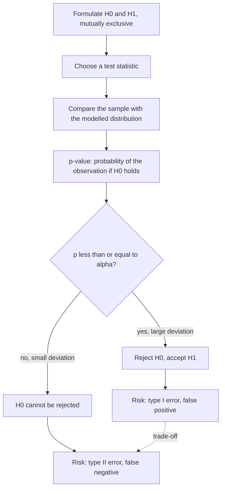

# Statistical Testing

## Definition

**Statistical testing** decides, on the basis of a sample, whether an observed deviation
from an assumed state of the world is large enough to be taken seriously. A
**hypothesis** is a statement that can be tested; a **test** is an experiment returning
true or false; a **statistical hypothesis** is one for which a *probability* of being
true or false can be given.

## Why it matters

Every differential-expression result, every biomarker claim and every screening test is
a test decision. The vocabulary on this page — `H₀`, `H₁`, type I and type II error,
p-value, significance level — is exactly what turns a difference in means into a
defensible statement.

## Details

**The two hypotheses**

- **Alternative hypothesis** `H₁` (also `H_A`) — the effect one wants to demonstrate.
- **Null hypothesis** `H₀` — its opposite, the "nothing is going on" statement.
- `H₀` and `H₁` are **mutually exclusive**.

Example from the notes:

```text
H1: mice treated with drug X live longer   →  E(T_X) >  E(T_untreated)
H0: they do not live longer                →  E(T_X) ≤  E(T_untreated)
```

One tests whether `H₀` can be **rejected** so that `H₁` may be accepted. Note the
asymmetry: a small deviation means `H₀` *cannot be rejected* — it does **not** mean `H₀`
is true.

**Principle of statistical testing**

1. Find a **test statistic**: a function modelling the distribution
   ([[probability-distribution]]).
2. Compare the observed values in the sample with that distribution.
3. **Test decision**: large deviation → reject `H₀`, accept `H₁`; small deviation → `H₀`
   cannot be rejected and `H₁` cannot be accepted.

**Errors**

A wrong decision can arise because the sample size is too small, because the sample
incidentally is not representative of the population, or because a test assumption is not
met.

| | Reality true | Reality false |
|---|---|---|
| **Measured true** | TP | **FP — type I error** |
| **Measured false** | **FN — type II error** | TN |

- **Type I error** — `H₁` falsely accepted → **false positive**.
- **Type II error** — `H₁` falsely rejected → **false negative**.
- Reducing the type I error **increases** the type II error, and vice versa.

```text
sensitivity = TP / (TP + FN)        // of all real positives, how many are found
specificity = TN / (TN + FP)
accuracy    = (TP + TN) / n
```

**p-value**

- The **p-value is the probability of a type I error (a false positive)**: the
  probability of an observed result assuming that the null hypothesis is true.
- Graphically: under the density of possible results, the observed data point sits
  somewhere on the axis; the p-value is the tail area beyond it — the probability of
  seeing something at least as extreme.

**Significance level α** — the cut-off p-value.

- `p ≤ α`: the deviation from `H₀` is significant at significance level `α` → **reject
  `H₀`**.
- `p > α`: the deviation is not significant at level `α` → **cannot reject `H₀`**.
- Usually `α = 0.05`, equivalently a confidence level of `1 − α`.
- `α` limits the type I error: small `α` → fewer FP but more FN; large `α` → more FP but
  fewer FN.

**One-sided versus two-sided**

- **One-sided hypothesis** — deviations in **one** direction are considered; the whole
  rejection region of size `α` sits in a single tail (which tail depends on the direction
  of `H₁`).
- **Two-sided hypothesis** — deviations in **both** directions are considered; the
  rejection region is split between the two tails.

## Diagram


The test workflow and the unavoidable trade-off between the two error types.

## Relations

- [[descriptive-statistics]] — supplies the sample summaries a test statistic is built
  from.
- [[probability-distribution]] — the reference distribution of the test statistic.
- [[qq-plot]] — checks the distributional assumption a test relies on.
- [[microarray-expression-analysis]] — the "statistical testing" stage of the expression
  pipeline is exactly this.
- [[rna-seq]] — count data are tested the same way, on a different distribution.
- [[multiple-testing-correction]] — what has to happen to `α` once thousands of tests are
  run at once; under `H₀` p-values are uniformly distributed, so a fraction `α` of them
  is significant by chance.
- [[position-weight-matrix]] — its score threshold is chosen from a background
  distribution exactly as a p-value cutoff.
- [[genome-wide-association-study]] — up to a million simultaneous test decisions.

- [[peak-calling]] — each candidate window is a hypothesis test against a local Poisson
  null.
- [[bisulfite-sequencing]] — the per-site test inside a differentially-methylated-region
  scan.
- [[baum-welch-algorithm]] — likelihood and the negative log likelihood, the same
  machinery seen from the model-fitting side.
- [[blast]] — its E-value is a significance statement of the same kind as a p-value.
- [[data-normalization]] — log-transforms skewed data so that the distributional
  assumption of a test actually holds.
- [[z-score]] — the standardized deviation on which the test decision of step 3 is
  taken.
- [[fishers-exact-test]] — the first fully specified test statistic in these notes: an
  exact test for a 2×2 contingency table, used throughout module 2 for enrichment.
- [[enrichment-analysis]] — applies a per-gene test first, then a second test on the
  resulting overlap.
- [[gene-set-enrichment-analysis]] — replaces the threshold with a permutation-based
  empirical p-value.
- [[keypathwayminer]] — "apply the statistics of choice" is step 1 of its pipeline.

> Module 2 supplies the concrete tests that module 1 described only in the abstract: a
> **t-test** to rank genes in a two-class design, a **Pearson correlation** to rank them
> against a quantitative phenotype, and [[fishers-exact-test]] to test an overlap.
- [[expectation-maximization]] — maximum-likelihood estimation under incomplete data;
  the same likelihood machinery, used for estimation rather than testing.
- [[roc-curve]] — what the confusion matrix becomes once the cutoff is swept instead of fixed.
- [[f-measure]] — combines precision and recall into one number, the counterpart of sensitivity/specificity used for clusterings.
- [[machine-learning]], [[cross-validation]] — a classifier's error estimate is a test statistic too, and must be computed on data the model has not seen.
- [[kaplan-meier-plot]] — the survival curves of module 2 come with a p-value from exactly this machinery.
- [[single-cell-analysis-workflow]] — differential expression testing is the gene-level downstream step.
- [[bootstrap-tree-assessment]] — branch support as a resampling-based confidence statement.
- [[droplet-based-single-cell-methods]] — the Poisson model behind the capture and duplication rates.
- [[activation-function]] — the sigmoid is the logistic link, shared with logistic regression.
- [[rna-interference]] — statistical analysis is a core task of genome-wide RNAi screening.
- [[mutual-information]] — an information-theoretic dependence measure whose significance needs permutation testing.
- [[sensitivity-correlation]] — replaces permutation tests with a simulated, reusable null model.
- [[sponge]] — null-model-based significance analysis on a genome-wide scale.
- [[maximum-likelihood]] — likelihood is the shared currency of likelihood-based testing and of model selection.

## Appears in

- [[L10-biostatistics-and-statistical-testing]]
- [[L12-binding-sites-and-position-weight-matrices]]
- [[L15-gwas-eqtl-and-multiple-testing]]
- [[L16-epigenetics]]
- [[E08-test-errors-and-z-score]]
- [[M2L01-enrichment-analysis]]
- [[M2L03-machine-learning-and-classification]]
- [[M2L09-non-coding-rnas]]
- [[M2E09-non-coding-rnas-and-sponge]]

## Sources

- `raw/module1/gsb_part2.pdf`, pp. 25–29.
- `raw/module1/gsb_3.pdf`, pp. 8, 29–30 — the p-value as a score threshold, and the
  multiple-testing problem with FWER and FDR.
- `raw/module1/gsb_part4.pdf`, pp. 6, 8, 16 — the p-value threshold of peak calling, the
  DMR significance criterion, and the likelihood scores of HMM training.
- `raw/module2/csb_1.pdf`, pp. 4–6 — the t-test and Pearson correlation as ranking
  statistics, and Fisher's exact test as the threshold-dependent enrichment test.

- `raw/module2/csb_4.pdf`, pp. 3, 6–9 — permutation p-values, Fisher's method, and the SPONGE null model.
