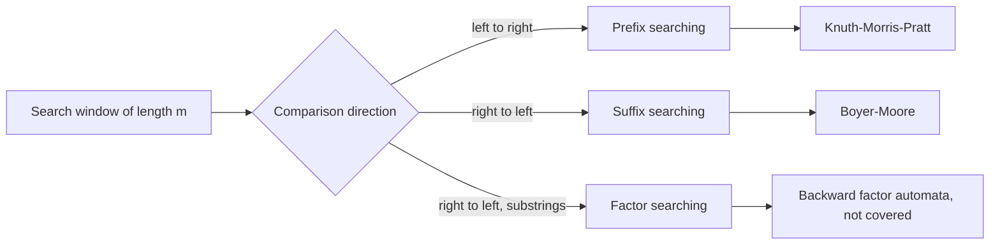

# String Matching

## Definition

**Exact string matching** is the problem of deciding whether a pattern `p` of length `m`
occurs inside a text (target) `t` of length `n`, and of reporting the position(s) at
which it occurs.

## Why it matters

Sequence data *is* string data. Patterns act as recognition elements in biological
processes: a transcription factor binds a short DNA pattern, a restriction enzyme cuts at
a specific site, a primer anneals to its complement. Locating every occurrence of such a
pattern in a genome of `3 · 10⁹` characters is a pure string-search problem, and the
naive solution is too slow at that scale (see [[algorithmic-complexity]]).

## Details

**Vocabulary**

For a string `P = P[1..m]`:

| Term | Meaning | Example in `ABCAB` |
|---|---|---|
| **prefix** | starts at position 1 | `A`, `AB`, `ABC`, … |
| **suffix** | ends at position `m` | `B`, `AB`, `CAB`, … |
| **factor** | any contiguous substring | `BCA`, `CA`, `B`, … |

**The search window**

All algorithms slide a window of length `m` along the text. They differ in the direction
in which the window is compared and in how far the window may jump after a mismatch.

**Four search paradigms**

1. **Brute force** — compare the window left to right at every offset. Time `O(m · n)`;
   the worst case is a repetitive text such as `t = xxxx…x` against `p = xxxy`.
2. **Prefix searching** — scan left to right; on a mismatch, shift so that the longest
   suffix of the matched part of the window that is also a prefix of the pattern lines up.
   This is what [[knuth-morris-pratt]] precomputes in its failure function.
3. **Suffix searching** — scan the window right to left, matching a suffix of the window
   against a suffix of the pattern. Characters of the text may be skipped without ever
   being read, so the search can be **sub-linear on average**. This is
   [[boyer-moore-string-search]].
4. **Factor searching** — also backwards, but using the longest suffix of the window that
   is also a *factor* of the pattern. More information per step, more preprocessing.

**Why exact matching is not enough**

Biological sequences diverge by substitutions, insertions and deletions
([[dna-mutation]]). An exact matcher reports nothing for a motif that differs in a single
base. The practical answer is approximate comparison — [[sequence-alignment]], and its
semi-global variant in particular, which is explicitly described in the notes as
"approximate pattern matching".

## Diagram

The three informed paradigms and the algorithms of this course that implement them.

## Relations

- [[knuth-morris-pratt]] — the prefix-searching algorithm.
- [[boyer-moore-string-search]] — the suffix-searching algorithm.
- [[boyer-moore-majority-vote]] — a *different* algorithm by the same authors; it finds a
  majority element in an array and has nothing to do with string search.
- [[sequence-alignment]] — the approximate successor to exact matching.
- [[algorithmic-complexity]] — the cost model used throughout.
- [[gene-regulation]] — transcription-factor binding sites are the biological patterns.
- [[suffix-tree]] and [[suffix-array]] — the **factor-searching** paradigm: they
  preprocess the *text* instead of the pattern.
- [[transcription-factor-binding-site]] — degenerate, so exact matching has to give way
  to the probabilistic [[position-weight-matrix]].
- [[promoter]] — a promoter is a cluster of such tolerant sites, which is why exact
  search is the wrong tool for finding one.

- [[planted-motif-problem]] — the approximate, unknown-pattern version: the pattern itself must be found.
- [[sequence-motif]] — why exact matching is insufficient for biological patterns.
- [[crispr-cas9]] — guide RNA targeting is exact matching adjacent to a spacer; off-targets are approximate matches.
- [[mirna-target-prediction]] — seed matching is short-pattern matching, which is why it is so unspecific.

## Appears in

- [[L08-exact-string-matching]]
- [[L12-binding-sites-and-position-weight-matrices]]
- [[L13-suffix-trees-and-arrays]]
- [[E05-kmp-string-matching]]
- [[E06-boyer-moore-string-search]]
- [[E10-suffix-trees-and-arrays]]
- [[M2L02-sequence-motifs-and-motif-discovery]] — module 2 relaxes exact matching into the approximate [[planted-motif-problem]].
- [[M2L09-non-coding-rnas]] — miRNA seed matching in module 2 is exact string matching on a 7-mer.

## Sources

- `raw/module1/gsb_part2.pdf`, pp. 1, 9.
- `raw/module1/gsb_3.pdf`, pp. 5, 13–15 — degenerate binding sites and the suffix-based
  factor search.

- `raw/module2/csb_4.pdf`, pp. 3–5 — guide RNA matching and seed matching.
