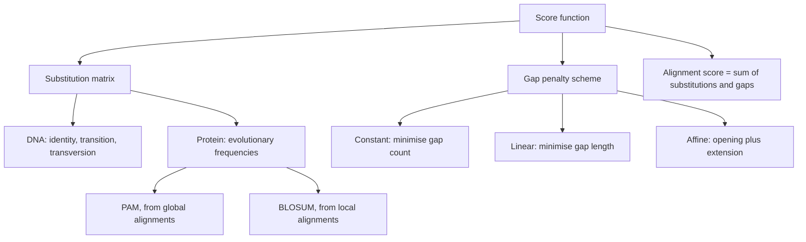

# Substitution Matrix and Gap Penalties

## Definition

A **substitution matrix** is an `N × N` matrix whose entry `r(a, b)` scores the
"goodness" of aligning residue `a` with residue `b`. Together with a **gap penalty**
scheme it forms the **score function** that every alignment algorithm maximises.

## Why it matters

[[needleman-wunsch]] and [[smith-waterman]] are only as good as the scores they are fed.
The matrix is where biology enters an otherwise purely combinatorial algorithm: it
encodes which substitutions evolution actually tolerates — i.e. **conservation** in the
sense of [[homology]] — and the gap scheme encodes how likely insertions and deletions
are ([[dna-mutation]]).

## Details

**DNA matrices**

Small and essentially chemical. The example used in the notes:

| | C | T | A | G |
|---|---|---|---|---|
| **C** | 2 | 1 | −1 | −1 |
| **T** | 1 | 2 | −1 | −1 |
| **A** | −1 | −1 | 2 | 1 |
| **G** | −1 | −1 | 1 | 2 |

`+2` on the diagonal (identity), `+1` for a **transition** (purine↔purine A/G or
pyrimidine↔pyrimidine C/T, chemically easy and therefore common) and `−1` for a
**transversion**.

**Protein matrices**

`20+ × 20+` entries, **evolutionary** rather than chemical: they are built from observed
amino-acid substitution frequencies in curated alignments.

| Family | Derived from |
|---|---|
| **PAM** (Point Accepted Mutation) | **global** alignments of closely related sequences |
| **BLOSUM** (BLOcks SUbstitution Matrix) | **local** alignments of conserved blocks |

**Gap penalties**

| Scheme | Cost of a gap of length λ | Effect |
|---|---|---|
| **constant** | the same for every gap, regardless of length | minimise the **number** of gaps |
| **linear** | `g · λ` | minimise the **total gap length** |
| **affine** | `g = o + (λ − 1) · e`, with opening `o < 0` and extension `e < 0`, `|o| > |e|` | one long gap is preferred over many short ones |

Affine penalties are the biological default: a single indel event can remove many
residues at once, so a long gap should not cost proportionally more than a short one.

**Alignment score**

The score of an alignment is the sum of all substitution scores plus all gap penalties.
It reflects the quality of the alignment, and it is the quantity whose statistical
significance [[blast]] reports as an E-value.

## Diagram

The two halves of a score function and the variants of each.

## Relations

- [[needleman-wunsch]], [[smith-waterman]] — consume this score function.
- [[sequence-alignment]] — the general framework.
- [[homology]] — conservation is exactly what the matrix rewards.
- [[blast]] — chooses a default matrix (BLOSUM62) and gap parameters per program.
- [[dna-mutation]] — the biological events behind substitutions and gaps.
- [[position-weight-matrix]] — the motif analogue: both score a sequence as a sum of
  **log-odds** terms against a background model.
- [[dynamic-programming]] — supplies the local score `r(a,b)` and gap penalty that the
  alignment recursion combines in every cell.
- [[genetic-code]] — its redundancy is why amino-acid substitution scoring carries more
  information than DNA scoring.

- [[information-content]] — the same log-ratio-against-a-background construction, measured in bits.
- [[sequence-logo]] — displays a per-position version of that comparison.
- [[jukes-cantor-model]], [[kimura-two-parameter-model]] — the mechanistic counterparts: a rate matrix `Q` derived from assumptions rather than counted from alignments.
- [[evolutionary-distance]], [[transition-and-transversion]], [[molecular-evolution]] — PAM and BLOSUM absorb the transition/transversion asymmetry empirically.
- [[graphlet-degree-signature-distance]] — plays the same role in network alignment that a substitution score plays in sequence alignment: how well does this pair match?
- [[phylogenetic-tree-reconstruction]] — the module-1 scoring model whose evolutionary assumptions become explicit substitution models here.

## Appears in

- [[L05-sequence-comparison-and-networks]]
- [[L09-sequence-alignment-and-homology]]
- [[E07-alignment-and-homology]]
- [[M2L08-molecular-evolution-and-phylogeny]] — module 2 makes the evolutionary model behind the matrix explicit as a rate matrix.

## Sources

- `raw/module1/gsb_part2.pdf`, pp. 15–16.
- `raw/module1/gsb_3.pdf`, pp. 6–7 — log-odds scoring against a background model.

- `raw/module2/csb_4.pdf`, p. 16 — pairScore and graphlet degree signature distance.
