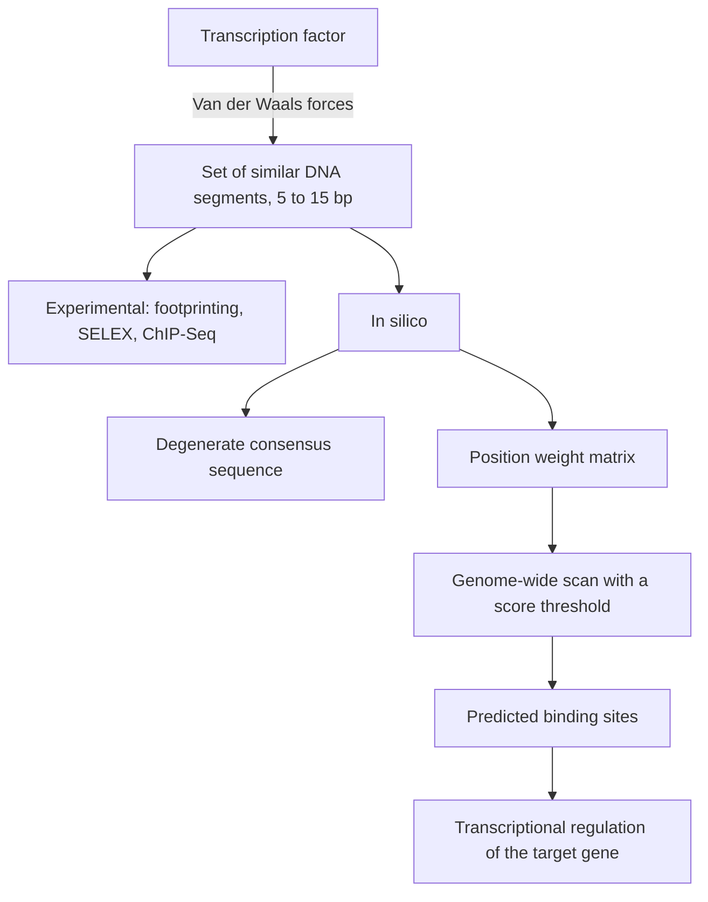

# Transcription Factor Binding Site

## Definition

A **transcription factor binding site (TFBS)** is a segment of DNA sequence that a
transcription factor (TF) binds to. Binding is mediated by Van der Waals forces
(Van-der-Waals-Kräfte) between the protein and the bases; a given TF binds not one exact
word but a **set of similar segments**.

## Why it matters

All biological functions of DNA are realized by the interaction of proteins with specific
DNA sequences. The notes list three classes:

1. **Gene expression** by RNA polymerase and the associated transcription factors.
2. **Genome re-arrangements** by site-specific recombination and transposition.
3. **Restriction and modification** of DNA by sequence-specific endonucleases.

The first of these is [[gene-regulation]]: finding the binding sites means finding the
control panel of the genome.

## Details

**Properties of TFBSs**

- **Short** — typically 5–15 bp.
- **Degenerate** — a TF tolerates variation; the *degree* of sequence degeneracy produces
  **different levels of regulation**, i.e. a weaker match means weaker binding and weaker
  regulation.
- Because they are short and inexact, exact [[string-matching]] is the wrong tool; a
  probabilistic model is needed.

**The task: predict TFBSs**

*Experimental approaches*

- **Traditional footprinting** — protect the bound region from digestion and read where
  the protein sat.
- **High-throughput SELEX** — systematic evolution of ligands by exponential enrichment;
  select bound oligonucleotides from a random pool.
- **[[chip-seq]]** — the genome-wide variant used elsewhere in this module.

*In silico approaches*

- Identify further candidate target TFBSs from known ones.
- **Degenerate consensus sequences** — one string with ambiguity codes; crude, because it
  throws away how *strongly* each position is preferred.
- **Position Weight Matrix (PWM)** / **Position-Specific Scoring Matrix (PSSM)** — the
  quantitative representation, see [[position-weight-matrix]].

## Diagram

From a protein that tolerates variation to a scored genome-wide prediction of its sites.

## Relations

- [[gene-regulation]] — promoters, operators and enhancers are built from binding sites.
- [[position-weight-matrix]] — the model used to represent and search for TFBSs.
- [[chip-seq]] — the experimental method that locates occupied sites genome-wide.
- [[string-matching]] — exact matching is insufficient because sites are degenerate.
- [[suffix-tree]] — the index that makes a genome-wide PWM scan fast.

- [[peak-calling]] — the computational step that converts ChIP-Seq reads into the
  candidate sites, in narrow-peak mode.
- [[atac-seq]] — open regions are where binding sites are actually usable; motif scanning
  of its peaks assigns factors to them.
- [[promoter]] — promoters are assembled from clusters of these short degenerate sites.
- [[expression-qtl]] — a cis-eQTL is often a variant sitting inside such a site.
- [[sequence-motif]] — the general notion of which a binding site is the archetype;
  module 2 builds its whole motif-discovery apparatus on it.
- [[gene-knockout]] — the experiment that produces candidate sequences: knock out the
  factor, take the upstream regions of the genes that change.
- [[em-motif-discovery]] and [[gibbs-sampling]] — the de novo methods that find these
  sites without a known motif.
- [[sequence-logo]] — how a discovered binding-site motif is displayed.
- [[microrna]] — the post-transcriptional counterpart: a short recognition site, usually in the 3′ UTR.
- [[mirna-target-prediction]] — the same accessibility and conservation arguments used for TFBS prediction.

## Module 2: finding sites de novo

Module 1 scanned for binding sites with a **known** [[position-weight-matrix]]. Module 2
asks the harder question: where does the matrix come from? The route is experimental
then computational — [[gene-knockout]] of a transcription factor identifies the genes it
controls, their **upstream sequences** are collected, and a motif-discovery algorithm
([[em-motif-discovery]], MEME, [[gibbs-sampling]]) extracts the shared short pattern.
The difficulties named there are the same ones that make scanning noisy: binding-site
positions vary, the sites are very short, and the signal-to-noise ratio against the
genomic background is bad. See [[M2L02-sequence-motifs-and-motif-discovery]].

## Appears in

- [[L12-binding-sites-and-position-weight-matrices]]
- [[L16-epigenetics]]
- [[E09-binding-sites-pwm-and-pca]]
- [[E12-epigenetics-and-peak-calling]]
- [[M2L02-sequence-motifs-and-motif-discovery]]
- [[M2E02-motif-discovery-and-expectation-maximization]]

## Sources

- `raw/module1/gsb_3.pdf`, p. 5.
- `raw/module1/gsb_part4.pdf`, pp. 4–5, 11 — ChIP as the technique for detecting TF
  binding sites, and MACS2 narrow-peak calling on TF ChIP data.
- `raw/module2/csb_1.pdf`, pp. 14, 17, 23 — motif discovery as the identification of
  binding sites, the knock-out rationale and the difficulties of the task.
- `raw/module2/csb_4.pdf`, pp. 1, 4–5 — miRNA binding sites and the features used to predict them.
