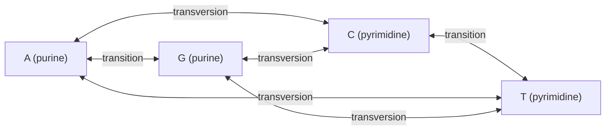

# Transition and Transversion

## Definition

The two types of nucleotide substitution:

- a **transition** exchanges two bases of the **same chemical class** — purine ↔ purine
  (`A ↔ G`) or pyrimidine ↔ pyrimidine (`C ↔ T`);
- a **transversion** exchanges a purine for a pyrimidine or vice versa
  (`A ↔ C`, `A ↔ T`, `G ↔ C`, `G ↔ T`).

**Transitions are more common** than transversions, even though each base has **two**
possible transversions and only **one** possible transition.

## Why it matters

The asymmetry is the whole reason the [[kimura-two-parameter-model]] exists. If all
substitutions were equally likely, the one-rate [[jukes-cantor-model]] would suffice; the
observed excess of transitions forces a second parameter, and therefore a different
distance formula.

## Details

```text
          transition
      A ←──────────────→ G        purines
      ↑ ╲              ╱ ↑
      │   ╲  transv. ╱   │  transversions
      │     ╲      ╱     │
      ↓       ╳        ↓
      T ←──────────────→ C        pyrimidines
          transition
```

Counting over a pair of aligned sequences gives the two quantities the K2P distance is
built from:

```text
P = share of sequence positions that have a TRANSITION
Q = share of sequence positions that have a TRANSVERSION
p = P + Q                         // the total p-distance
```

**Why transitions dominate.** The notes record the fact without a mechanism; the
standard explanation is that purines and pyrimidines differ in size, so a transversion
requires a geometrically more disruptive mispairing, and that the deamination of
5-methylcytosine produces thymine directly — a `C → T` transition. The notes give only
*"transitions are more common"*, so the mechanism is not course content.

**Consequence for distance estimation.** Because transitions saturate faster, two distant
sequences accumulate transversions for longer. A model that ignores the distinction
([[jukes-cantor-model]]) therefore underestimates deep divergences more severely than a
model that separates them.

## Diagram


Transitions stay inside a chemical class; transversions cross between purines and pyrimidines.

## Relations

- [[kimura-two-parameter-model]] — gives transitions rate `α` and transversions rate `β`,
  and estimates the distance from `P` and `Q` separately.
- [[jukes-cantor-model]] — the one-rate model that deliberately ignores the distinction.
- [[evolutionary-distance]] — `p = P + Q` is the p-distance both models correct.
- [[molecular-evolution]] — "acceptance of mutations" and the two substitution types.
- [[dna-mutation]] — module 1's structural classes of mutation; transitions and
  transversions subdivide the point substitutions among them.
- [[substitution-matrix]] — empirical matrices such as PAM and BLOSUM absorb the same
  asymmetry from observed data instead of modelling it.
- [[snp]] — most human SNPs are transitions, for the same reason.
- [[cpg-island]] — methylated CpGs are transition hotspots, which is where the
  asymmetry is strongest in the genome.

## Appears in

- [[M2L08-molecular-evolution-and-phylogeny]]
- [[M2E08-phylogenetics]]

## Sources

- `raw/module2/csb_3.pdf`, p. 27 — acceptance of mutations, the two substitution types,
  the `A G / C T` diagram, and "transitions are more common".
- `raw/module2/csb_3.pdf`, p. 28 — `P` and `Q` as the shares of positions with a
  transition and a transversion, and the Kimura rate matrix.
- `raw/module2/csb_3.pdf`, p. 37 — the exercise matrix with different rates for
  transitions and transversions.
