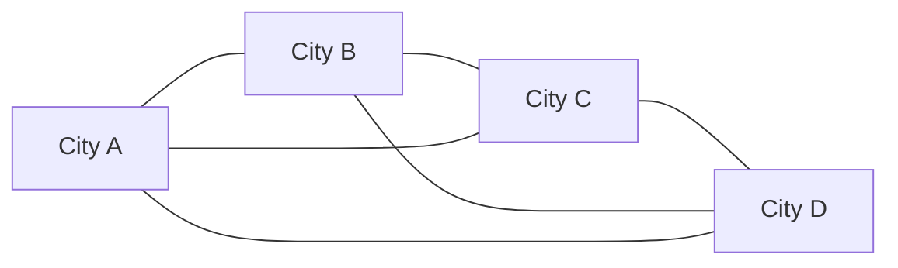

# Travelling salesman problem

## Definition

The travelling salesman problem (TSP) is the problem of **finding the shortest possible
route that visits a set of cities and returns to the starting city, while visiting each
city exactly once**.

## Why it matters

In this module the TSP is the textbook example on which
[[ant-colony-optimization]] is introduced. Its role is to show what a
*combinatorial optimisation* problem looks like: a finite but astronomically large set of
candidate solutions, a cost to minimise, and no way to enumerate them all — so a
metaheuristic that samples good solutions is used instead of an exact algorithm.

## Details

- A route visiting each city once and returning to the start is a **Hamiltonian cycle**
  in the complete graph of cities; the TSP is the optimisation version of the
  Hamiltonian-cycle problem discussed in [[hamiltonian-and-eulerian-paths]].
- There are `(n−1)!/2` distinct tours for `n` cities in the symmetric case, so brute
  force is factorial. The decision version is **NP-complete**, the optimisation version
  **NP-hard** — the same wall that makes overlap-graph [[greedy-assembly]] infeasible as
  an exact method.
- Because an exact solution is out of reach at scale, the practical answer is a
  **metaheuristic**: construct many candidate tours cheaply, keep what works, and bias
  future construction towards it. That is precisely the ant-colony scheme.
- The same shape of problem appears in this module in network enrichment:
  [[keypathwayminer]] searches for maximal connected subnetworks, which is likewise
  intractable to enumerate and is therefore attacked with ant colony optimisation.

## Diagram

Every tour is a Hamiltonian cycle in the complete graph of cities; the TSP asks for the cheapest one.

## Relations

- [[ant-colony-optimization]] — the metaheuristic introduced on this problem.
- [[hamiltonian-and-eulerian-paths]] — the TSP is the weighted optimisation version of
  the Hamiltonian cycle; the Eulerian contrast is what makes
  [[de-bruijn-assembly]] tractable where the Hamiltonian route is not.
- [[algorithmic-complexity]] — supplies the NP-hardness vocabulary.
- [[keypathwayminer]] — the biological optimisation problem that ACO is actually applied
  to in this course.
- [[maximum-parsimony]] — the phylogenetic combinatorial explosion, with the same conclusion: heuristics, not enumeration.
- [[neighbor-joining]] — a greedy heuristic over an intractable space.
- [[network-alignment]] — another NP-hard combinatorial problem attacked with metaheuristics.
- [[evolutionary-algorithm]] — the population-based metaheuristic, alongside ant colony optimisation.

## Appears in

- [[M2L01-enrichment-analysis]]
- [[M2E01-enrichment-analysis-and-keypathwayminer]]

## Sources

- `raw/module2/csb_1.pdf`, p. 9 — named as the example application of ant colony
  optimisation.
- `raw/module2/csb_1.pdf`, p. 11 — exercise definition.

- `raw/module2/csb_4.pdf`, pp. 12, 15 — NP-hardness and evolutionary search.
