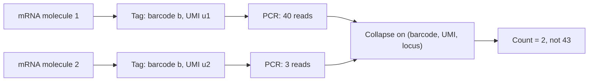

# Unique Molecular Identifier

## Definition

A **unique molecular identifier (UMI)** is a short random barcode attached to each
individual mRNA molecule *before* amplification. **UMIs are used to identify individual
molecules**, so that all the PCR copies of one original transcript can be recognised and
counted once.

## Why it matters

Library preparation amplifies, and amplification is not uniform: one molecule may yield
a hundred reads, another two. Without UMIs a count matrix measures *amplification
efficiency* as much as expression — the exact bias of [[next-generation-sequencing]] met
in module 1, made worse in [[single-cell-rna-seq]] because the starting material from one
cell is tiny and the number of PCR cycles correspondingly large.

Two tags therefore travel with every read:

| Tag | Answers |
|---|---|
| **Cell barcode** | *which cell* did this molecule come from? |
| **UMI** | *which molecule* within that cell was it? |

## Details

**UMI collapsing** *refers to the process of using UMIs to avoid double counting
molecules after sequencing.*

**Naive UMI collapsing** — the rule given in the notes:

> Just count reads that have the **same UMI**, the **same cell barcode**, and whose
> **cDNAs align to the same location**, as a **single event**.

```text
NAIVE-UMI-COLLAPSE(reads):
  seen ← ∅
  M ← 0                                        // the cell × gene count matrix
  for each read r:
    (barcode, umi, locus) ← PARSE-AND-ALIGN(r)
    key ← (barcode, umi, locus)
    if key ∉ seen:
      seen ← seen ∪ { key }
      M[barcode, GENE(locus)] ← M[barcode, GENE(locus)] + 1   // count once
  return M
```

More sophisticated UMI collapsing **allows different locations** — because sequencing
errors in the alignment, or an alternative 3' end, can place reads from the same molecule
at slightly different loci, and the naive rule would then count them twice.

**Error in the UMI itself** is the symmetric problem: a sequencing error turns one UMI
into a neighbouring one and invents a molecule. That is why the UMI pool must be large
relative to the number of molecules per gene per cell — the same **diversity** argument
as in [[barcode-collision]], one level down.

## Diagram


UMIs convert a read count distorted by amplification into a molecule count.

## Relations

- [[single-cell-rna-seq]] — UMIs are what make its count matrix a count of molecules.
- [[droplet-based-single-cell-methods]] — the UMI is added together with the cell
  barcode when the bead's primers are released.
- [[barcode-collision]] — the same uniqueness argument applied to cells rather than
  molecules.
- [[next-generation-sequencing]] — the PCR amplification bias UMIs correct.
- [[rna-seq]] — bulk protocols normalise reads instead, because per-molecule tagging is
  unnecessary at bulk input amounts.
- [[data-normalization]] — UMI counting removes one bias; normalisation across cells
  removes the rest.
- [[single-cell-analysis-workflow]] — count depth, one of the QC covariates, is a UMI
  count per barcode.

## Appears in

- [[M2L07-single-cell-rna-seq]]
- [[M2E07-single-cell-rna-seq-and-dimensionality-reduction]]

## Sources

- `raw/module2/csb_3.pdf`, p. 15 — the definition of UMI collapsing, the naive rule
  (same UMI, same cell barcode, same alignment location), and the note that more
  sophisticated collapsing allows different locations.
- `raw/module2/csb_3.pdf`, p. 21 — the exercise statement that UMIs are used to identify
  individual molecules.
