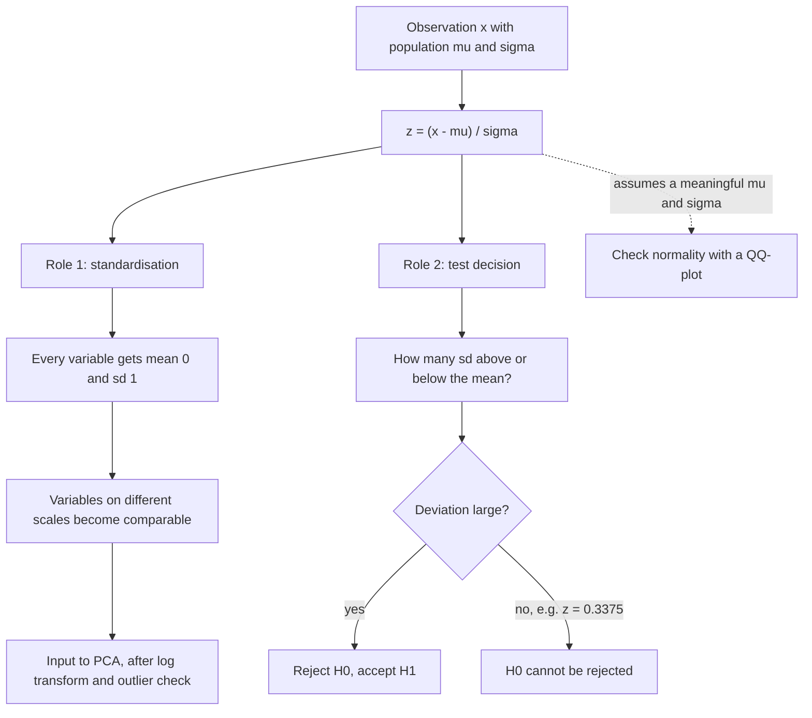

# z-score

## Definition

The **z-score** (**standard score**) is the number of standard deviations by which an
observation deviates from the mean:

```text
z = (x − μ) / σ
```

It is a measure of **relative standing** — where a single value sits within the spread of
its [[probability-distribution|distribution]] — and it is scale-free, so values from
different experiments become directly comparable.

## Why it matters

Omics variables are measured in incompatible units and on incompatible scales: intensities,
counts, concentrations. Expressing each value as a number of standard deviations removes
the unit and makes the values comparable, which is a precondition for
[[principal-component-analysis]] and the standard preprocessing step of
[[data-normalization]]. The same quantity, read against the normal distribution, is what
turns "higher than the mean" into a defensible test decision.

## Details

**Where it comes from**

The z-score is built directly on the two summaries of [[descriptive-statistics]]: the
mean `μ` (central tendency) and the standard deviation `σ` (variability). It belongs to
the third family of descriptors, **relative standing**, alongside quantiles, range and
the IQR.

```text
mean        x̄  = (1/n) · Σ xᵢ
std. dev.   σ  = sqrt( Σ (xᵢ − μ)² / N )
z-score     z  = (x − μ) / σ
```

**Role 1 — standardisation in normalization**

Replacing every value of a variable by its z-score is called **standardizing** or
**normalizing**. After standardization every variable has **mean 0 and standard deviation
1**. Applied to a normal variable, the transform maps it onto the **standard normal
distribution** with `μ = 0`, `σ = 1`.

In the preprocessing chain of [[L11-normalization-pca-and-batch-effects]] it is the second
move, after the log transform:

1. check the shape of the distribution; a **skewed** (e.g. exponential) variable has many
   extreme values far from the mean, and useful tests are hard to run on it;
2. **log transform** a right-skewed variable to pull the tail in;
3. **standardize** with the z-score so that variables on different scales become
   comparable;
4. inspect **outliers**, then feed the matrix to a model or to PCA.

What it does **not** do: standardization rescales values, it does **not** remove a
systematic [[batch-effect]]. A bias correlating with the outcome of interest survives any
rescaling. (The notes do list **standardization** among the batch-correction approaches
alongside PCA, SVD and ComBat, while simultaneously insisting that normalization does not
remove batch effects — the correction there is of the measurement scale, not of the
confounding.)

**Role 2 — the test decision in E08**

In [[E08-test-errors-and-z-score]] the same formula is used inferentially. A population
has `μ = 60` and `σ = 8`; a sample of `n = 25` people has a measured mean of `62.7`:

```text
z = (x̄ − μ) / σ = (62.7 − 60) / 8 = 0.3375
```

With `H₁`: smokers have a higher health-problem score, and `H₀`: they do not, the sample
mean lies only `0.3375` standard deviations above the population mean. The deviation is
small, so `H₀` cannot be rejected — in the wording of the sheet, **accept `H₀`, reject
`H₁`**. This is step 3 of the testing principle in [[statistical-testing]]: a large
deviation rejects `H₀`, a small one does not.

The takeaway recorded there: a z-score below `1` is unremarkable under a normal
distribution — **"higher than the mean" is not the same as "significantly higher"**.

**Pitfalls**

- The transform assumes a meaningful `μ` and `σ`. On a **skewed** variable both are
  dominated by the tail, which is why the log transform comes first; on a **bimodal**
  variable a single mean is misleading altogether.
- **Outliers** inflate `σ` and shift `μ`, shrinking everyone else's z-score.
- Interpreting `z` as a significance statement requires the normality assumption to
  actually hold — checkable with a [[qq-plot]], where a straight line indicates symmetry
  and a convex or concave curve a right or left skew.
- `σ` is the spread of the data, not the precision of the mean; the latter is
  `SEM = σ/√n`.

## Diagram


One formula, two uses: rescaling a variable for modelling, and locating an observation under the normal curve for a test decision.

## Relations

- [[descriptive-statistics]] — defines the mean and standard deviation the z-score is built from and lists it under relative standing.
- [[data-normalization]] — standardizing by z-score is the normalization step itself, applied after the log transform.
- [[probability-distribution]] — the z-score maps a normal variable onto the standard normal distribution with `μ = 0`, `σ = 1`.
- [[statistical-testing]] — the z-score is the deviation that the test decision in step 3 is taken on.
- [[qq-plot]] — checks the normality assumption that makes a z-score interpretable.
- [[principal-component-analysis]] — consumes the scaled vectors standardization produces.
- [[batch-effect]] — the systematic bias that standardizing values does not remove.
- [[microarray-expression-analysis]] — normalisation is a named stage of that pipeline.

## Appears in

- [[L10-biostatistics-and-statistical-testing]]
- [[L11-normalization-pca-and-batch-effects]]
- [[E08-test-errors-and-z-score]]

## Sources

- `raw/module1/gsb_part2.pdf`, pp. 19–22 — the descriptive-statistics formulas including the z-score; pp. 25–29 — the testing principle and test decision.
- `raw/module1/gsb_3.pdf`, p. 1 — the z-score as the standardizing/normalizing transform, log transform and outliers.
- `raw/module1/gsb_3.pdf`, pp. 1–2 — the exercise sheet items worked in [[E08-test-errors-and-z-score]].
- Consolidated from [[descriptive-statistics]], [[data-normalization]], [[probability-distribution]] and [[E08-test-errors-and-z-score]]; see those pages for the original `raw/` page references.
