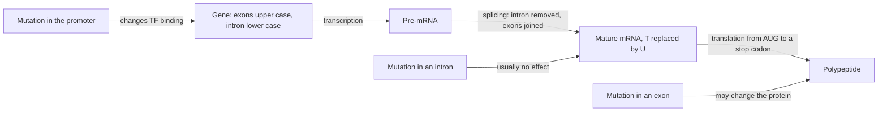

# E01 — Cell Biology and Gene Expression

## Task

The first exercise sheet ("GSB – Ex") asks:

1. Compare eukaryotic and prokaryotic cells in a table.
2. Describe the [[central-dogma]] of molecular biology.
3. Explain comparative gene-expression analysis.
4. Explain gene regulation, including positive and negative regulation.
5. Given the DNA stretch `5'…CAAGAT…G gtaag….g GAT…3'` (upper case = exons, lower case =
   intron), give the mRNA, the resulting amino-acid sequence with start and stop codons,
   and state the effect of a mutation in (a) the promoter, (b) an exon, (c) an intron.
   Also: when does DNA synthesis occur?

## Approach

Parts 1–4 are definitional and draw on [[genome-organization]], [[central-dogma]],
[[microarray-expression-analysis]] and [[gene-regulation]]. Part 5 requires applying the
[[splicing]] rule (introns are removed, exons are joined), then the transcription rule
(T → U), then the [[genetic-code]] read in triplets from `AUG`.

## Solution

**1. Eukaryote vs prokaryote**

| Feature | Eukaryote | Prokaryote |
|---|---|---|
| Nucleus | yes | no |
| Cell size | 10–100 µm | 0.1–5 µm |
| Organisation | mostly multicellular | unicellular |
| DNA form | linear | circular |
| Chromosomes | yes | none |

**2. Central dogma**

DNA →(transcription)→ mRNA →(translation)→ protein. mRNA is read in codons; translation
begins at `AUG` and ends at `UAA`, `UAG` or `UGA`.

**3. Comparative gene-expression analysis**

Measure the expression level of many genes in two conditions — e.g. an experimental
sample and a control — on the same platform, then compare per gene. On a two-colour cDNA
array the two samples compete for the same probes and the readout is a **ratio**; three
cases occur: expressed only in the control, only in the experiment, or in both. See
[[microarray-expression-analysis]].

**4. Gene regulation**

The control of which genes are expressed, when, and how strongly.

- **Positive regulation**: an **activator** binds and increases transcription.
- **Negative regulation**: a **repressor** binds (in prokaryotes, to the **operator**) and
  decreases or blocks transcription.
- In prokaryotes this is organised into **operons** — inducible (*lac*) or repressible
  (*trp*). In eukaryotes **enhancers** act on promoters over a distance. See
  [[gene-regulation]].

**5. Splicing and mutations**

The intron (lower case, beginning `gtaag…` and ending `…g`) is removed and the exons are
joined:

```text
DNA (coding strand):  5'...CAAGAT...G  gtaag....g  GAT...3'
after splicing:           ...CAAGAT...G           GAT...
mRNA:                 5'...CAAGAU...G             GAU...3'
```

The mature mRNA is read in triplets from the start codon `AUG` and translation stops at
the first in-frame stop codon, giving the polypeptide.

**Effect of a mutation by location**

| Location | Effect |
|---|---|
| **[[promoter|Promoter]]** | changes transcription-factor binding → increased *or* decreased expression |
| **Exon** | may change the amino-acid sequence of the protein |
| **Intron** | usually no effect |

**DNA synthesis** occurs during **replication** — not during transcription. A promoter
mutation alters the transcription-factor binding sites and therefore the transcription
level. See [[dna-mutation]].

## Diagram


The route taken by part 5 of the sheet, with the three mutation locations entering at the three different points that decide their consequence.

## Takeaway

Position determines consequence: the same single-base change is silent in an intron,
potentially protein-altering in an exon, and dose-altering in a promoter. Knowing which
compartment of [[genome-organization]] a variant falls into is the first question to ask
of any observed mutation.

## See also

- [[L01-bioinformatics-and-the-cell]] — the lecture that sets up the prokaryote/eukaryote
  comparison and the central dogma asked for in parts 1 and 2.
- [[L02-gene-expression-and-regulation]] — the lecture behind parts 3 and 4: comparative
  gene-expression analysis, operons, activators and repressors.

## Sources

- `raw/module1/gsb_part1.pdf`, pp. 10–11.
