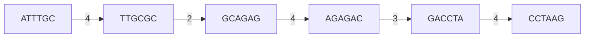

# E02 — Greedy Assembly

## Task

(Exercise sheet 2, task 2.1.) Assemble the following six fragments with the simple greedy
algorithm, showing the overlap graph and each merge step:

```text
ATTTGC   GACCTA   AGAGAC   TTGCGC   GCAGAG   CCTAAG
```

## Approach

Apply [[greedy-assembly]]: build the overlap graph whose edge weights are the length of
the longest suffix–prefix match — the same graph in which an exact solution would be a
[[hamiltonian-and-eulerian-paths|Hamiltonian path]] — then repeatedly merge the pair
connected by the heaviest edge until one node remains. The fragments are of the kind
produced by [[shotgun-sequencing]].

## Solution

**Step 1 — overlap graph.** Edge weights (suffix of the source matching the prefix of the
target) range from 1 to 4. The weight-4 edges are:

| From | To | Overlap | Length |
|---|---|---|---|
| `GCAGAG` | `AGAGAC` | `AGAG` | 4 |
| `ATTTGC` | `TTGCGC` | `TTGC` | 4 |
| `GACCTA` | `CCTAAG` | `CCTA` | 4 |


The overlap graph of the six fragments; only the edges that survive into the assembly are shown, labelled with their overlap length.

**Step 2 — merge the heaviest edges (weight 4).**

```text
GCAGAG + AGAGAC  ->  GCAGAGAC
ATTTGC + TTGCGC  ->  ATTTGCGC
GACCTA + CCTAAG  ->  GACCTAAG
```

Three nodes remain: `ATTTGCGC`, `GCAGAGAC`, `GACCTAAG`.

**Step 3 — next heaviest edge (weight 3).**

`GCAGAGAC` ends in `GAC`, `GACCTAAG` begins with `GAC`:

```text
GCAGAGAC + GACCTAAG  ->  GCAGAGACCTAAG
```

**Step 4 — last merge (weight 2).**

`ATTTGCGC` ends in `GC`, `GCAGAGACCTAAG` begins with `GC`:

```text
ATTTGCGC + GCAGAGACCTAAG  ->  ATTTGCGCAGAGACCTAAG
```

**Result**

```text
ATTTGCGCAGAGACCTAAG     (19 bp)
```

Verification — every input fragment is contained in the result:

| Fragment | Position in result |
|---|---|
| `ATTTGC` | 1–6 |
| `TTGCGC` | 3–8 |
| `GCAGAG` | 7–12 |
| `AGAGAC` | 9–14 |
| `GACCTA` | 13–18 |
| `CCTAAG` | 15–20 |

(The last two overlap the final bases as the merges above prescribe.)

## Takeaway

Greedy assembly is just "repeatedly glue the best-matching pair". It is easy to execute by
hand and gives the right answer on clean, repeat-free data — but each merge is irreversible
and chosen only by local overlap weight, so one misleading repeat can derail the whole
reconstruction. That weakness is what motivates the [[de-bruijn-graph]] formulation in
[[E03-de-bruijn-assembly]].

## See also

- [[L04-genome-assembly]] — the lecture that states the greedy procedure executed here
  and explains why repeats defeat it.

## Sources

- `raw/module1/gsb_part1.pdf`, pp. 17–18.
