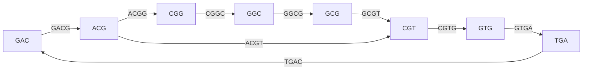
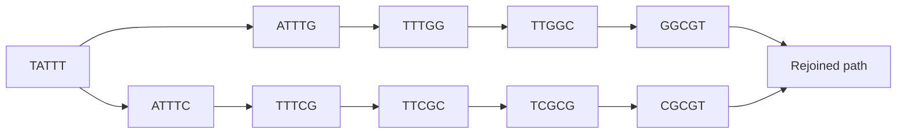

# E03 — De Bruijn Assembly

## Task

(Exercise sheet 2, task 2.2.)

**a)** From the 5-mers
`ACGGC, CGGCG, CGTGA, GACGT, GCGTG, GGCGT, GTGAC, TGACG`
derive all contained 4-mers.
**b)** Count how often each 4-mer occurs.
**c)** Build the de Bruijn graph and read off the resulting sequence.
**d)** Build the 5-mer graph of `TATTTGGCGTATTTCGCGT` and identify the artifact.

## Approach

Apply [[de-bruijn-assembly]]: decompose the reads into *k*-mers, use the (k−1)-mers as
nodes and the *k*-mers as edges, then find an
[[hamiltonian-and-eulerian-paths|Eulerian path]]. See [[de-bruijn-graph]] for
the artifact vocabulary.

## Solution

**a) 4-mers from each 5-mer**

| 5-mer | 4-mers |
|---|---|
| `ACGGC` | `ACGG`, `CGGC` |
| `CGGCG` | `CGGC`, `GGCG` |
| `CGTGA` | `CGTG`, `GTGA` |
| `GACGT` | `GACG`, `ACGT` |
| `GCGTG` | `GCGT`, `CGTG` |
| `GGCGT` | `GGCG`, `GCGT` |
| `GTGAC` | `GTGA`, `TGAC` |
| `TGACG` | `TGAC`, `GACG` |

**b) Counts**

| 4-mer | Count |
|---|---|
| `ACGG` | 1 |
| `ACGT` | 1 |
| `CGGC` | 2 |
| `CGTG` | 2 |
| `GACG` | 2 |
| `GCGT` | 2 |
| `GGCG` | 2 |
| `GTGA` | 2 |
| `TGAC` | 2 |

**c) Graph and reconstruction**

Using the 4-mers as edges between 3-mer nodes:


The de Bruijn graph on 3-mer nodes; the back-edge TGAC closes a cycle, and the ACGT edge provides the exit that ends the traversal.

Walking every edge exactly once, starting at `GAC`:

```text
GAC -> ACG -> CGG -> GGC -> GCG -> CGT -> GTG -> TGA -> GAC -> ACG -> CGT
```

Spelling it out — the first node contributes three bases, every further step one:

```text
GACGGCGTGACGT          (13 bp)
```

**d) Bubble**

The 5-mers of `TATTTGGCGTATTTCGCGT` are
`TATTT, ATTTG, TTTGG, TTGGC, TGGCG, GGCGT, GCGTA, CGTAT, GTATT, TATTT, ATTTC, TTTCG,
TTCGC, TCGCG, CGCGT`.

`TATTT` occurs twice and is where the graph branches: one path continues
`ATTTG → TTTGG → TTGGC → …` and the other `ATTTC → TTTCG → TTCGC → TCGCG → CGCGT`. The two
paths diverge after `TATTT` and rejoin, which is exactly the definition of a **bubble**.


A bubble: two paths diverge after the repeated 5-mer TATTT and reconverge downstream.

A bubble has three possible causes: a **true variant**, a **mid-read sequencing error**,
or a **PCR artifact** — here the two branches are long and internally consistent, which
points to a true variant rather than an error.

## Takeaway

Switching from "nodes are reads" to "edges are k-mers" turns an NP-hard Hamiltonian
problem into a polynomial Eulerian one, and it does so without ever computing a pairwise
alignment. The price is ambiguity: cycles and bubbles must be interpreted, and the
Eulerian path is generally not unique — so the graph topology itself becomes the object of
analysis. Compare with [[E02-greedy-assembly]].

## See also

- [[L04-genome-assembly]] — the lecture that introduces the de Bruijn construction used
  here and catalogues the spur, bubble, cycle and frayed-rope artifacts of part d.

## Sources

- `raw/module1/gsb_part1.pdf`, pp. 21–23.
