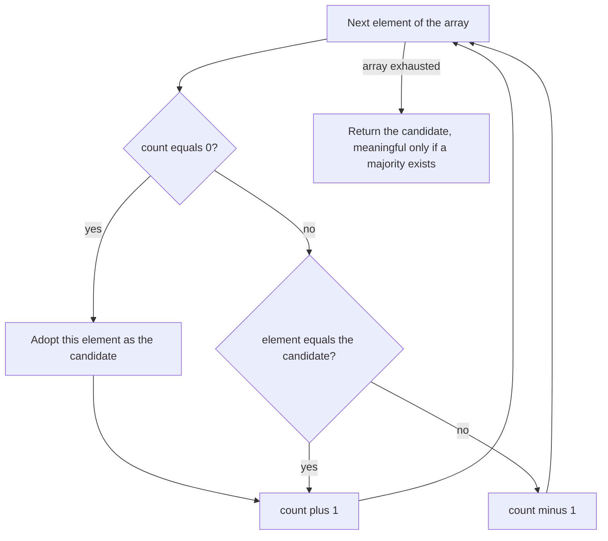

# E04 — Complexity and the Majority Element

## Task

(Exercise sheet 3.)

**1.** Time complexity and Big-O notation.
 a) An `O(n log n)` algorithm processes 1000 data items in 1 ms. How long for 10⁶ items?
 b) Give the Big-O class of ten given expressions.
 c) Decide which Big-O calculation rules are correct and fix the wrong ones.
 d) Algorithm A runs in `TA(n) = 0.001·n` ms, algorithm B in `TB(n) = 500·√n` ms. Which is
    better for up to 10⁹ records?
 e) Determine the complexity of a triple-nested loop.

**2.** The majority element.
 a) Solve it by divide and conquer.
 b) Give the Boyer–Moore algorithm.
 c) What happens if there is no majority element?

## Approach

Part 1 applies the definitions and rules on [[algorithmic-complexity]]; part 2 is the
[[boyer-moore-majority-vote]] method page.

## Solution

**1a) Scaling an `O(n log n)` algorithm**

```text
T(n) = c · n · log n
T(1000)   = c · 1000 · log(1000) = 1 ms      =>  c = 1/3000 ms
T(1000000) = (1/3000) · 10^6 · log(10^6)
           = (1/3000) · 10^6 · 6
           = 2000 ms
```

So 10⁶ items take **2000 ms** (using log base 10, as in the notes).

**1b) Big-O classes**

| # | Expression | Class |
|---|---|---|
| 1 | `5 + 0.001n³ + 0.025n` | `O(n³)` |
| 2 | `500n + 100n^1.5 + 50 n log₁₀ n` | `O(n^1.5)` |
| 3 | `0.3n + 5n^1.5 + 2.5n^1.75` | `O(n^1.75)` |
| 4 | `n² log₂ n + n (log₂ n)²` | `O(n² log₂ n)` |
| 5 | `n log₃ n + n log₂ n` | `O(n log n)` |
| 6 | `3 log₈ n + log₂ log₂ log₂ n` | `O(log₈ n)` |
| 7 | `100n + 0.01n²` | `O(n²)` |
| 8 | `0.01n + 100n²` | `O(n²)` |
| 9 | `2n + n^0.5 + 0.5n^1.25` | `O(n^1.25)` |
| 10 | `0.01 n log₂ n + n (log₂ n)²` | `O(n (log₂ n)²)` |

The pattern: keep only the fastest-growing term and drop constant factors — note that
rows 7 and 8 land in the same class despite very different constants.

**1c) Calculation rules**

| Claim | Verdict | Correction |
|---|---|---|
| `O(f + g) = O(f) + O(g)` | ✗ wrong | `O(f + g) = O(max{f, g})` |
| `O(f · g) = O(f) · O(g)` | ✓ correct | — |
| `g = O(f)` and `h = O(f)` ⟹ `g = O(h)` | ✗ wrong | `g = O(f)` and `f = O(h)` ⟹ `g = O(h)` |

**1d) A vs B up to 10⁹ records**

Asymptotically `TB(n) = O(√n)` beats `TA(n) = O(n)`. But:

```text
500·√n  ≤  0.001·n        | ÷ 0.001
500000·√n ≤ n
500000  ≤ √n
n ≥ 2.5 · 10^11
```

B only overtakes A beyond 2.5 · 10¹¹ records — far above the 10⁹ limit, so **A is better
here**.

**1e) Nested loops**

```text
for (i = 1; i < n; i *= 2)        // O(log2 n)
  for (j = n; j > 0; j /= 2)      // O(log2 n)
    for (k = j; k < n; k += 2)    // O(n)
      sum += (i + j * k);         // O(1)
```

Total: **`O(n · (log₂ n)²)`**.

**2a) Divide and conquer**

```text
MAJORITY(array):
  if LENGTH(array) = 1:
    return array[0]
  mid ← LENGTH(array) / 2
  L ← array[0 .. mid-1]
  R ← array[mid .. end]
  left_m  ← MAJORITY(L)
  right_m ← MAJORITY(R)
  if left_m = right_m:
    return left_m
  l_count ← 0; r_count ← 0
  for i ← 0 to LENGTH(L)-1:
    if L[i] = left_m:  l_count ← l_count + 1
  for i ← 0 to LENGTH(R)-1:
    if R[i] = right_m: r_count ← r_count + 1
  if l_count > r_count: return left_m
  else:                 return right_m
```

Cost: `O(n log n)` — `O(n)` counting work on each of `log n` levels.

**2b) Boyer–Moore**

```text
BOYER-MOORE-MAJORITY(array, l):
  count ← 0
  candidate ← 0
  for i ← 0 to l-1:
    if count = 0:
      candidate ← array[i]
    if array[i] = candidate:
      count ← count + 1
    else:
      count ← count - 1
  return candidate
```

Cost: `O(n)` time, `O(1)` space.

**2c) No majority element**

The algorithm still returns a value: **the last object that was set as candidate**. The
output is therefore only meaningful if a majority is known to exist, or if a second
counting pass verifies the candidate.

## Diagram


The single-pass vote of part 2b as a state machine: the counter is the only memory, and a candidate survives exactly as long as it is not out-voted.

## Takeaway

Asymptotic notation answers "what happens eventually", not "what is faster on my data" —
part 1d is the counterexample. And an algorithm's guarantee is only as strong as its
precondition: Boyer–Moore is optimal in time and space, yet silently wrong when its
assumption of an existing majority fails. See [[algorithmic-complexity]] and
[[boyer-moore-majority-vote]], introduced in [[L07-algorithms-and-complexity]].

## See also

- [[dynamic-programming]] — the other design pattern taught alongside divide and conquer
  in [[L07-algorithms-and-complexity]]; the majority element needs only the latter,
  because its two halves are solved independently rather than from a shared table.

## Sources

- `raw/module1/gsb_part1.pdf`, pp. 28–31.
