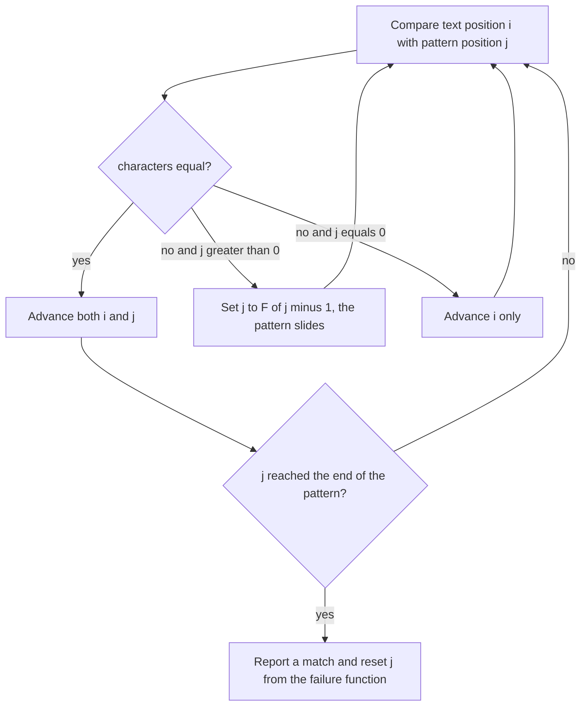

# E05 — KMP String Matching

## Task

Exercise sheet 4, Knuth–Morris–Pratt.

a) Compute the failure function of `P = ATGATTATGAATGA`.
b) Compute the failure function of `P = AATGCAAT`.
c) Run [[knuth-morris-pratt]] with that pattern on
   `T = AATGCATTGCGCATTCTGAATGCAATCTG` and give the match position.
d) How many iterations does the search take?
e) Give a worst case for the number of comparisons within one window.

## Approach

The failure function is filled left to right with two pointers, `i` over the positions to
be filled and `j` over the length of the current border: on `P[i] = P[j]` the border
grows, otherwise `j` falls back to `F[j−1]`, and if `j` is already `0` the entry is `0`.
Indices are 0-based, as in the notes.

During the search the text pointer `i` never moves backwards; on a mismatch only `j` is
reset to `F[j−1]` — this is the **prefix-searching** paradigm of [[string-matching]].

## Solution

**a)** `P = ATGATTATGAATGA`

| index | 0 | 1 | 2 | 3 | 4 | 5 | 6 | 7 | 8 | 9 | 10 | 11 | 12 | 13 |
|---|---|---|---|---|---|---|---|---|---|---|---|---|---|---|
| `P` | A | T | G | A | T | T | A | T | G | A | A | T | G | A |
| `F` | 0 | 0 | 0 | 1 | 2 | 0 | 1 | 2 | 3 | 4 | 1 | 2 | 3 | 4 |

The reset at index 5 is the instructive one: `ATGAT` extends to a border of length 2, but
`P[5] = T` does not continue it, and after falling back to `j = 0` the character `T` does
not match `P[0] = A` either, so `F[5] = 0`.

**b)** `P = AATGCAAT`

| index | 0 | 1 | 2 | 3 | 4 | 5 | 6 | 7 |
|---|---|---|---|---|---|---|---|---|
| `P` | A | A | T | G | C | A | A | T |
| `F` | 0 | 1 | 0 | 0 | 0 | 1 | 2 | 3 |

**c)** With `T = AATGCATTGCGCATTCTGAATGCAATCTG`, the first full match of `AATGCAAT`
starts at **position 18** (0-based): `T[18..25] = AATGCAAT`. The partial match at
position 0 fails at `T[6] = T` versus `P[6] = A`, and the failure function slides the
pattern without re-reading any text character.

**d)** The search takes **29 iterations** of the main loop — one per text character,
which is the linear behaviour KMP guarantees.

**e)** The worst case inside a single window is `m − 1` comparisons before the mismatch,
e.g.

```text
Text:    a b c e a b c e
Pattern: a b c d
```

Three characters match and the fourth fails at every offset.

## Diagram


The KMP search loop of part c: only the pattern pointer is ever reset, and the failure function says how far back, which is why the text pointer moves forward exactly once per character.

## Takeaway

The failure function is a property of the pattern alone and costs `O(m)`; the search is
then `O(n)` because the text pointer only moves forward. Linearity is **guaranteed**,
unlike in [[boyer-moore-string-search]] — but it is bought by reading every text
character at least once, which is precisely why Boyer–Moore is faster in practice
([[L08-exact-string-matching]]).

## Sources

- `raw/module1/gsb_part2.pdf`, pp. 5–6.
