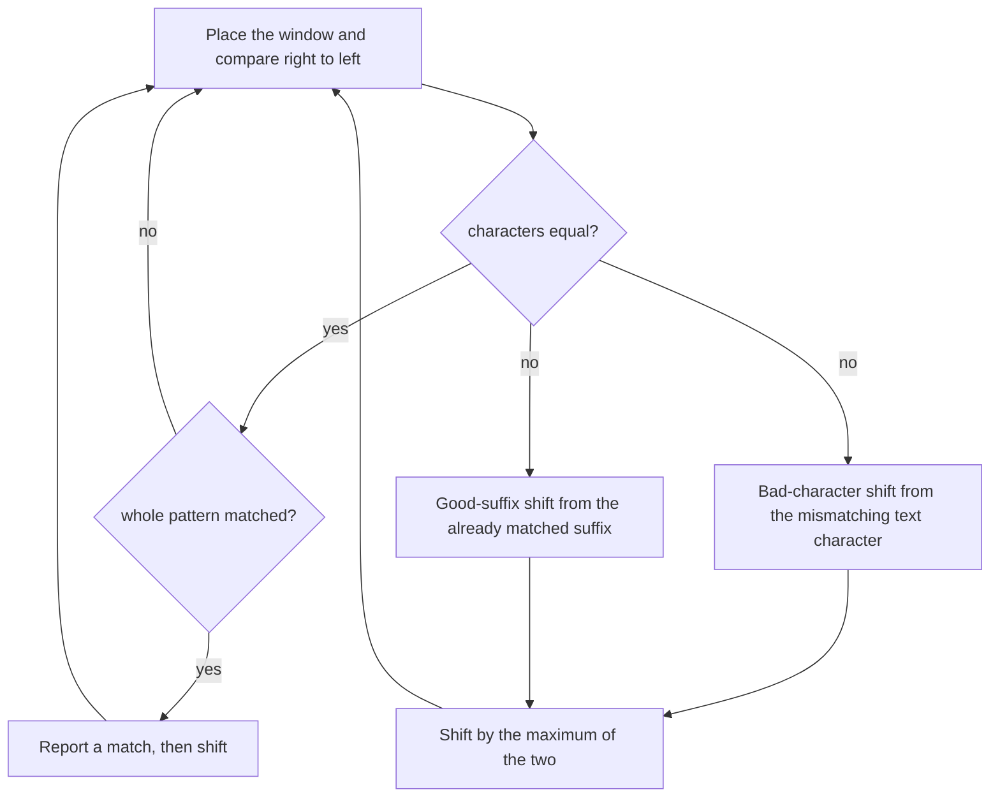

# E06 — Boyer–Moore String Search

## Task

Exercise sheet 4, Boyer–Moore, with `P = ATGATTATGAATGA`.

a) Compute the bad-character table.
b) Compute the good-suffix table.
c) Search `s = GCATCGCAGAGAGTATACAGTACG` with `p = GCAGAGAG`: how many shifts are
   needed, and how long is the second shift?
e) What is the difference between Boyer–Moore–Horspool (BMH) and Boyer–Moore (BM)?

## Approach

Both tables are preprocessing on the pattern alone. The bad-character entry of a
character `c` is `len(P) − (rightmost index of c) − 1`, where the **last position of the
pattern is excluded** (otherwise a shift of zero would be possible). Characters absent
from the pattern allow the whole window to be skipped.

During the search the window is compared **right to left** — the **suffix-searching**
paradigm of [[string-matching]] — and the shift taken is the maximum of the two rules.
See [[boyer-moore-string-search]].

## Solution

**a)** `P = ATGATTATGAATGA`, `len(P) = 14`. Rightmost occurrences excluding index 13:
`A` at 10, `T` at 11, `G` at 12.

| character | rightmost index | `14 − index − 1` | shift |
|---|---|---|---|
| `A` | 10 | `14 − 10 − 1` | **3** |
| `T` | 11 | `14 − 11 − 1` | **2** |
| `G` | 12 | `14 − 12 − 1` | **1** |
| any other | – | – | 14 |

**b)** The good-suffix table was written on the sheet with several corrections and could
not be transcribed with confidence; the legible entries are large values (around 13) for
the long suffixes and small values (3, then 1) for the short ones, which is the expected
shape: a long matched suffix that does not reappear in the pattern forces a large shift,
while a short suffix that reappears forces a small one. Recorded in [[open-questions]].

**c)** `s = GCATCGCAGAGAGTATACAGTACG`, `p = GCAGAGAG`, `m = 8`.

| shift | rule | value |
|---|---|---|
| 1st | good suffix | 1 |
| 2nd | bad character `C` at `i = 5`: `6 − 8 + 1 + 5` = 4, good suffix also 4 | **4** |

So **two shifts** are needed, and the **second shift is 4 characters**.

**e)** **BMH** (Boyer–Moore–Horspool) derives its shift from the **last character of the
window** rather than from the mismatching character, and it uses **only the bad-character
rule** — no good-suffix table at all. It is therefore much simpler to implement, at the
price of occasionally shorter shifts.

## Diagram

The Boyer–Moore loop of part c: every mismatch consults both precomputed tables and the longer of the two jumps is taken.

## Takeaway

Boyer–Moore's speed comes entirely from preprocessing the pattern: two small tables turn
a mismatch into a long jump. The good-suffix rule is the harder half to compute and the
first thing dropped in the simplified BMH variant — which is what most real
implementations use.

## Sources

- `raw/module1/gsb_part2.pdf`, p. 10.
