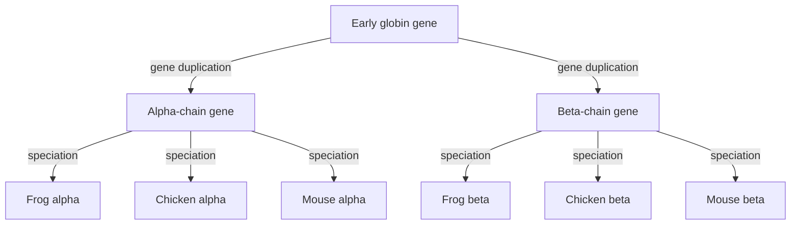

# E07 — Alignment and Homology

## Task

Exercise sheet 5.

Q3a) Given the globin gene tree — an early globin gene duplicating into an α-chain and a
β-chain gene, each then present in frog, chicken and mouse — label which genes are
orthologs, which are paralogs and which are homologs.

Q4) Align `seq1 = YCTYSRFTVF` and `seq2 = YRTYTVF` globally with gap penalty `g = −2`,
match `+1`, mismatch `−1`.

Q5) Name the algorithms used for global and for local alignment and say what they have in
common.

## Approach

For Q3a the rule is which **event** separated the two genes: speciation → orthologs,
duplication → paralogs, either → homologs (see [[homology]]).

For Q4 the algorithm is [[needleman-wunsch]]: initialise the first row and column with
multiples of the gap penalty, fill the matrix with the three-way maximum, then trace back
from the bottom-right corner.

## Solution

**Q3a)**

```text
                early globin gene
                        |
            ---- gene duplication ----
            |                        |
      alpha-chain gene         beta-chain gene
       /      |      \           /    |     \
  frog α  chicken α  mouse α  mouse β chick β frog β
```

- Within one chain group (frog α, chicken α, mouse α): **orthologs** — separated by
  speciation.
- Any α-chain gene versus any β-chain gene: **paralogs** — separated by the duplication.
- All six genes together: **homologs** — they share a common ancestor.

**Q4)** The first row of the matrix is initialised as

`0, −2, −4, −6, −8, −10, −12, −14, −16, −18, −20`

(and the first column analogously down to `−14`). Filling the matrix and tracing back
gives

```text
Y C T Y S R F T V F
Y R T Y - - - T V F
```

The `Y`, `T`, `Y`, `TVF` positions match; `C` is aligned against `R` as a mismatch, and
the three residues `SRF` of `seq1` have no counterpart in `seq2`, producing a run of
three gaps. With an **affine** gap penalty this single three-residue gap would be charged
much less than three separate gaps ([[substitution-matrix]]).

**Q5)** [[needleman-wunsch]] computes the **global** alignment and [[smith-waterman]] the
**local** alignment. Both are examples of **[[dynamic-programming|dynamic programming]]**:
they decompose the alignment into optimal prefix alignments stored in a matrix
([[algorithmic-complexity]]).

## Diagram


The globin gene tree of Q3a: genes separated by the duplication edge are paralogs, genes separated only by speciation edges are orthologs, and all six leaves are homologs.

## Takeaway

Global alignment is end-to-end and therefore forces unmatched regions into gaps; local
alignment would simply have dropped `SRF`. The choice between them is the first decision
in any comparison, and it follows from the biology: whole-gene comparison versus shared
domain ([[L09-sequence-alignment-and-homology]]). Similarity is evidence for homology,
but only the duplication/speciation history decides whether two homologs are paralogs or
orthologs.

## Sources

- `raw/module1/gsb_part2.pdf`, pp. 14, 18.
