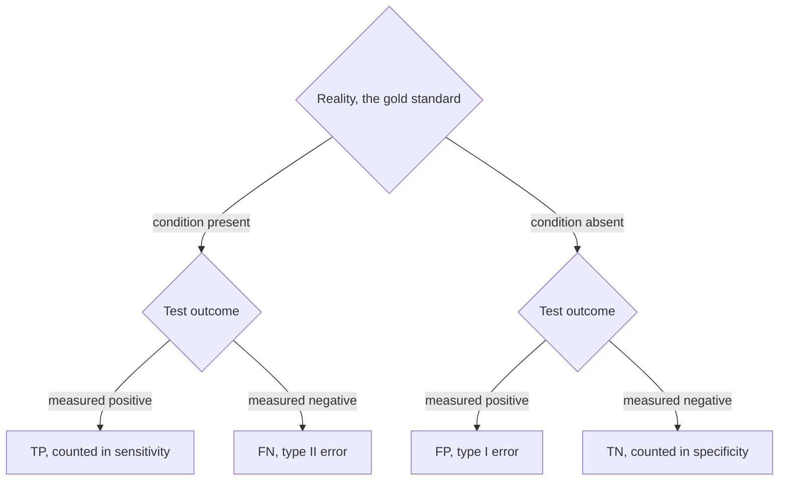

# E08 — Test Errors and z-Score

## Task

Exercise sheet 6.

1a) Draw the confusion matrix of measurement versus reality and mark which cell is the
type I and which the type II error.
1b) For a screening test evaluated against a gold standard with `TP = 35`, `FP = 30`,
`FN = 15`, `TN = 120`, compute sensitivity, specificity and accuracy.
2a) A population has `μ = 60` and `σ = 8`; a sample of `n = 25` people has a measured
mean of `62.7`. Compute the z-score.
2b) Formulate `H₀` and `H₁` for the claim that smokers have a higher health-problem score
and give the test decision.
3) Which distribution describes each of the following? a) 100 head/tail results of a coin
toss; b) 10,000 results (1–20) of a 20-sided die; c) the number of guests entering between
20:00 and 22:00 on each of 100 days; d) human IQ; e) the number of times the result is
"head".
4) Which QQ-plot shape corresponds to which distribution shape?

## Approach

The confusion matrix cross-tabulates what was measured against what is true; the two
off-diagonal cells are the two error types ([[statistical-testing]]). The [[z-score]]
`(x − μ)/σ` expresses the deviation in standard deviations
([[descriptive-statistics]]).

## Solution

**1a)**

| | Reality: true | Reality: false |
|---|---|---|
| **Measured true** | TP | **FP — type I error** |
| **Measured false** | **FN — type II error** | TN |

A **type I error** accepts `H₁` although it is false (false positive); a **type II
error** rejects `H₁` although it is true (false negative).

**1b)** With `n = 35 + 30 + 15 + 120 = 200`:

```text
sensitivity = TP / (TP + FN) = 35 / (35 + 15)  = 35 / 50  = 0.7
specificity = TN / (TN + FP) = 120 / (120 + 30) = 120 / 150 = 0.8
accuracy    = (TP + TN) / n  = (35 + 120) / 200 = 155 / 200 = 0.775
```

The test finds 70 % of the true cases and correctly clears 80 % of the healthy ones.

**2a)**

```text
z = (x̄ - μ) / σ = (62.7 - 60) / 8 = 0.3375
```

**2b)**

- `H₁`: people who smoke have a higher score ("health problems").
- `H₀`: people who smoke do **not** have a higher score.

The sample mean `62.7` lies only `0.3375` standard deviations above the population mean,
i.e. very close to it. The deviation is small, so `H₀` cannot be rejected — in the
wording of the sheet: **accept `H₀`, reject `H₁`**.

**3)**

| | data | distribution |
|---|---|---|
| a) | 100 coin head/tail results | **uniform** |
| b) | 10,000 results 1–20 of a 20-sided die | **uniform** |
| c) | guests entering between 20:00 and 22:00, over 100 days | **Poisson** |
| d) | human IQ | **normal** |
| e) | the number of times the result is "head" | **binomial** |

a) and b) describe the individual outcomes of a fair device, each equally likely, hence
uniform; e) counts successes in a fixed number of independent trials, which is the
binomial case of [[probability-distribution]]; c) counts rare events in a fixed interval,
the Poisson case.

**4)** The QQ-plot shape reads off the shape of the sampled distribution
([[qq-plot]]):

| distribution | QQ-plot |
|---|---|
| symmetric | **straight line** |
| symmetric with fat tails | **S-shape** |
| positive (right) skew | **convex curve** |
| negative (left) skew | **concave curve** |

A skewed result is exactly what motivates the log transform of
[[data-normalization]].

## Diagram


The confusion matrix of part 1a read as a decision flow: truth first, test outcome second, and the two off-diagonal leaves are the two error types.

## Takeaway

Sensitivity and specificity measure different failure modes and cannot both be maximised:
lowering the decision threshold converts false negatives into false positives, exactly
the type I / type II trade-off controlled by the significance level `α`. A z-score below
`1` is unremarkable under a normal [[probability-distribution]] — "higher than the mean"
is not the same as "significantly higher".

## Relations

- [[M2L03-machine-learning-and-classification]] — module 2 reuses exactly this confusion matrix as a classifier scorecard.
- [[roc-curve]] — what you get when the cutoff of this test is swept instead of fixed.
- [[M2E03-machine-learning-and-classification]] — the module-2 sheet asking the same TP/FP questions of a trained classifier.

## Sources

- `raw/module1/gsb_part2.pdf`, p. 29.
- `raw/module1/gsb_3.pdf`, pp. 1–2 — items 3 and 4 of the same sheet, plus the z-score as
  the normalization step of [[data-normalization]].
