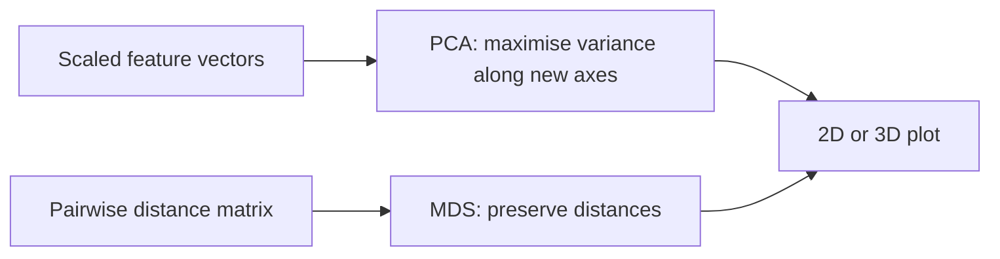

# E09 — Binding Sites, PWM and PCA

## Task

1. Multiple choice.
   a) What is a transcription factor binding site?
   b) What is a position weight matrix?
2. Given a set of aligned sequences of length 10:
   a) build the position **count** matrix;
   b) build the **relative** matrix using the background `A 0.2, T 0.2, C 0.3, G 0.3` and
      a pseudo-count mass of `C = 4`;
   c) which plot visualises the result?
3. a) What is PCA? b) What is the difference between MDS and PCA?

## Approach

Items 1 and 2 apply [[transcription-factor-binding-site]] and
[[position-weight-matrix]] directly: count, add pseudo-counts, normalise per column.
Item 3 contrasts the two projections covered in
[[L11-normalization-pca-and-batch-effects]] —
[[principal-component-analysis]] and multidimensional scaling.

## Solution

**1a)** A TFBS is *"that location of the DNA where a protein binds to control the
transcriptional expression of a gene"*. The distractor describing counts of amino acids
for protein structures is wrong — a PWM over nucleotides models DNA, not protein folds.

**1b)** A PWM is *"a matrix to store the position-specific nucleotide frequencies for a
given set of sequences"*.

**2a)** The count matrix has one column per motif position, `j ∈ [0, 9]`, and one row per
nucleotide; entry `f*_ij` is the number of input sequences carrying nucleotide `i` at
position `j`. The sheet's sequences are dominated by `C`, with `T` fixed at position 2
and `C` nearly fixed at positions 6–8, giving a strongly `C`-rich consensus.

> The individual sequence letters and several column counts on p. 11 are not legible with
> confidence; the exact count matrix is therefore **not** reproduced here. See
> [[open-questions]].

**2b)** The recipe is independent of the exact counts:

```text
f^P_ij = f*_ij + C · π_i          // C = 4, π = (A 0.2, T 0.2, C 0.3, G 0.3)
f_ij   = f^P_ij / Σ_a f^P_aj      // column sum = N + C
```

The worked entry on the sheet is position `j = 0`, nucleotide `A`:

```text
f^P_{A,0} = 3 + 0.2 · 4 = 3.8
f_{A,0}   = 3.8 / 22    ≈ 0.172
```

so the column sum is `22 = N + C` with `N = 18` sequences. Further entries written on the
sheet include `T ≈ 0.12` and `0.036`, `C ≈ 0.6` and `0.78`, `G ≈ 0.1` and `0.054` — the
`C` row dominates, as expected from the consensus.

**2c)** The plot is a **sequence logo**: one stack per position, the height of the stack
given by the information content and the height of each letter by its relative frequency.

**3a)** PCA is one of the techniques used for **unsupervised learning** problems: an
orthogonal linear transformation projecting high-dimensional data into fewer dimensions
while capturing the most variance.

**3b)**

| | input | output |
|---|---|---|
| **PCA** | scaled (normalized) vectors in `n`-dimensional space | projection onto the directions of greatest variance |
| **MDS** | pairwise **distances** between data points | a 2D/3D projection in which the distances between points are preserved |


Both end in the same kind of picture but start from fundamentally different input.

## Takeaway

A PWM is nothing more than a column-normalised count table plus a background — but the
pseudo-count is what keeps an unobserved nucleotide from vetoing an entire candidate, and
the column sum `N + C` is the quickest sanity check on the arithmetic. For projections,
always ask what the **input** was: vectors (PCA) or distances (MDS).

> The sequence logo requested in this exercise is defined only in module 2; see
> [[sequence-logo]] and [[information-content]] for the construction — stack height from
> the relative entropy, letter height from each residue's contribution.

## Sources

- `raw/module1/gsb_3.pdf`, pp. 10–12.
- `raw/module2/csb_1.pdf`, pp. 15–16, 24 — the sequence-logo construction that this
  exercise assumed.
