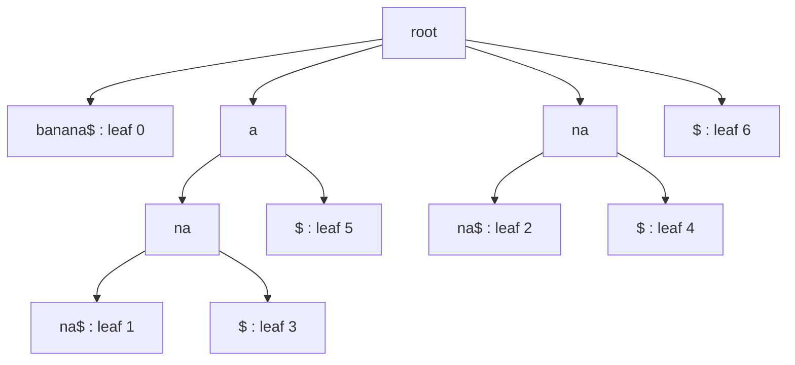

# E10 — Suffix Trees and Suffix Arrays

## Task

**8.1** Construct the suffix tree of `banana$` step by step, then of `ananas$`.
**8.2** Construct the suffix tree of `CACGACGAT$` and mark the repetitive sequences of
length ≥ 2.
**8.3** For `teethermometer$`, list the suffixes, construct the suffix tree, and derive
the suffix array with its `lcp` and `skp` columns.

## Approach

All three items use the incremental `O(n²)` construction of [[suffix-tree]] — the
text-indexing answer to [[string-matching]]: push the
suffixes in order, create a new edge when matching stops at a node, and split an edge
when the mismatch happens in its middle. Item 8.2 exploits the fact that **every internal
node is a repeated substring**. Item 8.3 flattens the tree into the three arrays of
[[suffix-array]], using the convention that the sentinel `$` sorts **after** every letter.

## Solution

**8.1 — `banana$`**

Suffixes, pushed in index order:

```text
0 banana$   1 anana$   2 nana$   3 ana$   4 na$   5 a$   6 $
```

- Push `banana$` → one root edge to leaf 0.
- `anana$`, `nana$` share nothing with existing edges → new root edges (leaves 1, 2).
- `ana$` shares `ana` with leaf 1's edge → split it: node `a`, node `ana`, children
  `na$` (leaf 1) and `$` (leaf 3).
- `na$` shares `na` with leaf 2's edge → split: node `na`, children `na$` (leaf 2) and
  `$` (leaf 4).
- `a$` shares `a` with the node `a` → new child `$` (leaf 5).
- `$` → new root edge (leaf 6).


The suffix tree of `banana$`; the internal nodes spell the repeats `a`, `ana` and `na`.

**`ananas$`** — suffixes `0 ananas$`, `1 nanas$`, `2 anas$`, `3 nas$`, `4 as$`,
`5 s$`, `6 $`. The same splits occur one position earlier, because the string now ends in
`s$`:

- node `a` → child edge `na` → node `ana` with children `nas$` (leaf 0) and `s$`
  (leaf 2); node `a` also has the child `s$` (leaf 4);
- node `na` with children `nas$` (leaf 1) and `s$` (leaf 3);
- root edges `s$` (leaf 5) and `$` (leaf 6).

**8.2 — `CACGACGAT$`**

Suffixes:

```text
0 CACGACGAT$   1 ACGACGAT$   2 CGACGAT$   3 GACGAT$   4 ACGAT$
5 CGAT$        6 GAT$        7 AT$        8 T$        9 $
```

The internal nodes — i.e. the repeated substrings of length ≥ 2 — are:

| internal node | occurs at | children |
|---|---|---|
| `ACGA` | 1, 4 | `CGAT$` (leaf 1), `T$` (leaf 4) |
| `CGA` | 2, 5 | `CGAT$` (leaf 2), `T$` (leaf 5) |
| `GA` | 3, 6 | `CGAT$` (leaf 3), `T$` (leaf 6) |

The longest repeat is **`ACGA`**, occurring at positions 1 and 4; `CGA` and `GA` are its
suffixes and therefore repeat as well. This is exactly how a suffix tree answers the
"longest repeated substring" question: take the deepest internal node.

**8.3 — `teethermometer$`**

The 15 suffixes (indices 0–14):

```text
0 teethermometer$   1 eethermometer$   2 ethermometer$   3 thermometer$
4 hermometer$       5 ermometer$       6 rmometer$       7 mometer$
8 ometer$           9 meter$          10 eter$          11 ter$
12 er$             13 r$              14 $
```

Sorted with `$` ranked after every letter, the suffix array with its `lcp` and `skp`
columns:

| i | suf[i] | S_suf[i] | lcp[i] | skp[i] |
|---|---|---|---|---|
| 0 | 1 | `eethermometer$` | 0 | 15 |
| 1 | 5 | `ermometer$` | 1 | 5 |
| 2 | 12 | `er$` | 2 | 3 |
| 3 | 10 | `eter$` | 1 | 5 |
| 4 | 2 | `ethermometer$` | 2 | 5 |
| 5 | 4 | `hermometer$` | 0 | 15 |
| 6 | 9 | `meter$` | 0 | 15 |
| 7 | 7 | `mometer$` | 1 | 8 |
| 8 | 8 | `ometer$` | 0 | 15 |
| 9 | 6 | `rmometer$` | 0 | 15 |
| 10 | 13 | `r$` | 1 | 11 |
| 11 | 0 | `teethermometer$` | 0 | 15 |
| 12 | 11 | `ter$` | 2 | 13 |
| 13 | 3 | `thermometer$` | 1 | 14 |
| 14 | 14 | `$` | 0 | 15 |

Checks: `lcp[2] = 2` because `ermometer$` and `er$` share `er`; `lcp[12] = 2` because
`teethermometer$` and `ter$` share `te`. `skp[i]` is the next index whose `lcp` is
smaller; `15` (= `n`) means "no such index", i.e. the scan runs off the end. Note the
ordering `ermometer$` *before* `er$`: with `$` ranked last, the longer suffix wins at an
equal prefix, which also puts the bare `$` in the final row.

## Takeaway

Building a suffix tree by hand is mechanical — only two cases exist, "new edge" and
"split edge" — and once it exists, questions that sound different are all the same
question: *is this a substring* is a path walk, *what repeats* is an internal node, and
*what is the longest repeat* is the deepest internal node. The suffix array stores the
same answers in three integer columns, which is why real genome indexes use it.

## Sources

- `raw/module1/gsb_3.pdf`, pp. 16–19.
