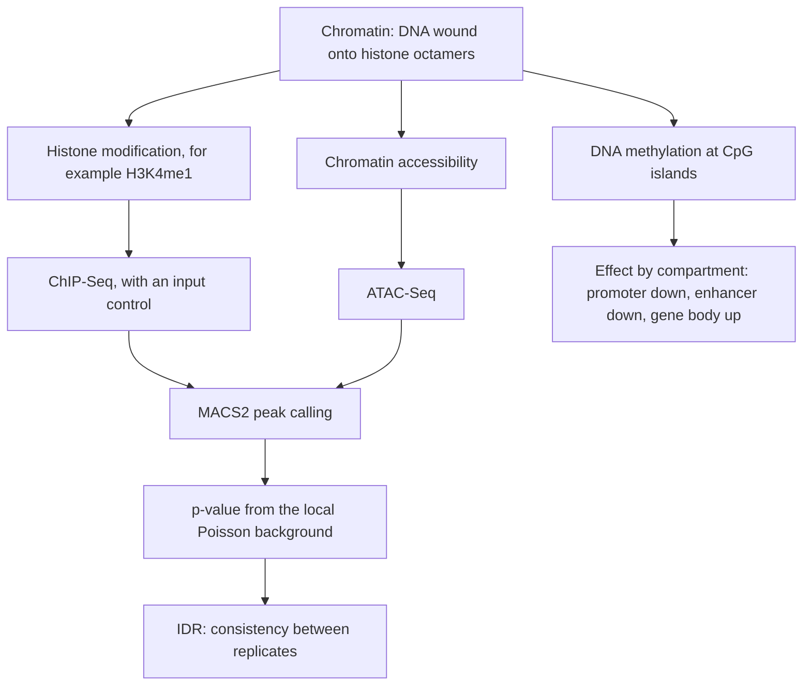

# E12 — Epigenetics terminology and peak calling

Exercise sheet 10 of the course ("GSB-Ex 10"). A terminology sheet: four blocks of
definitions covering the vocabulary of [[epigenetics]], the nomenclature of
[[histone-modification]], the capabilities of MACS2 ([[peak-calling]]) and the effects of
[[dna-methylation]].

## Task

1. Define: a) epigenetics, b) chromatin, c) histone, d) histone modification,
   e) CpG islands.
2. a) Decode the marks `H3K4me1`, `H3K9me3`, `H4K20me2`, `H3K4Ac`.
   b) Define euchromatin and heterochromatin.
3. a) Which statements about **MACS2** are true? b) How does MACS infer its p-value?
   c) What does **IDR** measure?
4. a) What are CpG islands? b) What is the effect of DNA methylation in the promoter
   region, in an enhancer region and in the gene body?

## Approach

Everything here is definitional, so the "method" is to map each term onto the right wiki
page: [[epigenetics]] and [[chromatin]] for part 1, [[histone-modification]] for part 2,
[[peak-calling]] for part 3, and [[dna-methylation]] with [[cpg-island]] for part 4. The
only part requiring reasoning rather than recall is 3b, where the p-value has to be
traced back to the **local Poisson background model**
([[probability-distribution]]).

## Solution

### 1 — Terminology

a) **Epigenetics** — in the German wording of the sheet: *"Das Fachgebiet der Biologie,
das sich mit der Frage befasst, welche Faktoren die Aktivität eines Gens und damit die
Entwicklung der Zelle zeitweilig festlegen"* — the branch of biology concerned with which
factors temporarily fix the activity of a gene and thereby the development of the cell.
The mechanism is **chemical modification of the DNA or of the histones**, not a change in
the sequence.

b) **Chromatin** — a mixture of DNA and proteins that forms the chromosomes in the cells
of higher organisms; in the German gloss, *"DNA-Strang auf Histone aufgewickelt"* — the
DNA strand wound onto histones. See [[chromatin]].

c) **Histone** — a protein that provides **structural support** for a chromosome. DNA
wraps around complexes (octamers) of histones, giving both **compaction** and
**regulation**.

d) **Histone modification** — **any covalent addition of a chemical group**; named
examples are **methylation**, **acetylation** and **phosphorylation**. See
[[histone-modification]].

e) **CpG islands** — regions in the DNA where a C followed by a G occurs frequently, and
which are constantly methylated. See [[cpg-island]].

### 2 — Marks and chromatin states

a)

| Mark | Reading |
|---|---|
| `H3K4me1` | histone 3 **mono**methylated at lysine 4 |
| `H3K9me3` | histone 3 **tri**methylated at lysine 9 |
| `H4K20me2` | histone 4 **di**methylated at lysine 20 |
| `H3K4Ac` | histone 3 **acetylated** at lysine 4 |

The pattern is `H<histone number> K<residue position> <mark><count>`; `K` is lysine,
`me1/2/3` counts methyl groups, `Ac` is acetylation.

b) **Euchromatin** is defined as **active chromatin with a low level of compaction in the
interphase nucleus**. **Heterochromatin** is defined as **chromatin which is more densely
packed than euchromatin**.

### 3 — Peak calling

a) True of **MACS2**:

- it **should be used with an input sequencing control** when calling [[chip-seq|ChIP]]
  peaks — it can run without one, but that is **not recommended**;
- it **can call peaks on ATAC-Seq data** ([[atac-seq]]);
- it **can call peaks on TF ChIP data** — transcription-factor binding sites, see
  [[transcription-factor-binding-site]];
- it **can call narrow peaks**;
- it **can call broad peaks**.

b) **MACS infers the p-value** by computing it from a **local Poisson distribution of the
background**. The local rate is the dynamic
`λ_local = max(λ_BG, λ_1k, λ_5k, λ_10k)`; the p-value of a window with `k` reads is the
Poisson tail probability `P(X ≥ k)` under that rate. Taking the maximum over nested
neighbourhoods is what makes the test robust against local bias.

c) **IDR** — the **irreproducible discovery rate** — **measures consistency between
replicates in high-throughput experiments**. Highly significant peaks are consistent
between replicates, low-significance peaks are not, so IDR separates real signal from
artifacts.

### 4 — DNA methylation

a) **CpG islands are stretches of CpGs that are constantly methylated** — dense regions
of C and G, usually associated with gene [[promoter|promoters]].

b) Effect of DNA methylation by compartment:

| Region | Effect |
|---|---|
| promoter region | **decrease** gene expression |
| enhancer region | **decrease** gene expression |
| gene body | **increase** gene expression |

The first two follow from blocked access of the transcription machinery together with a
closed chromatin structure; the third is the counter-intuitive one — gene-body
methylation **correlates with high expression**.

## Diagram

The sheet in one picture: one packing layer, three readouts, and the two questions the sheet asks about each of them.

## Takeaway

The epigenetic vocabulary is layered and each layer has its own readout: **chromatin** is
the structure, **histone modification** and **DNA methylation** are the marks,
**ChIP-Seq + peak calling** and **bisulfite sequencing** are the assays. The one fact
worth memorising against intuition is that methylation is **not** uniformly repressive —
its effect depends on *where* it sits, repressing at promoters and enhancers but
accompanying expression in gene bodies. And on the computational side: MACS2's p-value is
a **local** Poisson tail probability, which is precisely why a control library matters.

## Sources

- `raw/module1/gsb_part4.pdf`, pp. 10–12.
- Lecture background in [[L16-epigenetics]], `raw/module1/gsb_part4.pdf`, pp. 1–9.
