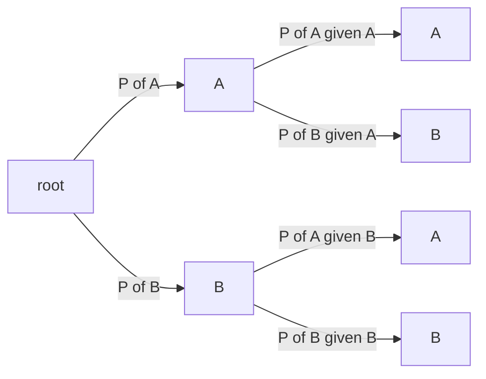

# E13 — Markov chains and the Viterbi algorithm

Exercise sheet 11 of the course ("GSB-Ex 11"), and the last exercise of module 1. Two
parts: estimating a first-order [[markov-chain]] from dinucleotide probabilities, and
running the [[viterbi-algorithm]] on a small two-state
[[hidden-markov-model]].

## Task

1. **Markov chain.** The dinucleotide probabilities `P(XX)` of a sequence are given.
   a) For a **first-order** chain, derive the transition matrix.
   b) Give the probability of a whole sequence `Z`.
2. **Viterbi algorithm.** With `P(S₁) = 0` and `P(S₂) = 1`, and the two-state model
   sketched on the sheet, decode the observation sequence `C A A`.

## Approach

Part 1 is conditional probability and nothing more: a transition probability
`P(Y | X)` is the joint `P(XY)` divided by the marginal `P(X)`, and the marginal is
obtained by summing the joint over the second letter. Part 2 is the [[dynamic-programming|dynamic program]] of
the [[viterbi-algorithm]]: fill a trellis column by column with
`previous · transition · emission`, keeping only the **maximum** incoming value per cell,
then backtrack.

The probability tree drawn at the top of the sheet is the conceptual picture: from the
root, `P(A)` and `P(B)` branch to the two first letters, and each branches again with
conditional probabilities `P(A|A)`, `P(B|A)`, `P(A|B)`, `P(B|B)`, so that
`P(AA) = P(A)·P(A|A)` and `P(AB) = P(A)·P(B|A)`, and marginalising gives
`P(A) = Σ_X P(AX)`.


The probability tree of the sheet: joint probabilities are products along a path, marginals are sums over the leaves.

## Solution

### 1a — First-order transition matrix

We need, for every pair,

```
P(Y | X) = P(XY) / P(X)      with     P(X) = Σ_Y P(XY)
```

Marginalising the given dinucleotide table over the second base:

```
P(A) = P(AA) + P(AT) + P(AC) + P(AG) = 0.33
P(T) = 0.29
P(C) = 0.23
P(G) = 0.18
```

(The four marginals sum to 1.03, so at least one of them is rounded; see
[[open-questions]].)

The transition matrix has rows `A, T, C, G` (the current base) and columns `A, T, C, G`
(the next base), and **each row sums to 1**. The sheet computes two entries explicitly:

```
P(A | A) = P(AA) / P(A) = 0.27
P(A | T) = P(TA) / P(T) = 0.31
```

The remaining entries are **left blank on the sheet** and are *not* reconstructed here —
the underlying dinucleotide table was not transcribable. The method is the one shown:
divide each cell of the dinucleotide table by its row marginal.

### 1b — Probability of a sequence

For a sequence `Z = x₁ x₂ … x_ℓ`, the first-order chain factorises as

```
P(Z) = P(x_ℓ | x_{ℓ-1}) · … · P(x₂ | x₁) · P(x₁)
```

i.e. the initial probability of the first base multiplied by one transition probability
per step. In practice this is computed in log space, as a sum of logs, to avoid
underflow.

### 2 — Viterbi decoding of `C A A`

The model on the sheet attaches the **emission probabilities to the transitions**:

| Transition | probability | emits `A` | emits `C` |
|---|---|---|---|
| `S₁ → S₁` | 0.6 | 0.8 | 0.2 |
| `S₁ → S₂` | 0.4 | 0.5 | 0.5 |
| `S₂ → S₁` | 0.1 | 0.1 | 0.9 |
| `S₂ → S₂` | 0.9 | 0.3 | 0.7 |

Initialisation: `V[S₁, 0] = 0`, `V[S₂, 0] = 1`.

**Column 1, observation `C`** — the two products written on the sheet:

```
V[S₁,1] = max( 0 · 0.6 · 0.2 , 1 · 0.1 · 0.9 ) = max( 0 , 0.09 ) = 0.09   ← from S₂
V[S₂,1] = max( 0 · 0.4 · 0.5 , 1 · 0.9 · 0.7 ) = max( 0 , 0.63 ) = 0.63   ← from S₂
```

**Column 2, observation `A`**:

```
V[S₁,2] = max( 0.09 · 0.6 · 0.8 , 0.63 · 0.1 · 0.1 ) = max( 0.0432 , 0.0063 ) = 0.0432  ← from S₁
V[S₂,2] = max( 0.09 · 0.4 · 0.5 , 0.63 · 0.9 · 0.3 ) = max( 0.0180 , 0.1701 ) = 0.1701  ← from S₂
```

**Column 3, observation `A`**:

```
V[S₁,3] = max( 0.0432 · 0.6 · 0.8 , 0.1701 · 0.1 · 0.1 ) = max( 0.020736 , 0.001701 ) = 0.020736  ← from S₁
V[S₂,3] = max( 0.0432 · 0.4 · 0.5 , 0.1701 · 0.9 · 0.3 ) = max( 0.008640 , 0.045927 ) = 0.045927  ← from S₂
```

**Termination and backtrack.** The last maximum entry is `V[S₂,3] = 0.045927`. Following
the backpointers from right to left gives `S₂ ← S₂ ← S₂`, so the most probable state path
for `C A A` is

```
S₂ → S₂ → S₂        with probability 0.045927
```

| | `C` | `A` | `A` |
|---|---|---|---|
| `S₁` | 0.09 | 0.0432 | 0.020736 |
| `S₂` | **0.63** | **0.1701** | **0.045927** |

The notes fill in only the first column; columns 2 and 3 above are derived here from the
model probabilities given on the sheet.

## Takeaway

Both parts are the same lesson in different clothing: a Markov model turns a sequence
into a **product of local terms**, and everything else follows from that factorisation.
Estimating the model means dividing joint counts by marginals; using the model means
multiplying local terms along a path. The Viterbi twist is that when the path is unknown
we keep, at every cell, only the **best way of getting there** — which is what collapses
an exponential path enumeration into an `O(L·|Q|²)` table. Work in log space, and never
forget the backpointers: the table alone gives the probability, only the backtrack gives
the answer.

## Sources

- `raw/module1/gsb_part4.pdf`, pp. 19–20.
- Lecture background in [[L17-markov-chains-and-hidden-markov-models]],
  `raw/module1/gsb_part4.pdf`, pp. 13–18.
