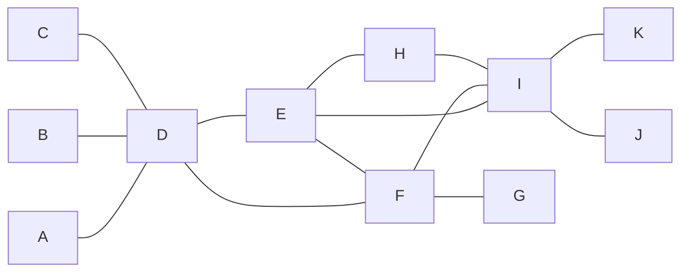

# M2E01 — Enrichment Analysis and KeyPathwayMiner

## Task

1. **GSEA** — (a) how must the genes be ordered for the statistical assessment in the
   enrichment analysis? (b) sketch the ES-score distribution and mark the cutoff.
   (c) name a way to calculate the significance of the overlap between a set of
   significant genes and a pre-given set of genes.
2. **Gene Ontology** — what is it, what kind of relationships does it contain, and what
   graph structure does it form?
3. **Ant Colony Optimization** — describe it.
4. **Travelling Salesman Problem** — state it.
5. **KeyPathwayMiner** — given a graph `G` and a binary indicator matrix over five
   patients, decide which candidate subnetworks are valid solutions
   (a) under the **INEs** model for `K = 2, L = 3` and for `K = 1, L = 1`, and
   (b) under the **GLONE** model for `L = 10` and for `L = 15`.

## Approach

Parts 1–4 are definitional and are covered by [[gene-set-enrichment-analysis]],
[[fishers-exact-test]], [[gene-ontology]], [[ant-colony-optimization]] and
[[travelling-salesman-problem]]. Part 5 is the mechanical core: build the per-gene
zero count from the matrix, convert it into an **activity** verdict for the INE model,
and then check each hand-drawn candidate against **both** constraints — the exception
budget *and* maximality. See [[keypathwayminer]].

## Solution

### 1. GSEA

**(a)** For the statistical assessment in the enrichment analysis the genes must be
ordered by **decreasing enrichment score**. The running sum of
[[gene-set-enrichment-analysis]] is computed by projecting the gene set onto this ranked
list from top (up-regulated) to bottom (down-regulated).

**(b)** The ES-score distribution under the null hypothesis is generated by permutation;
the **real ES score acts as the cutoff**, and the empirical p-value is the fraction of
randomised ES scores that are ≥ the real one.

**(c)** **Fisher's Exact Test.** (The answer sheet also wrote "or GSEA enrichment test"
and then **struck it through** — GSEA scores a whole ranked distribution, it does not
test the significance of a *given overlap* between two fixed sets, which is exactly what
the 2×2 table of [[fishers-exact-test]] does.)

### 2. Gene Ontology

> Gene Ontology is a controlled vocabulary that defines biological functions and entities
> and relationships between them. Typical examples of the latter are **"is a"** and
> **"part of"**.

The GO is **not a tree** (this was written and struck through). It forms a **directed
graph that is acyclic** — a DAG. A term may therefore have more than one parent. See
[[gene-ontology]].

### 3. Ant Colony Optimization

No answer was written on the sheet. The model answer is on
[[ant-colony-optimization]]: a set of ants is randomly placed on the graph, each
constructs a candidate solution by a random walk whose transition probabilities depend
on the pheromone on the edges, and every ant that completes a valid solution reinforces
the pheromone of the edges it used; evaporation plus reinforcement concentrate later
walks on good regions.

### 4. Travelling Salesman Problem

> Finding the shortest possible route that visits a set of cities and returns to the
> starting city, while visiting each city once.

See [[travelling-salesman-problem]].

### 5. KeyPathwayMiner

**The graph `G`** (11 genes):

The interaction network used in the exercise; D, E, F and I are the hubs.

**The indicator matrix** (`1` = differentially expressed in that patient):

| gene | P1 | P2 | P3 | P4 | P5 | zeros |
|---|---|---|---|---|---|---|
| A | 1 | 1 | 1 | 0 | 0 | 2 |
| B | 0 | 0 | 0 | 0 | 1 | 4 |
| C | 0 | 1 | 1 | 1 | 1 | 1 |
| D | 0 | 0 | 0 | 1 | 0 | 4 |
| E | 1 | 1 | 0 | 0 | 1 | 2 |
| F | 1 | 1 | 1 | 1 | 1 | 0 |
| G | 1 | 0 | 0 | 0 | 0 | 4 |
| H | 0 | 0 | 1 | 0 | 0 | 4 |
| I | 1 | 1 | 1 | 1 | 1 | 0 |
| J | 0 | 0 | 0 | 1 | 1 | 3 |
| K | 0 | 1 | 0 | 0 | 1 | 3 |

**Activity rule** (INEs): a node is **active** if it has **at most `L` zeros** — i.e. it
is differentially expressed in all but at most `L` cases.

| `L` | active | inactive |
|---|---|---|
| `L = 1` | C, F, I | A, B, D, E, G, H, J, K |
| `L = 3` | A, C, E, F, I, J, K | B, D, G, H |

#### (a) INEs

**`K = 2, L = 3`.** The three candidates drawn on the sheet are all annotated
**not valid**:

| candidate | why not |
|---|---|
| first | *not valid since K and J could also be in it* — the exception budget is not exhausted, so the subnetwork is **not maximal** |
| second | same reason — **not maximal** |
| third | *not valid since K is not in it* — again **not maximal** |

So all three failures are **maximality** failures, not budget failures. A correct
solution must be grown until no neighbour can be added. For example
`{A, C, D, E, F, H, I, J, K}` is connected and contains exactly the two inactive nodes
`D` and `H`, meeting `K = 2` with `L = 3`.

**`K = 1, L = 1`.** With `L = 1` only `C`, `F` and `I` are active:

| candidate | inactive nodes | verdict |
|---|---|---|
| `{C, D, F, I}` | `D` → 1 | **valid** — connected (C–D, D–F, F–I) and within `K = 1` |
| `{C, D, E, F, I}` | `D`, `E` → 2 | **not valid** — 2 > `K = 1` |
| `{E, F, H, I, K}` | `E`, `H`, `K` → 3 | **not valid** — 3 > `K = 1` |

#### (b) GLONE

Under GLONE there is no per-node verdict: the **zeros of every node in the subnetwork
are summed** and the sum must not exceed `L`.

| `L` | candidate sum of zeros | verdict |
|---|---|---|
| 10 | 10 | **valid** (10 ≤ 10) |
| 10 | 14 | **not valid** |
| 10 | 9 | **valid** |
| 15 | 20 | **not valid** |
| 15 | 18 | **not valid** |
| 15 | 13 | **valid** |

The point of the comparison: the subnetwork with sum 13 fails at `L = 10` but passes at
`L = 15`, while the one with sum 18 fails at both — raising the *global* budget admits
larger or noisier modules, and the budget is consumed by the whole module rather than
being granted per node as under INEs.

> [!warning] Arithmetic discrepancies on the sheet
> The per-node zero counts written next to the graph give `B = 3`, but the indicator
> matrix row for `B` is `0 0 0 0 1`, i.e. **4** zeros. The written counts total 26, the
> matrix totals 27. The exact node membership of the hand-drawn GLONE blobs could not be
> read reliably, so only the sums and verdicts are reproduced above. Recorded in
> [[open-questions]].

## Takeaway

- Threshold methods and whole-distribution methods answer **different** questions:
  Fisher tests a *given overlap*, GSEA tests a *ranked distribution*. Choosing the right
  one is the first thing an exam asks.
- The Gene Ontology's DAG structure, not a tree, is what makes a gene inherit several
  functional annotations at once.
- In KeyPathwayMiner the usual mistake is not the exception count but **maximality** —
  every valid solution must be grown until no further node fits. All three failures in
  part (a) were of this kind.
- INEs give each node its own budget of `L`; GLONE spends one budget across the whole
  module. At the same `L`, GLONE is far stricter.

## Relations

- [[gene-set-enrichment-analysis]], [[fishers-exact-test]], [[enrichment-analysis]]
- [[gene-ontology]], [[gene-set]]
- [[keypathwayminer]], [[interaction-network]]
- [[ant-colony-optimization]], [[travelling-salesman-problem]]
- [[M2L01-enrichment-analysis]] — the lecture this exercise accompanies.
- [[M2E05-grandforest-and-bicon]] — the later sheet on the other two de novo network methods, [[grandforest]] and [[bicon]].

## Sources

- `raw/module2/csb_1.pdf`, p. 10 — GSEA ordering, the ES cutoff sketch, Fisher's exact
  test, the Gene Ontology answer with "tree" struck through.
- `raw/module2/csb_1.pdf`, p. 11 — ACO (unanswered) and the TSP definition.
- `raw/module2/csb_1.pdf`, p. 12 — the graph, the indicator matrix, the activity rule,
  the `L ≤ 1` and `L ≤ 3` columns and the three invalid `K = 2, L = 3` candidates.
- `raw/module2/csb_1.pdf`, p. 13 — the three `K = 1, L = 1` candidates and the GLONE
  sums and verdicts for `L = 10` and `L = 15`.
