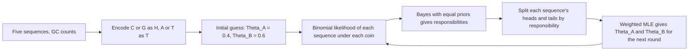

# M2E02 — Motif Discovery and Expectation Maximization

## Task

1. **Definitions.**
   (a) What is a sequence motif? What is a gene knock-out, what are its advantages, and
   why would one knock out a gene encoding a transcription factor?
   (b) What is a sequence logo and what information does it contain?
   (c) What is the difference between the entropy of a distribution `P_i` and the
   relative entropy?
2. **Expectation Maximization.** Given five DNA sequences of length 10:
   (a) estimate the probability `Θ` of observing a G or C at any position in this genome
   and compute the likelihood of each sequence under it;
   (b) with `Θ_A⁰ = 0.4` and `Θ_B⁰ = 0.6`, run one EM iteration treating G/C as "head"
   and A/T as "tail";
   (c) what is EM used for?
   (d) what are the problems with EM, and how does MEME address them?

## Approach

Part 1 is definitional: [[sequence-motif]], [[gene-knockout]], [[sequence-logo]],
[[information-content]]. Part 2 is the coin-flip instance of
[[expectation-maximization]] dressed as a genomics question — the "coin" is the GC bias
of a genomic region, the latent variable is which of the two regions a sequence came
from. The E-step computes responsibilities by Bayes with equal priors; the M-step
re-estimates each `Θ` by weighted MLE.

## Solution

### 1a. Sequence motif and gene knock-out

**Sequence motif**: a short, recurring pattern in DNA/RNA that is believed to have a
biological function beyond that of a single sequence. These motifs are often involved in
**protein–DNA interactions** that are critical to the regulation of gene expression.

**Gene knock-out**: the process of deactivating a gene by either replacing it with an
inactive sequence or disrupting its function.

Advantages:
- (+) allows studying the function of a specific gene, understanding its role in normal
  development and physiology as well as in the pathology of diseases;
- (+) researchers can gain insights into the biological processes the gene is involved
  in.

**Why knock out a gene encoding a transcription factor**: to learn about the role that
the factor plays in [[gene-regulation]] and its effects on downstream biological
processes. When a specific TF is knocked out we see the differentially expressed genes;
those genes are likely controlled by that TF, and **their upstream sequences are likely
to contain the binding sites** — which is exactly the input that
[[em-motif-discovery]] needs. See [[gene-knockout]] and
[[transcription-factor-binding-site]].

### 1b. Sequence logo

A [[sequence-logo]] contains information about the **frequency** and **conservation** of
each nucleotide or amino acid at each position within a sequence alignment. The **height
of each letter represents the frequency** of that letter at that position.

### 1c. Entropy versus relative entropy

**Uncertainty** — the entropy of the distribution `P_i` — measures the **randomness in a
distribution**. **Relative entropy** measures the **difference between two
distributions**, here the observed column against the background `π`. See
[[information-content]].

### 2a. Estimating Θ and the sequence likelihoods

The five sequences, with their G/C counts:

| | sequence | G/C count |
|---|---|---|
| Seq 1 | `CTGAACGAGG` | 6 |
| Seq 2 | `CATTCCTTGG` | 5 |
| Seq 3 | `CGGGCCGGAC` | 9 |
| Seq 4 | `GTGGACCCTC` | 7 |
| Seq 5 | `AAAATGTACC` | 3 |

```
Θ = ( total_count(C) + total_count(G) ) / (5 · n) = 30 / 50 = 0.6
```

Then, **not looking at the order** of the characters:

```
P(Seq_i | Θ) = Θ^#Head · (1 - Θ)^#Tail
```

| | computation | likelihood |
|---|---|---|
| Seq 1 | `0.6⁶ · 0.4⁴` | 0.00119 |
| Seq 2 | `0.6⁵ · 0.4⁵` | 0.00079 |
| Seq 3 | `0.6⁹ · 0.4¹` | 0.00403 |
| Seq 4 | `0.6⁷ · 0.4³` | 0.00179 |
| Seq 5 | `0.6³ · 0.4⁷` | 0.00035 |

These are the likelihoods of observing these sequences under a single GC model.
Seq 3 is the most likely and Seq 5 the least — unsurprising, since `Θ = 0.6` favours
GC-rich sequences.

### 2b. One EM iteration with two models

Encoding: `(C, G) → H` and `(A, T) → T`.

| | H/T string | #H |
|---|---|---|
| Seq 1 | `HTHTTHHTHH` | 6 |
| Seq 2 | `HTTTHHTTHH` | 5 |
| Seq 3 | `HHHHHHHHTH` | 9 |
| Seq 4 | `HTHHTHHHTH` | 7 |
| Seq 5 | `TTTTTHTTHH` | 3 |

**Step 1 — likelihoods under each model**, using the **binomial** distribution
`P(h | X) = B(Θ_X, n, k) = C(n,k) · Θ_X^k · (1−Θ_X)^{n−k}`, with `Θ_A⁰ = 0.4`,
`Θ_B⁰ = 0.6`:

| | under `Θ_A⁰ = 0.4` | under `Θ_B⁰ = 0.6` |
|---|---|---|
| Seq 1 | 0.1111 | 0.25 |
| Seq 2 | 0.2 | 0.2 |
| Seq 3 | 0.001 | 0.04 |
| Seq 4 | 0.042 | 0.215 |
| Seq 5 | 0.215 | 0.042 |

**Step 2 — responsibilities by Bayes.** In general
`P(Z_k | E) = P(E | Z_k) · P(Z_k) / P(E)`; if `P(Z_A) = P(Z_B)` the priors cancel and

```
P(Θ_A | Seq) = Θ_A^h (1-Θ_A)^t / ( Θ_A^h (1-Θ_A)^t + Θ_B^h (1-Θ_B)^t )
             = P(Seq | A) / ( P(Seq | A) + P(Seq | B) )
```

| row | `P(Θ_A given Seq)` | `P(Θ_B given Seq)` | heads → A | heads → B |
|---|---|---|---|---|
| 1 | 0.307 | 0.693 | 1.842 | 3.758 *(struck through; 0.693 · 6 = 4.158)* |
| 2 | 0.5 | 0.5 | 2.5 | 2.5 |
| 3 | 0.0243 | 0.976 | 0.218 | 8.782 |
| 4 | 0.1634 | 0.837 | 1.144 | 5.8562 |
| 5 | 0.837 | 0.1634 | 5.8562 | 1.144 |

Note how row 2, with five heads and five tails, is owned **equally** by both models —
a 5:5 outcome cannot distinguish two biases that are symmetric about 0.5.

**Step 3 — re-estimation.** The sheet's M-step is

```
Θ_A¹ = Σ_i (#heads attributed to A) / ( n · Σ_i P(Θ_A | Seq_i) )
```

and reports `Θ_A¹ = 0.674`, `Θ_B¹ = 0.303`.

> [!warning] The arithmetic on this page does not close
> Three problems, all recorded in [[open-questions]]:
> 1. **Row 5 reuses row 4's numbers.** Seq 5 has only **3** heads, so heads → A should be
>    `0.837 · 3 = 2.511` and heads → B `0.1634 · 3 = 0.49`, not `5.8562 / 1.144`.
> 2. **Row 3 uses the rounded likelihoods.** With `0.001` and `0.04` the responsibility
>    is `0.0243`; with the exact binomial values it is `0.0376`.
> 3. **The reported `Θ_A¹ = 0.674` and `Θ_B¹ = 0.303` cannot be reproduced** from the
>    sheet's own table. Recomputing with the table as written gives `Θ_A¹ ≈ 0.631` and
>    `Θ_B¹ ≈ 0.708`; with row 5 corrected, `Θ_A¹ ≈ 0.449` and `Θ_B¹ ≈ 0.687`. The
>    *method* is right; the numbers are not. Treat the procedure, not the values, as the
>    exam-relevant content.

The correct M-step, written out:

```text
M-STEP(seqs, w):
  // w[i] = P(Theta_A | seq i); n = flips per round
  nH_A ← Σ_i w[i]   · heads[i]
  nT_A ← Σ_i w[i]   · (n - heads[i])
  nH_B ← Σ_i (1-w[i]) · heads[i]
  nT_B ← Σ_i (1-w[i]) · (n - heads[i])
  Θ_A ← nH_A / (nH_A + nT_A)        // equivalently Σ w[i]·heads[i] / (n · Σ w[i])
  Θ_B ← nH_B / (nH_B + nT_B)
  return Θ_A, Θ_B
```

### 2c. What EM is used for

- **Motif discovery** — see [[em-motif-discovery]].
- **Discovering [[cpg-island]]s.**

### 2d. Problems with EM, and MEME

- (−) once the probability of a certain letter equals **0**, we will never find a motif
  with that letter at that position → if the motif is not a combination of the initial
  guesses, the run **FAILs**;
- (−) it can be **trapped in local maxima**;
- (−) there has to be **exactly one motif in every sequence**;
- (−) it **cannot find more than one motif**;
- (−) it **cannot include previous knowledge**.

→ **MEME** introduces **pseudo-counts** to prevent zeros and **can include prior
knowledge**, giving a good starting point — but it can be **trapped in local maxima
too**. The answer to *that* is [[gibbs-sampling]].

## Takeaway



One hand-worked EM iteration: likelihood, responsibility, weighted split, re-estimate, repeat.

- EM is one idea wearing many costumes: coins, GC content, motif positions,
  [[baum-welch-algorithm|HMM state paths]]. Identify the latent variable and the rest
  follows mechanically.
- Equal priors turn Bayes into a simple normalisation — the responsibility is just each
  model's likelihood divided by the sum.
- Probabilistic, *soft* assignment is what distinguishes EM from simply labelling each
  datum with its most likely source.
- Rounding intermediate likelihoods propagates: row 3's `0.0243` versus the exact
  `0.0376` is a 50 % relative error carried straight into the M-step.

## Relations

- [[expectation-maximization]], [[em-motif-discovery]], [[gibbs-sampling]]
- [[sequence-motif]], [[sequence-logo]], [[information-content]]
- [[gene-knockout]], [[transcription-factor-binding-site]]
- [[cpg-island]] — the second EM application named here.
- [[probability-distribution]] — the binomial used throughout part 2.
- [[M2L02-sequence-motifs-and-motif-discovery]] — the lecture this exercise accompanies.
- [[position-weight-matrix]] — the model estimated in the M-step is a positional
  probability matrix of exactly this kind.

## Sources

- `raw/module2/csb_1.pdf`, p. 23 — sequence motif, gene knock-out, advantages and the TF
  rationale.
- `raw/module2/csb_1.pdf`, p. 24 — sequence logo and the entropy/relative-entropy
  distinction.
- `raw/module2/csb_1.pdf`, p. 25 — the five sequences, `Θ = 30/50 = 0.6` and the five
  likelihoods.
- `raw/module2/csb_1.pdf`, p. 26 — the H/T encoding, the binomial likelihood table, the
  Bayes step, the responsibility table and the reported `Θ_A¹`, `Θ_B¹`.
- `raw/module2/csb_1.pdf`, p. 27 — EM applications, the five problems and MEME.
