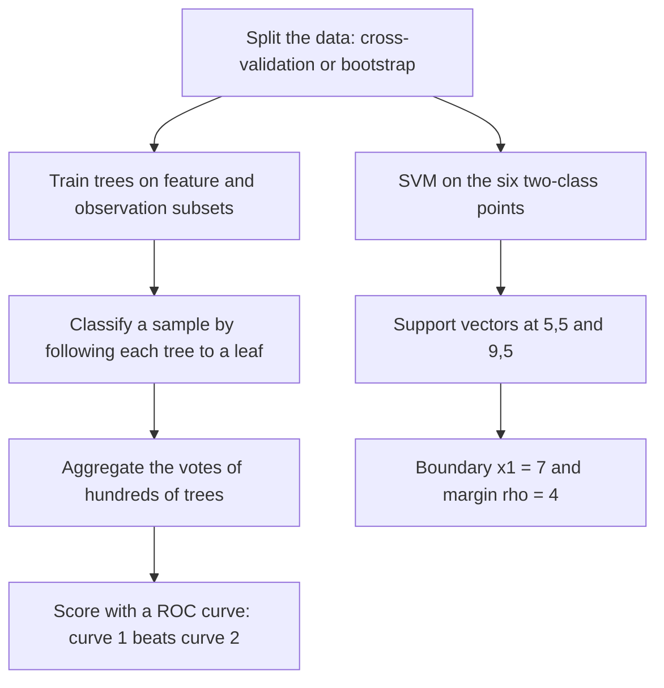

# M2E03 — Machine Learning and Classification

Exercise sheet for [[M2L03-machine-learning-and-classification]]: four blocks on data
handling in [[machine-learning]], on the [[random-forest]], on the [[roc-curve|ROC
curve]], and on the [[support-vector-machine]].

## Task

1. **Data in machine learning.**
   a) What is overfitting?
   b) What is cross-validation, and how does it help against overfitting?
   c) Give an example of why one would use leave-one-out cross-validation.
   d) Contrast bootstrapping and cross-validation.
2. **Random forest.**
   a) How is a sample classified?
   b) What is a *feature* in this context?
3. a) How does a random forest differ from a single decision tree?
   b) Two ROC curves are drawn in the TP-rate / FP-rate plane. Which classifier is
      better, and why?
4. **SVM.** Can an SVM be a linear or a non-linear model? Given
   `Class 1: (1,9), (5,5), (1,2)` and `Class 2: (9,5), (13,1), (13,9)`, plot the points
   and identify the **support vectors**, the **decision boundary** and the **margin `ρ`**.

## Approach

Block 1 is [[overfitting]], [[cross-validation]] and [[bootstrapping]] — all three are
about *how data is spent*, not about any model. Block 2–3 are [[decision-tree]] and
[[random-forest]] plus [[roc-curve]] for scoring. Block 4 is the geometry of
[[support-vector-machine]]: with two classes separated along a single axis, the separator
is found by inspection.

## Solution

### 1 — Data in machine learning

**a) Overfitting**

> The model **perfectly explains the training data, but performs poorly on new data**.

**b) Cross-validation**

> Cross-validation **leaves a certain amount of data out of the training data set** and
> **tests afterwards whether the model can correctly predict the test data**.

It helps against overfitting

- by providing a **more reliable estimate of the model's ability to generalize to new
  data**, and
- by using **multiple, non-overlapping subsets** of the data for training and testing →
  a **wider range of data** is covered.

**c) Why leave-one-out**

> If we have a relatively **small dataset** and we want to ensure that we are not
> overfitting to the **limited number of observations** we have — e.g. **patients in
> disease research**.

It **helps to identify potential issues with overfitting and ensures that every model is
robust enough.**

**d) Bootstrapping versus cross-validation**

| Bootstrapping | Cross-validation |
|---|---|
| **Random sampling with replacement** | **Partitioning of the data into folds** |
| Used for **estimating the sampling distribution of a statistic** or making **inferences about a population** | Used for **evaluation of the performance of a predictive model** |

### 2 — Random forest

**a)** Classification means to **follow the tree based on the entry data**: at each node
the sample's value for that node's attribute decides which branch to take, until a leaf
assigns the class.

**b)** **Feature = variable = node inside the tree.** The three words name the same thing
from three viewpoints: the column of the data matrix, the quantity being tested, and the
place in the tree where it is tested.

### 3 — Forest versus tree, and ROC

**a)** In a random forest one can **generate hundreds of trees and then aggregate the
results of those trees**. Two levels of randomisation make the trees differ:

- each **individual tree is built on a subset of the features**;
- each **individual tree is built on a subset of the observations**.

That is what makes the forest robust where a single tree is not.

**b)** The two curves in the TP-rate / FP-rate plane:

| Curve | at FP rate 25 % | reading |
|---|---|---|
| **1** — bowed towards the top-left | **TP rate 100 %** | **all positive samples are predicted positive** |
| **2** — close to the diagonal | TP rate 37 % | barely better than chance |

> **1 is better: the TP rate is 100 % when the FP rate is only 25 %**, whereas **2 has an
> FP rate of 25 % at only 37 % TP**.

Equivalently: curve 1 has the larger area under it, i.e. the larger **AUC**
([[roc-curve]]).

### 4 — SVM

**An SVM can be both a linear and a non-linear model** — linear in the original feature
space, non-linear once that space is mapped to a higher-dimensional one in which the
training set becomes separable.

```text
Class 1:  (1,9)   (5,5)   (1,2)          // left
Class 2:  (9,5)   (13,1)  (13,9)         // right
```

```text
 x2
  9 │  ×                    ○
    │
  7 │
    │
  5 │        ×[SV] │ ○[SV]
    │              │
  3 │              │
    │              │
  1 │              │        ○
    └──────────────┴──────────────── x1
      1      5     7     9     13
                 decision
                 boundary
```

- **Support vectors**: `(5,5)` from class 1 and `(9,5)` from class 2 — the two points
  closest to the gap.
- **Decision boundary**: the vertical line halfway between them,
  `x₁ = (5+9)/2 = 7`, i.e. `f(x) = sign(x₁ − 7)` with `w = (1,0)ᵀ`, `b = −7`.
- **Margin `ρ`**: the distance between the support vectors, `ρ = 9 − 5 = 4`.

Check: `(1,9)` and `(1,2)` → `sign(−6) = −1`; `(13,1)` and `(13,9)` → `sign(6) = +1`.
All six points are classified correctly, and the four non-support vectors could be moved
freely within their half-planes without changing the separator.

## Diagram


The sheet runs one pipeline from data splitting through forest aggregation to ROC scoring, and a second branch solving the SVM geometry by inspection.

## Takeaway

Evaluation is not an afterthought — **how the data is split decides what the reported
score means**. Cross-validation and bootstrapping answer two different questions
(performance of a model versus distribution of a statistic), a ROC curve answers a
classifier's question at *every* cutoff rather than one, and an SVM's answer depends on
only a handful of points: **the support vectors are the model**.

## Relations

- [[M2L03-machine-learning-and-classification]] — the lecture this sheet accompanies.
- [[overfitting]], [[cross-validation]], [[bootstrapping]] — block 1.
- [[decision-tree]], [[random-forest]] — blocks 2 and 3a.
- [[roc-curve]] — block 3b.
- [[support-vector-machine]] — block 4.
- [[E08-test-errors-and-z-score]] — the module-1 exercise on the same confusion matrix,
  one cutoff at a time.

## See also

- [[node-impurity]] — impurity is computed explicitly when splitting the exercise's tree.

## Sources

- `raw/module2/csb_part2.pdf`, p. 9 — data in machine learning: overfitting,
  cross-validation, leave-one-out, bootstrapping versus cross-validation.
- `raw/module2/csb_part2.pdf`, p. 10 — random forest, trees versus forests, and the two
  ROC curves.
- `raw/module2/csb_part2.pdf`, p. 11 — the SVM point sets, support vectors, decision
  boundary and margin.
