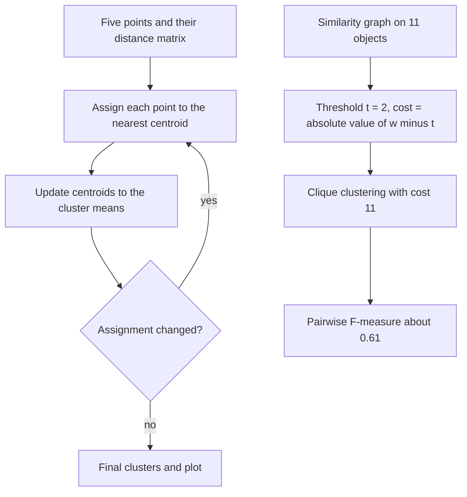

# M2E04 — k-Means and TransClust

Exercise sheet for [[M2L04-clustering]]: a full [[k-means]] run by hand on five points,
and a [[transclust]] thresholding with its cost and its [[f-measure]] evaluation.

## Task

1. **k-means.** Given `x1 = (1,2)`, `x2 = (5,8)`, `x3 = (7,3)`, `x4 = (6,4)`,
   `x5 = (4,7)`, set up the distance matrix.
   a) Run one k-means assignment step with `x1, x3, x4` as the initial centroids.
   b) Update the centroids.
   c) Continue k-means until it stops.
   d) Plot the final centroids.
   e) For which shapes does k-means work best? How is the number of clusters estimated
      without a gold standard, and how is the result evaluated with one?
   f) What is the biggest practical weakness?
2. **TransClust.** A weighted similarity graph over the objects `0…10` is given by a
   similarity matrix.
   a) Draw the similarity graph.
   b) Apply the threshold `t = 2` (a missing edge counts as weight `0`).
   c) Give the clustering.
   d) Compute its cost.
   e) Given the gold standard, compute precision, recall and the F-measure.

## Approach

Exercise 1 is the [[k-means]] loop executed literally: assign by nearest centroid, move
each centroid to the mean of its members, repeat until the assignment stops changing.
Exercise 2 is [[transclust]]: thresholding turns similarities into edge-modification
costs `c = |w − t|`, the clustering is a disjoint union of cliques, and the cost is the
sum of the flips needed to get there. Evaluation uses the **pairwise** TP/FP/FN/TN rule
of [[f-measure]].

## Solution

### 1 — k-means

**Distance matrix.** The exercise sets up the `5 × 5` Euclidean distance matrix with a
zero diagonal; the entries needed below are

```text
d(x2, x1) = √((5-1)² + (8-2)²) = √52  = 7.21
d(x2, x3) = √((5-7)² + (8-3)²) = √29  = 5.39
d(x2, x4) = √((5-6)² + (8-4)²) = √17  = 4.12
d(x5, x1) = √((4-1)² + (7-2)²) = √34  = 5.83
d(x5, x3) = √((4-7)² + (7-3)²) = √25  = 5.00
d(x5, x4) = √((4-6)² + (7-4)²) = √13  = 3.61
```

**a) Assignment with centroids `x1`, `x3`, `x4`**

`x2` and `x5` are both closest to `x4`:

```text
Cluster 1: x1
Cluster 2: x3
Cluster 3: x4, x2, x5
```

**b) Centroid update**, `c_i = (1/|S_i|) Σ_{x_i ∈ S_i} x_i`:

```text
c1' = (1, 2)
c2' = (7, 3)
c3' = ( (5+6+4)/3 , (8+4+7)/3 ) = ( 5 , 6.33̅ )
```

**c) Continue**

*Iteration 2* — reassign against `c1' = (1,2)`, `c2' = (7,3)`, `c3' = (5,6.33)`.
`x4 = (6,4)` is now closer to `c2'` (`1.41`) than to `c3'` (`2.54`), so it leaves
cluster 3:

```text
Cluster 1: x1          Cluster 2: x3, x4         Cluster 3: x2, x5
c1 = c1_old = (1,2)    c2 = (6.5, 3.5)           c3 = (4.5, 7.5)
```

*Iteration 3* — the assignment is **the same → STOP**; only the distances to the
centroids are updated.

**d) Plot**

```text
 y
  9 │
  8 │           ⊙ (4.5, 7.5)        ← centroid of {x2, x5}
  7 │
  6 │
  5 │
  4 │                  ⊙ (6.5, 3.5) ← centroid of {x3, x4}
  3 │
  2 │  • (1,2)                       ← the singleton x1
  1 │
    └──────────────────────────── x
      1        5        7
```

**e)**

- **k-means works best for clustering a convex shape.**
- To estimate the number of clusters **without a gold standard**, use the **elbow
  method** on the sum of squared error.
- **Given a gold standard**, use the **[[f-measure]]** to evaluate the clustering
  results, **where 1 is best and 0 is worst**.

**f)**

- **k-means is very sensitive to the initial seed.**
- **Bad initialization can lead to poor convergence.**

### 2 — TransClust

**a) Similarity graph.** Nodes `0…10`, edges weighted by the similarity matrix, e.g.
`0–1 = 5`, `1–2 = 3`, `1–5 = 4`, `5–3 = 9`, `5–6 = 3`, `6–3 = 8`, `3–4 = 4`,
`4–7 = 8`, `7–8 = 2`, `7–9 = 3`, `4–9 = 5`, `4–10 = 10`.

**b) Threshold `t = 2`, with a missing edge counted as weight `0`.** Every pair is
shifted by the threshold:

```text
w' = w − t              existing edge if w > t, no edge if w < t
c  = |w − t|            cost of flipping that pair
```

So `0–1` becomes `3`, `1–2` becomes `1`, `7–8` becomes `0` (free either way), and every
absent pair becomes `−2`, i.e. a non-edge that costs `2` to insert.

**c) Clustering.** The transitive projection drawn in the notes gives the two triangles
`{3, 5, 6}` and `{4, 7, 9}`, the singletons `{8}` and `{10}`, and a further group around
`{0, 1, 2}` — this last group is overdrawn in the scan and cannot be read with certainty
(see [[open-questions]]).

**d) Cost.** Summing `|w − t|` over every inserted and deleted edge:

```text
cost = (2 + 1) + 0 + 3 + (3 + 2) = 11
```

**e) Evaluation against the gold standard**

```text
C1: 1, 3, 6, 8, 0
C2: 2, 9, 10
C3: 4, 5, 7
```

The unit of counting is a **pair of objects**:

| | Definition |
|---|---|
| **TP** | in the same cluster in the gold standard **and** in the prediction |
| **TN** | **not** in the same cluster in the GS **and not** in the prediction |
| **FN** | in the same cluster in the GS **but not** in the prediction |
| **FP** | **not** in the same cluster in the GS **but** in the prediction |

All `C(11,2) = 55` unordered pairs are labelled this way. For example, with the predicted
triangle `{3,5,6}`: the pair `3–6` is **TP** (together in `C1` and in the prediction),
the pair `3–5` is **FP** (`3 ∈ C1`, `5 ∈ C3`, but predicted together), and the pair
`1–3` is **FN** (together in `C1`, apart in the prediction). The notes work through the
complete list, then

```text
precision = TP / (TP + FP)
recall    = TP / (TP + FN)
F         = 2 · (precision · recall) / (precision + recall) ≈ 0.6133
```

— which the notes annotate as **low**: the threshold `t = 2` does not reproduce the gold
standard well. Sweeping `t` and maximising `F` is exactly the density-parameter search
described in [[f-measure]].

## Diagram


The left branch is the k-means loop run to convergence, the right branch the TransClust thresholding, costing and evaluation.

## Takeaway

Two clusterings of the same kind of data, reached by two completely different routes.
[[k-means]] needs **feature vectors** and a **fixed `k`**, converges in a handful of
cheap iterations, and depends entirely on its seed. [[transclust]] needs only a
**similarity function** and no `k`, but pays for it with an **NP-hard** objective and a
**threshold** that must be tuned. Both are judged the same way: by the pairwise
[[f-measure]] against a gold standard, or by an internal quality curve when there is
none.

## Relations

- [[M2L04-clustering]] — the lecture this sheet accompanies.
- [[k-means]] — exercise 1.
- [[transclust]] — exercise 2.
- [[f-measure]] — the evaluation used in both.
- [[cluster-analysis]] — the framing concept.
- [[E11-population-genetics-and-multiple-testing]] — the module-1 sheet with a comparable
  by-hand numeric workflow.

## Sources

- `raw/module2/csb_part2.pdf`, pp. 17–18 — the k-means data, distance matrix,
  assignment, centroid update, iterations, plot, and the closing remarks.
- `raw/module2/csb_part2.pdf`, pp. 19–20 — the TransClust similarity graph, the `t = 2`
  thresholding, the clustering, the cost of 11, the gold standard, the pair
  classification and the F-measure.
