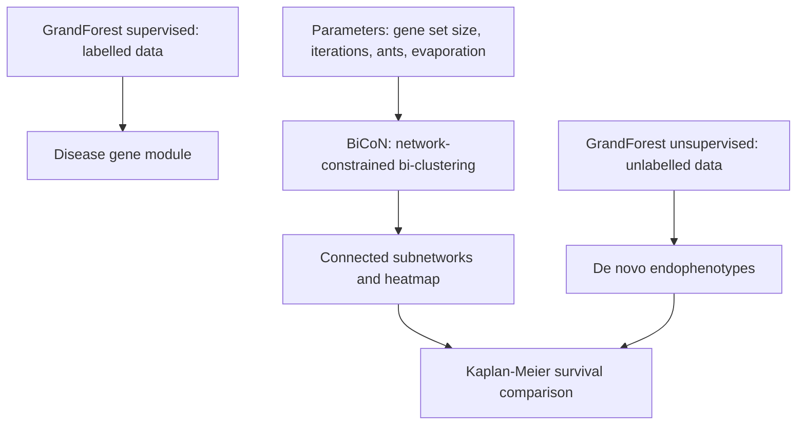

# M2E05 — GrandForest and BiCoN

Exercise sheet for [[M2L05-network-based-disease-modules]]: vocabulary for
[[grandforest]], and the outputs and parameters of [[bicon]].

## Task

1. **GrandForest.**
   a) What is de novo endophenotyping?
   b) What is the difference between a supervised and an unsupervised analysis?
   c) What is a Kaplan–Meier plot, and what is on its axes?
2. **BiCoN**, a network-constrained bi-clustering approach. What do the extracted
   subnetworks, the heatmap and the survival analysis show, and what parameters does
   BiCoN use?

## Approach

Both questions are definitional, but they sit on the two tools of the lecture. Question
1 unpacks the [[endophenotype]] vocabulary and the supervised/unsupervised split of
[[machine-learning]], and closes with the clinical validation step,
[[kaplan-meier-plot]]. Question 2 reads a [[bicon]] result and lists the knobs of its
underlying [[ant-colony-optimization]] search.

## Solution

### 1 — GrandForest

**a) De novo endophenotyping**

```text
de novo        ≙  new
phenotype      =  the set of observable characteristics or traits of an organism,
                  e.g. hair colour
endophenotype  =  measurable traits that are thought to be more closely linked to
                  the genetic factors underlying a disorder
```

> **De novo endophenotyping** refers to the process of **identifying and characterizing
> newly recognized or previously unknown measurable traits** that are believed to be
> **intermediate markers of the underlying genetic factors of a disorder**.

**b) Supervised versus unsupervised analysis**

| Supervised analysis | Unsupervised analysis |
|---|---|
| **Input features and corresponding output labels** — **labelled data** | **The model has to figure out the labels** — **unlabelled data** |

[[grandforest]] runs in both modes: supervised it returns a **disease-gene module** from
a response variable; unsupervised it generates a background, learns to separate
foreground from background, and **clusters the patients on the module genes** into de
novo endophenotypes.

**c) Kaplan–Meier plot**

> A graphical representation that **visualizes the probability of an event occurring over
> time**. Often used to **analyse survival times**.

```text
y-axis : probability of the event of interest NOT occurring
x-axis : time passed
```

### 2 — BiCoN

**BiCoN is a network-constrained bi-clustering approach**: it returns two patient
subgroups together with the two gene sets that separate them, under the constraint that
each gene set induces a **connected subnetwork**.

**Reading the output**

| Output | What it shows |
|---|---|
| **Extracted subnetworks** | *we see a connected subnetwork with `k` genes inside the bi-cluster* |
| **Heatmap** | *we can see the bi-clustering* — patients on one axis, genes on the other |
| **Survival analysis** | a **[[kaplan-meier-plot]]** *shows the differences in survival rate between the bi-clusters* |

**Parameters used by BiCoN**

- **minimal and maximal number of genes** wanted in each subnetwork
- **gene set size / input size**
- **maximum number of iterations**
- **number of ants** — *can explore a larger search space*, so **increase it with the
  search space**
- **evaporation rate** — **decrease it until convergence**

The last two are the [[ant-colony-optimization]] knobs: more ants widen the exploration,
and a lower evaporation rate makes the pheromone trail persist so the colony converges on
a single solution.

## Diagram


Both tools end at the same validation step, a Kaplan-Meier plot comparing the subgroups they discovered.

## Takeaway

The two network tools answer the question module 1 could not: *are the clinical labels
even the right labels?* Supervised learning can only reproduce the diagnosis it is given,
so discovering a **new** disease subtype requires an **unsupervised** analysis — and a
discovered subgroup is only worth anything if it is validated against an outcome, which
is what the **Kaplan–Meier plot and its p-value** do. The network constraint is what
keeps such an unsupervised search from drowning in noise: **only connected subnetworks
are considered**.

## Relations

- [[M2L05-network-based-disease-modules]] — the lecture this sheet accompanies.
- [[grandforest]] — exercise 1.
- [[bicon]] — exercise 2.
- [[endophenotype]], [[kaplan-meier-plot]] — the two concepts defined here.
- [[machine-learning]] — the supervised/unsupervised distinction of question 1b.
- [[ant-colony-optimization]] — the source of BiCoN's ant and evaporation parameters.
- [[M2E01-enrichment-analysis-and-keypathwayminer]] — the earlier sheet on the other de
  novo network method.

## Sources

- `raw/module2/csb_part2.pdf`, p. 24 — de novo, phenotype, endophenotype, de novo
  endophenotyping, supervised versus unsupervised analysis, the Kaplan–Meier plot and its
  axes.
- `raw/module2/csb_part2.pdf`, p. 25 — BiCoN's extracted subnetworks, heatmap, survival
  analysis and the five parameters.
