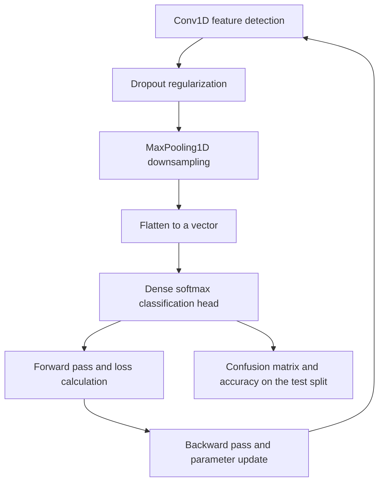

# M2E06 — Deep Learning

## Task

1. Define **[[backpropagation]]**, **[[dropout]]** and a **[[pooling-layer]]**.
2. Apply **max pooling** and **average pooling** with a `2×2` filter to a given `4×4`
   matrix.
3. Name the **stages of one epoch** of training.
4. Sketch a complete **Keras** classification pipeline for a
   [[convolutional-neural-network]].

## Approach

Everything here follows directly from [[M2L06-deep-learning]]: the definitions check
that the three ingredients of training are distinguished — the *gradient computation*
(backpropagation), the *regularizer* (dropout) and the *downsampling operator*
(pooling). The pooling arithmetic is mechanical; the epoch stages are the loop body of
[[gradient-descent]]; the Keras sketch is where the abstractions become argument names.

## Solution

### 1. Definitions

- **Backpropagation** — *an algorithm to compute the gradient of the loss with respect to
  every weight, by propagating the error backwards through the layers*. It is what makes
  [[gradient-descent]] feasible on a network with thousands of parameters.
- **Dropout** — *randomly deactivating a fraction of the neurons during training*, so
  that no neuron can rely on any particular other one. A regularizer against
  [[overfitting]].
- **Pooling layer** — *reduces the dimensionality of a feature map by summarising each
  window with a single value*, typically its maximum or its mean.

### 2. Pooling, `2×2` filter, stride 2

Input:

| | | | |
|---|---|---|---|
| 1 | 25 | 3 | 18 |
| 12 | 12 | 9 | 6 |
| 37 | 4 | 50 | 8 |
| 2 | 21 | 1 | 31 |

**Max pooling** — take the largest value of each `2×2` block:

```text
block top-left     {1, 25, 12, 12}   → 25
block top-right    {3, 18, 9, 6}     → 18
block bottom-left  {37, 4, 2, 21}    → 37
block bottom-right {50, 8, 1, 31}    → 50
```

| 25 | 18 |
|---|---|
| **37** | **50** |

**Average pooling** — take the mean of each block:

```text
(1 + 25 + 12 + 12) / 4 = 50/4  = 12.5
(3 + 18 + 9 + 6)   / 4 = 36/4  = 9
(37 + 4 + 2 + 21)  / 4 = 64/4  = 16
(50 + 8 + 1 + 31)  / 4 = 91/4  = 22.75
```

| 12.5 | 9 |
|---|---|
| **16** | **22.75** |

Max pooling keeps *whether a feature was detected anywhere in the window*; average
pooling keeps *how strongly it was present overall*. Max pooling is the default in
classification because detection, not intensity, is what the label depends on.

### 3. The stages of one epoch

```text
FOR each mini-batch in the training set:
  1. FORWARD PASS      — push the inputs through the network to get predictions
  2. LOSS CALCULATION  — compare predictions with labels via the cost function
  3. BACKWARD PASS     — backpropagate the error to obtain the gradients
  4. PARAMETER UPDATE  — gradient descent step on every weight and bias
```

One **epoch** is one complete sweep over the training data; the four stages repeat for
every mini-batch within it.

### 4. The Keras pipeline

```text
// ---- data preparation ----
data   ← pd.concat(positive_examples, negative_examples)
X, y   ← features(data), labels(data)
X_train, X_test, y_train, y_test ←
      train_test_split(X, y, random_state = 42, stratify = y)
      // random_state fixes the split so the run is reproducible
      // stratify = y keeps the class proportions in both parts

// ---- model definition ----
model ← Sequential([
          Conv1D(filters, kernel_size, activation = 'relu'),   // feature detection
          Dropout(rate),                                       // regularization
          MaxPooling1D(pool_size),                             // downsampling
          Flatten(),                                           // to a vector
          Dense(units, activation = 'softmax')                 // classification head
        ])

// ---- training ----
model.compile(optimizer, loss, metrics)
model.fit(X_train, y_train, epochs, batch_size, validation_split)

// ---- evaluation ----
y_pred ← model.predict(X_test)
confusion_matrix(y_test, y_pred)
accuracy_score(y_test, y_pred)
```

The ordering `Conv1D → Dropout → MaxPooling1D → Flatten → Dense` is the
**convolutional block** of [[M2L06-deep-learning]] written out, and the evaluation step
lands back on the [[roc-curve|confusion matrix and accuracy]] of
[[M2L03-machine-learning-and-classification]].

`Conv1D` rather than `Conv2D` because the input is a **sequence** — a one-dimensional
signal along a genome or a read — not an image.

## Diagram


The Keras layer stack is traversed forwards for every mini-batch and backwards to update the weights, with evaluation on the held-out split once training ends.

## Takeaway

Training a network is a four-stage loop repeated over mini-batches, and every
architectural choice in the Keras call is one of the lecture's concepts under another
name: `Dropout` is regularization, `MaxPooling1D` is dimensionality reduction, `stratify`
is the same class-balance discipline that [[cross-validation]] demands, and
`random_state` is what makes a stochastic method reportable.

## See also

- [[cost-function]] — the quantity evaluated numerically in this exercise.
- [[deep-learning]] — the field whose vocabulary the exercise drills.
- [[neural-network]] — the small network traced by hand here.

## Sources

- `raw/module2/csb_3.pdf`, p. 10 — definitions of backpropagation, dropout and the
  pooling layer; the `4×4` max- and average-pooling example; the stages of an epoch.
- `raw/module2/csb_3.pdf`, p. 11 — the Python/Keras pipeline sketch.

## Appears in

- [[M2L06-deep-learning]] — the lecture this exercise accompanies.
