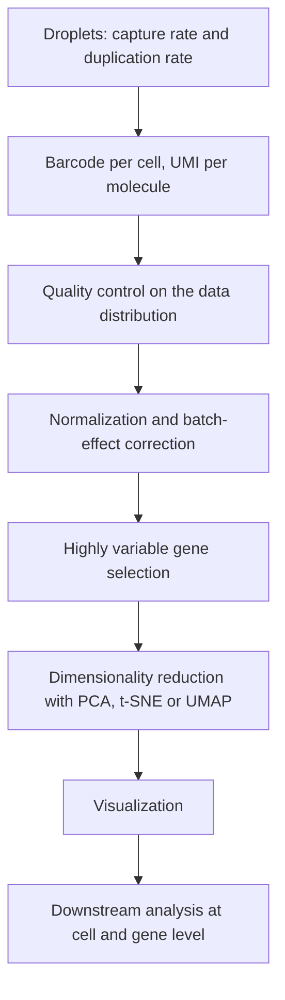

# M2E07 — Single-Cell RNA-Seq and Dimensionality Reduction

## Task

1. Define the **capture rate** and the **duplication rate** of a droplet experiment.
2. What are **UMIs** for, and what is the **main job of a barcode**?
3. Name the **first step** of [[t-sne]] and of [[umap]].
4. Which of the visualization methods are **non-linear**? Which preserves **global**
   as well as local dissimilarities?
5. In **Scanpy**, how are QC thresholds chosen?
6. Give **five reasons** for restricting the analysis to
   [[highly-variable-genes]].
7. How does **downstream analysis** split, and what are the **seven steps** of the
   workflow?

## Approach

The exercise is a check on [[M2L07-single-cell-rna-seq]]: the first half tests whether
the *experimental* artefacts and their Poisson arithmetic are understood, the second half
whether the *computational* pipeline is understood as a sequence of decisions rather than
a recipe.

## Solution

### 1. Capture rate and duplication rate

With Poisson loading at mean `μ` cells per droplet:

```text
capture rate     = P(at least one cell in the droplet)
                 = 1 − e^(−μ)

duplication rate = P(more than one cell | at least one cell)
                 = ( 1 − e^(−μ) − μ·e^(−μ) ) / ( 1 − e^(−μ) )
```

The **capture rate** is the share of droplets that yield data at all; the
**duplication rate** is the share of those that yield a [[doublet]] instead of a single
cell. Raising `μ` raises both — this is the central trade-off of
[[droplet-based-single-cell-methods]].

### 2. UMIs and barcodes

- A **[[unique-molecular-identifier]]** tags an individual **mRNA molecule** before
  amplification, so that all reads carrying the same UMI are **collapsed** into one
  count. It removes **PCR amplification bias**.
- A **barcode**'s main job is to identify the **cell** a read came from — it is what
  makes the output a *cells × genes* matrix instead of one pooled sample. Its failure
  mode is the [[barcode-collision]].

The distinction in one line: **the barcode says *which cell*, the UMI says *which
molecule***.

### 3. First steps

- **t-SNE** — *select neighbours with respect to a **Gaussian distribution*** over the
  points in the high-dimensional space, giving `p_ij`.
- **UMAP** — *approximate the manifold* in the high-dimensional space using
  **simplicial complexes** as neighbourhood graphs.

### 4. Linear and non-linear

- **Non-linear**: **t-SNE** and **UMAP**.
- **Linear**: [[principal-component-analysis]].
- **Preserving both local similarities and global dissimilarities**: **UMAP**. t-SNE
  preserves local similarities only.
- Both t-SNE and UMAP are **visualization only — not clustering**.

### 5. Scanpy thresholds

Thresholds on the QC covariates are **not fixed numbers**; they are read off the
**distribution of the data itself**. One plots count depth per cell, number of detected
genes per cell and mitochondrial fraction per cell, and cuts where the distribution shows
a clear shoulder — low-count, low-gene cells being empty droplets or damaged cells, and
high-mitochondrial cells being dying ones. The threshold is set as **permissively as
possible**, because an over-aggressive filter removes real rare cell types, which is
exactly what the experiment was done to find.

### 6. Five reasons for highly variable genes

1. Most genes show **no meaningful variation between cells** and so carry no signal.
2. They **add noise** that obscures the genes that do vary.
3. They **inflate the dimensionality** and so the computation time.
4. They **worsen the distance estimates** used by clustering and the embeddings.
5. The genes that distinguish **cell types** are by definition the variable ones.

### 7. Downstream analysis and the seven steps

Downstream analysis splits in two:

| Level | Questions |
|---|---|
| **Cell level** | clustering, cell-type annotation, trajectories and pseudotime, composition between conditions |
| **Gene level** | differential expression, marker genes, [[gene-set-enrichment-analysis\|enrichment]], regulatory networks |

The **seven steps** of the workflow, as the notes list them:

```text
1. quality control
2. normalization
3. data correction (batch effects, e.g. ComBat)
4. feature selection (highly variable genes)
5. dimensionality reduction
6. visualization
7. downstream analysis
```

See [[single-cell-analysis-workflow]] for the full detail of each.

## Diagram


The seven steps of the workflow follow directly from the droplet experiment that produced the count matrix.

## Takeaway

Single-cell data is defined by its artefacts. Barcodes, UMIs, doublets and collisions
are not incidental technicalities — they determine what the count matrix *means*, and
every downstream step from QC thresholds to the choice between t-SNE and UMAP is a
decision about how much of that matrix to trust.

## See also

- [[single-cell-rna-seq]] — the protocol this exercise works through.

## Sources

- `raw/module2/csb_3.pdf`, p. 21 — capture and duplication rates, UMIs, the main job of
  a barcode, the first steps of t-SNE and UMAP, which methods are non-linear, and UMAP
  for both local and global structure.
- `raw/module2/csb_3.pdf`, p. 22 — Scanpy thresholding, the five reasons for highly
  variable genes, the cell-level / gene-level split, and the seven steps.

## Appears in

- [[M2L07-single-cell-rna-seq]] — the lecture this exercise accompanies.
