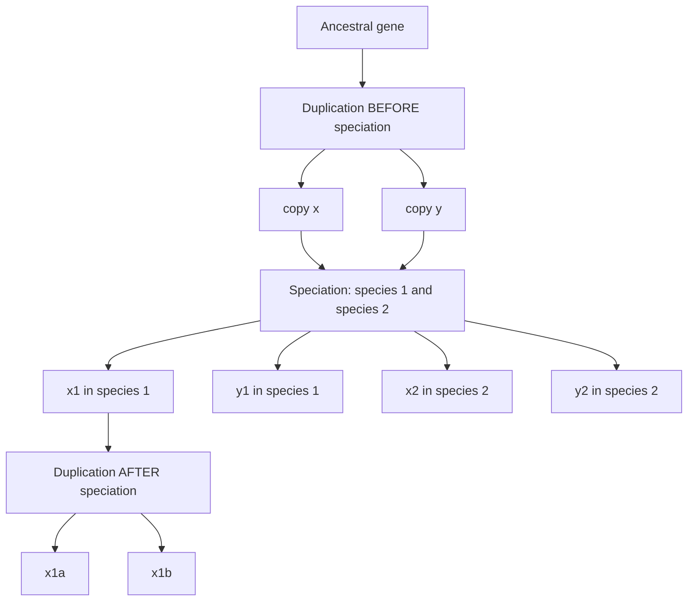
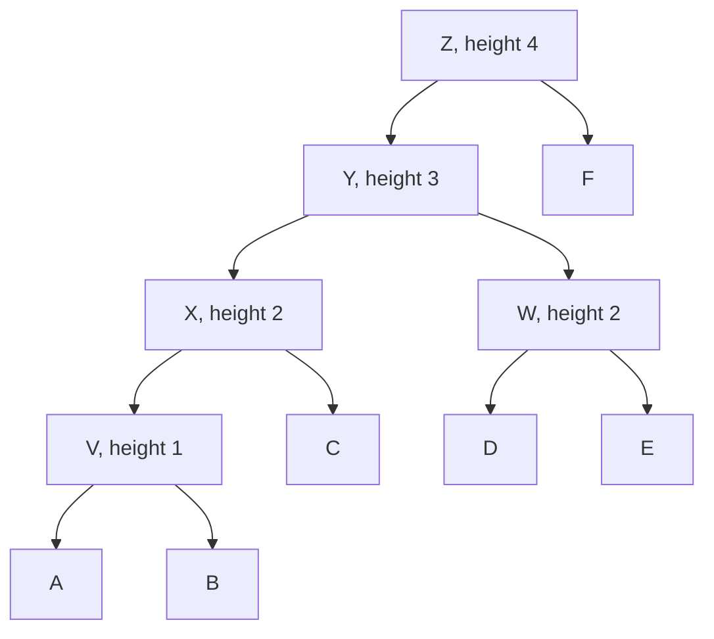

# M2E08 — Phylogenetics

## Task

1. Lay out the **homology hierarchy**: orthology, paralogy, **in-paralogs**,
   **out-paralogs**, **co-orthologs**.
2. **Why do genes evolve?**
3. How many **unrooted** and **rooted** trees exist for **5 taxa**, and why?
4. What is the difference between a **gene tree** and a **species tree**?
5. Name the **quantitative models** of molecular evolution; write down a normal
   Jukes–Cantor matrix, a **GC-biased** one, and one with **distinct transition and
   transversion rates**.
6. Use a **multiple sequence alignment** to build a distance matrix.
7. Run **[[upgma]]** on six taxa A–F.

## Approach

The exercise walks the whole of [[M2L08-molecular-evolution-and-phylogeny]] in order:
first the vocabulary of what may be compared ([[homology]]), then why there is anything
to compare at all, then the combinatorics that forces heuristics, then the modelling
([[jukes-cantor-model]], [[kimura-two-parameter-model]]), and finally one complete
reconstruction by hand.

## Solution

### 1. The homology hierarchy

Starting from one ancestral gene, two kinds of event produce two kinds of relationship:

| Term | Definition |
|---|---|
| **Homologs** | genes descended from a common ancestral gene |
| **Orthologs** | homologs separated by a **speciation** event |
| **Paralogs** | homologs separated by a **duplication** event |
| **In-paralogs** | paralogs that arose by a duplication **after** the speciation of interest — i.e. *within* one lineage |
| **Out-paralogs** | paralogs that arose by a duplication **before** the speciation of interest — they predate the split |
| **Co-orthologs** | a set of in-paralogs in one species that are **jointly orthologous** to a single gene in the other species |


x1 and y1 are out-paralogs because their duplication predates the speciation; x1a and x1b are in-paralogs and together are co-orthologs of x2 in species 2.

### 2. Why do genes evolve?

Three mechanisms:

- **Mutation** — the source of new variants; see [[dna-mutation]].
- **Genetic recombination** — reshuffling of existing variants between chromosomes.
- **Gene flow** — the movement of variants between populations; see
  [[population-genetics]].

### 3. Counting trees for 5 taxa

```text
unrooted:  (2n − 5)! / ( 2^(n−3) · (n − 3)! )
         = (10 − 5)! / ( 2² · 2! )  =  120 / 8  =  15

rooted:    (2n − 3)! / ( 2^(n−2) · (n − 2)! )
         = (10 − 3)! / ( 2³ · 3! )  =  5040 / 48  =  105
```

**The constructive argument** the notes give, which is worth more than the formula:
an unrooted tree with **4** taxa has **5 branches**, and the fifth taxon can be inserted
into **any** of them. There are **3** distinct unrooted 4-taxon topologies, so

```text
3 × 5 = 15 unrooted trees
```

And since a rooted tree is an unrooted tree with the root placed on any of its
`2n − 3 = 7` branches:

```text
15 × 7 = 105 rooted trees
```

The two routes agree — and the super-exponential growth they expose is why
[[maximum-parsimony]] cannot enumerate topologies beyond a handful of taxa.

### 4. Gene tree versus species tree

A **gene tree** follows the evolution of one specific gene; a **species tree** follows
the relationships of the species themselves. They are **not necessarily identical**,
because a gene may **duplicate before or after** two species diverge, and because of gene
loss and horizontal transfer. See [[gene-tree-and-species-tree]].

### 5. Quantitative models and their matrices

Named in the notes: **P-distance**, **Poisson distance**, **Jukes–Cantor**, **Kimura**.
Explicitly marked **not presented: Felsenstein**.

**Normal Jukes–Cantor** — one rate, rows and columns both sum to zero:

```text
         A      C      G      T
   A   -3α      α      α      α
   C     α    -3α      α      α
   G     α      α    -3α      α
   T     α      α      α    -3α
```

**GC-biased** — the rate *into* `G` and `C` is `γ > α`, so the columns no longer sum to
zero and the base composition drifts towards GC:

```text
         A           C      G           T
   A  -(α+2γ)        γ      γ           α
   C     α     -(2α+γ)      γ           α
   G     α           γ   -(2α+γ)        α
   T     α           γ      γ        -(α+2γ)
```

**Distinct transitions and transversions** (Kimura) — `α` for `A↔G` and `C↔T`, `β` for
the four cross-class exchanges, rows summing to zero:

```text
         A          C          G          T
   A  -(α+2β)       β          α          β
   C     β       -(α+2β)       β          α
   G     α          β       -(α+2β)       β
   T     β          α          β       -(α+2β)
```

> The GC-biased and transition/transversion matrices in the notes are partly written
> over; the exact off-diagonal entries of the GC variant are uncertain. The versions
> above are the self-consistent reconstructions, with the stated property that rows sum
> to zero. See [[open-questions]].

### 6. From an MSA to a distance matrix

For each pair of sequences, count the differing alignment columns `D` and divide by the
alignment length `L`:

```text
p = D / L
```

With `L = 50` and three mismatching columns between `S1` and `S2`:

```text
p(S1, S2) = 3 / 50 = 0.06
```

Repeating for every pair fills the lower triangle of the matrix that
[[upgma]] or [[neighbor-joining]] consumes. See [[evolutionary-distance]].

### 7. UPGMA on taxa A–F

Initial distance matrix:

| | A | B | C | D | E |
|---|---|---|---|---|---|
| **B** | 2 | | | | |
| **C** | 4 | 4 | | | |
| **D** | 6 | 6 | 6 | | |
| **E** | 6 | 6 | 6 | 4 | |
| **F** | 8 | 8 | 8 | 8 | 8 |

**Step 1.** Minimum is `d(A,B) = 2` → **V = A ∪ B** at height **1**.

```text
d(C,V) = ½(4+4) = 4    d(D,V) = 6    d(E,V) = 6    d(F,V) = 8
```

**Step 2.** Minimum is 4, taken at `(D,E)` → **W = D ∪ E** at height **2**.

```text
d(W,C) = ½(6+6) = 6    d(W,V) = ¼(6+6+6+6) = 6    d(F,W) = 8
```

**Step 3.** Minimum is `d(V,C) = 4` → **X = V ∪ C** at height **2**.

```text
d(X,W) = (1/6)(6+6+6+6+6+6) = 6        d(F,X) = ⅓(8+8+8) = 8
```

**Step 4.** Minimum is `d(X,W) = 6` → **Y = X ∪ W** at height **3**.

```text
d(F,Y) = 8
```

**Step 5.** Join `Y` and `F` into the root **Z** at height **4**.

**Branch lengths** (parent height minus child height):

```text
A → V = 1       B → V = 1       V → X = 1       C → X = 2
D → W = 2       E → W = 2       W → Y = 1       X → Y = 1
Y → Z = 1       F → Z = 4
```

**Check.** Every root-to-leaf path sums to 4:

```text
A: 1 + 1 + 1 + 1 = 4     C: 2 + 1 + 1 = 4     D: 2 + 1 + 1 = 4     F: 4   ✓
```

— which is the **ultrametric** property, as the [[molecular-clock]] assumption requires.


The completed UPGMA tree for taxa A–F, with F as the most distant taxon joining last at the root.

## Takeaway

Phylogenetics is three separate decisions stacked on each other, and each can ruin the
one above it: **which genes** may be compared at all (the homology hierarchy), **which
model** turns differences into distance, and **which algorithm** turns distance into a
tree. The UPGMA trace shows the third decision is the easy one — it is arithmetic; the
first two are where the biology lives.

## See also

- [[bootstrap-tree-assessment]] — supplies the branch-support values the exercise asks for.
- [[molecular-evolution]] — the substitution models the exercise applies.
- [[phylogenetic-tree]] — the object the exercise builds and compares.
- [[phylogenetic-tree-reconstruction]] — the four-step pipeline the exercise runs.
- [[transition-and-transversion]] — counted explicitly when applying Kimura's model.

## Sources

- `raw/module2/csb_3.pdf`, p. 35 — the homology hierarchy with in-paralogs,
  out-paralogs and co-orthologs, and the family-history tree.
- `raw/module2/csb_3.pdf`, p. 36 — why genes evolve; 15 unrooted and 105 rooted trees for
  5 taxa with the branch-insertion argument; gene tree versus species tree.
- `raw/module2/csb_3.pdf`, p. 37 — the quantitative models, the normal `Q^JC`, the
  GC-biased matrix with `γ > α`, and the matrix with distinct transition and transversion
  rates.
- `raw/module2/csb_3.pdf`, p. 38 — building the distance matrix from an MSA, with
  `p(S1,S2) = 3/50`.
- `raw/module2/csb_3.pdf`, p. 39 — the full UPGMA worked example on taxa A–F.

## Appears in

- [[M2L08-molecular-evolution-and-phylogeny]] — the lecture this exercise accompanies.
