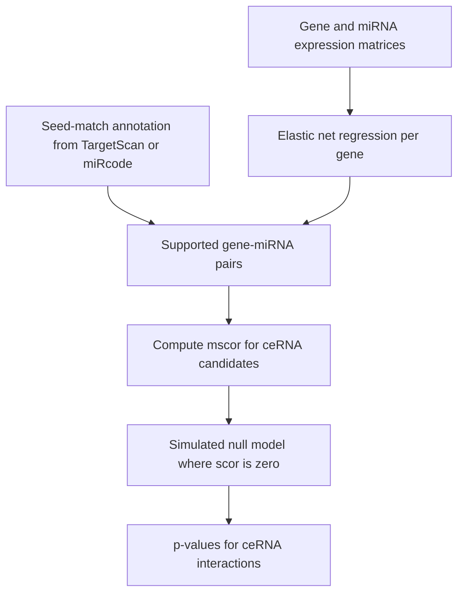

# M2E09 — Non-coding RNAs and SPONGE

## Task

1. Summarise what is known about [[microrna|miRNAs]]: how they act, how they differ from
   [[small-interfering-rna|siRNAs]], and why their target prediction is hard.
2. Which database collects miRNAs, and what is a **miRNA family**?
3. What are miRNA binding sites called, and how do miRNAs act according to the
   [[competing-endogenous-rna|ceRNA]] hypothesis?
4. How does [[sponge]] identify gene–miRNA interactions, and where do its p-values come
   from?

## Approach

Questions 1–3 are definitional and are answered from [[M2L09-non-coding-rnas]], which
places both effectors inside [[rna-interference]] and that in turn inside the wider class
of [[non-coding-rna]]. Question 4 requires separating SPONGE's **two** interaction
filters — an external annotation and a regression model — from its **separate**
significance machinery, which tests [[sensitivity-correlation]] against a simulation
rather than a closed form ([[statistical-testing]]).

## Solution

### 1. What miRNAs do

- miRNAs **repress gene expression**.
- They bind their targets via a **seed match** — a short near-complementary stretch,
  typically in the 3′ UTR.
- They act **in a complex with Argonaute** (miRISC), not alone.
- They **differ from siRNAs**: siRNAs are **perfectly complementary** to their target and
  therefore **highly specific**, and they trigger cleavage rather than translational
  repression.
- Consequence for bioinformatics: because the seed is only ~7 nt,
  **[[mirna-target-prediction]] suffers from many false positives**.

### 2. Database and families

- **miRBase** is the reference database of miRNAs.
- A **miRNA family** is a set of **miRNAs sharing an identical seed sequence**. Since the
  seed determines targeting, family members are largely interchangeable in their target
  repertoire — which is also why conservation of the seed is one of the four prediction
  features.

### 3. Binding sites and the ceRNA hypothesis

- miRNA binding sites are called **miRNA response elements (MREs)**.
- Under the ceRNA hypothesis, miRNAs act **in trans**: a transcript carrying an MRE
  titrates miRNA away from every other transcript carrying the same MRE, so two genes
  regulate each other **indirectly**, through a shared miRNA, without any direct
  interaction.

### 4. How SPONGE finds gene–miRNA interactions

SPONGE uses **two** sources of evidence for an interaction:

1. **User-provided target annotation** — e.g. **TargetScan** or **miRcode**, i.e. seed
   matches predicted from sequence.
2. **An elastic net regression model**, in which the **gene is the response variable**
   and the **miRNA expression values are the explanatory variables**. The elastic net
   penalty drives most coefficients to zero, so only miRNAs that actually explain the
   gene's expression survive; annotated-but-unexpressed interactions are discarded.

The **p-values come from a null model**: SPONGE simulates the distribution of `mscor`
under the null hypothesis that the **partial correlation equals the gene correlation**
(i.e. `scor = 0`, the miRNAs have no influence). Because the null distribution is
parameterised by gene–gene correlation, the number of miRNAs and the sample size, it can
be precomputed and reused, which is what makes the test genome-wide rather than
per-triplet — the exact failing of [[mutual-information|conditional mutual information]].

```text
SPONGE-INTERACTIONS(gene expr G, miRNA expr M, annotation T):
  I ← ∅
  for each gene g, miRNA m with seed match in T:
    β ← ELASTIC-NET(response = G[g], predictors = M)      // sparse regression
    if |β[m]| > threshold:
      I ← I ∪ { (g, m) }                                  // supported by both filters
  return I
```

## Diagram


SPONGE keeps only pairs supported by both annotation and regression, then judges them against a precomputed simulated null.

## Takeaway

**An annotation says a binding site *could* be used; expression data says it *is* used.**
Every step of this exercise is the same move — seed match plus conservation plus
expression for target prediction, annotation plus elastic net for SPONGE, and a simulated
null instead of an analytic one for significance. The generalisable lesson is that when a
signal is short and therefore ambiguous, the fix is never a better sequence score but an
orthogonal source of evidence.

## Sources

- `raw/module2/csb_4.pdf`, p. 10 — the full exercise with all four questions.
- Context: `raw/module2/csb_4.pdf`, pp. 1–9; see [[M2L09-non-coding-rnas]].
