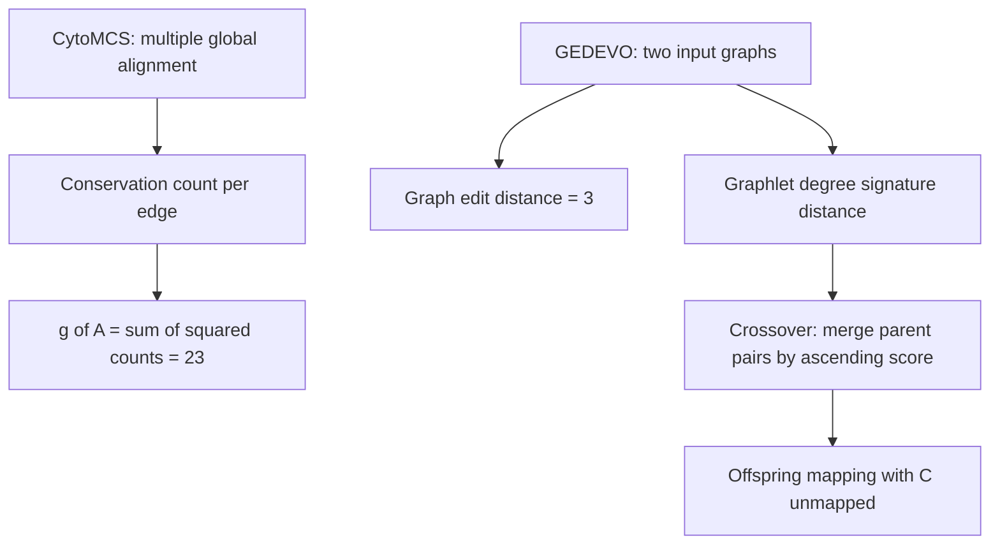

# M2E10 — Network Alignment

## Task

1. **CytoMCS.**
   a) Which kind of [[network-alignment]] does [[cytomcs]] perform?
   b) Given an alignment of a square-shaped network across several input networks, with
      per-edge conservation counts 2, 3, 3 and 1, compute the partially-conserved-edge
      score `g(A)`.
2. **GEDEVO.**
   a) Compute the [[graph-edit-distance]] `GED(G₁,G₂)` for the two given graphs.
   b) Given graphlet degrees for nodes `u` and `v` over orbits 0–14, compute the
      [[graphlet-degree-signature-distance]].
   c) State the formulas for `GDSD(u,v)` and `Dᵢ(u,v)`.
   d) Perform the [[gedevo]] **crossover** on three parent mappings with
      `V₁ = {A,B,C,D,E}`, `V₂ = {F,G,H,I}`.

## Approach

1b and 2a are direct evaluations of the two objective functions from
[[M2L10-network-alignment]]; 2d is the only part that is a procedure rather than a
formula, and the whole difficulty there is the conflict-skipping rule.

## Solution

### 1a) Kind of alignment

CytoMCS performs **multiple, global** network alignment: it aligns **more than two**
networks at once, and the mappings `f_i : V₁ → V_i` are **one-to-one over entire
networks**, not many-to-many over subnetworks.

### 1b) Partially conserved edges

```text
c_A(u,v) = Σ_{i=1..n} [ 1 if (f_i(u), f_i(v)) ∈ E_i else 0 ]
g(A)     = Σ_{(u,v)} c_A(u,v)²
```

The four edges of the square have conservation counts 3, 3, 2 and 1, so

```text
g(A) = 3² + 3² + 2² + 1² = 9 + 9 + 4 + 1 = 23
```

Note why the square: `Σ c = 9` would be the same for a 3+3+2+1 split and for a 4+2+2+1
split, but squaring rewards the former's concentration. This is exactly the
"**fewer well-conserved edges over many poorly conserved ones**" design goal.

### 2a) Graph edit distance

Transforming `G₁` into `G₂` takes three operations:

```text
1. insert edge
2. insert node
3. insert edge
⇒ GED(G₁, G₂) = 3
```

Each operation is counted once; because GED is symmetric, deleting the same three
elements transforms `G₂` back into `G₁`.

### 2b) Graphlet degree signature distance

Only `d₀(u) = 4` and `d₀(v) = 1` are cleanly readable in the scan; the remaining orbits
1–14 are overwritten. The orbit-0 contribution is

```text
D₀(u,v) = w₀ · | log(4+1) − log(1+1) | / log( max(4,1) + 2 )
        = w₀ · | log 5 − log 2 | / log 7
```

and the full signature distance would sum the same expression over all 15 orbits. The
unreadable entries are recorded in [[open-questions]].

### 2c) The formulas

```text
                 | log(d_i^u + 1) − log(d_i^v + 1) |
D_i(u,v) = w_i · ───────────────────────────────────
                      log( max(d_i^u, d_i^v) + 2 )

              Σ_i D_i(u,v)
GDSD(u,v) =  ──────────────
                Σ_i w_i
```

The weights `w_i` **adjust for redundancy**, because some orbits are contained in others
and would otherwise be counted several times. The `+1` keeps the logarithm defined for
degree 0 and the `+2` in the denominator normalises each term into `[0,1]`.

### 2d) Crossover

Parents, with per-pair scores (**lower is better**):

| | A | B | C | D | E |
|---|---|---|---|---|---|
| **P1** | F (0.75) | H (0.10) | I (0.60) | G (0.05) | ∅ (1.0) |
| **P2** | I (0.35) | F (0.45) | H (0.30) | ∅ (1) | ∅ (1) |
| **P3** | H (0.80) | ∅ (1) | I (0.60) | F (0.05) | G (0.95) |

Sort all pairs ascending and merge from the left, skipping any pair whose source node or
target node is already taken:

```text
D → F  (0.05)   take
D → G  (0.05)   skip   // D already mapped
B → H  (0.10)   take
C → H  (0.30)   skip   // H already taken
A → I  (0.35)   take
B → F  (0.45)   skip   // B and F already taken
C → I  (0.60)   skip   // I already taken
A → H  (0.80)   skip   // A already mapped
E → G  (0.95)   take
```

No remaining pair can place `C`, because every target it was mapped to in a parent is
already used — so **`C → ∅`**.

```text
Offspring:  A → I,  B → H,  C → ∅,  D → F,  E → G
```

Since `|V₁| = 5 > |V₂| = 4`, at least one node had to go unmapped; the greedy order
guarantees it is the one whose parent pairs were worst or most contested.

## Diagram


The two tools share a pattern: a cheap objective on the left, and a heuristic search producing the mapping on the right.

## Takeaway

**Both objectives are one line of arithmetic; the engineering is in the search.**
`g(A) = 23` and `GED = 3` take seconds to compute — it is finding the mapping that
maximises or minimises them that is NP-hard, which is why both [[cytomcs]] and
[[gedevo]] are heuristics. And the crossover shows the price of that heuristic:
greedy merging is fast and conflict-free but is not guaranteed to produce the best
recombination of its parents.

## Sources

- `raw/module2/csb_4.pdf`, p. 18 — CytoMCS alignment type, `g(A) = 23`, and `GED = 3`.
- `raw/module2/csb_4.pdf`, p. 19 — the graphlet degree table, the GDSD formulas, and the
  worked crossover.
- Context: `raw/module2/csb_4.pdf`, pp. 11–17; see [[M2L10-network-alignment]].
